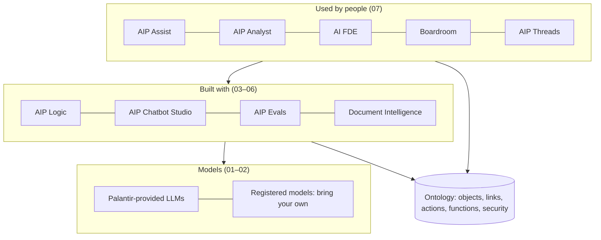

# 01 — What AIP is

*Sources: [AIP overview](https://www.palantir.com/docs/foundry/aip/overview/) · [AIP features](https://www.palantir.com/docs/foundry/aip/aip-features/) · [The Agent Stack](https://www.palantir.com/docs/foundry/aip/agent-stack/) · checked October 8, 2026 · Ready for Review*

AIP is easiest to understand as three layers sitting on the Ontology: **models** at the bottom, **builder tools** in the middle, and **apps that people use** at the top. This page is the map. Every box links to the module that explains it.

## What the docs say AIP is

- **[Docs]** AIP "connects AI with your data and operations". Its builder tools (AIP Logic, AIP Chatbot Studio, AIP Evals) are for building AI workflows, agents and functions "on top of the Ontology and developer toolchain".
- **[Docs]** Chatbot Studio was formerly called *AIP Agent Studio*, and a chatbot was formerly an *AIP Agent*. Older course material and URLs still use the old names.
- **[Docs]** The overview lists five benefits: integration with existing Foundry data, the platform's security and governance, model management, scalability, and explainability through audit trails and evaluations.
- **[Docs]** "AIP feature availability is subject to change and may differ between customers." Every page in this area should be read with that in mind.

**[Explanation]** The overview page is a positioning page. The checkable claims behind "security", "explainability" and "scalability" are in specific pages: [markings for LLM data access](../08-security-governance-and-admin/README.md), [Evals](../04-aip-evals/README.md), [capacity and rate limits](../08-security-governance-and-admin/README.md) and [observability](../09-cost-and-observability/README.md).

## Builder tools vs AIP inside other apps

The *AIP features* page separates two things that are easy to blur.

| | What it is | Examples from the page | Where it's covered |
|---|---|---|---|
| **AIP applications** | Products whose purpose is AI | AIP Assist, AIP Logic, AIP Chatbot Studio, AIP Evals, AIP Threads | This area |
| **LLMs inside core code** | Palantir-provided LLMs callable from code | Functions, Transforms, Jupyter notebooks in Code Workspaces | [Ontology 09-04](../../Ontology/09-functions/04-functions-on-models-and-llms.md) for functions |
| **AIP features in platform apps** | AI added to non-AI apps | Use LLM node and *Text to embeddings* in Pipeline Builder; Notepad text tools; Scheduler cron generation; Automate's AIP Logic integration | Outside this area, except Automate ([Ontology 16-04](../../Ontology/16-ai-and-agents/04-human-in-the-loop-and-staged-writes.md)) |

- **[Docs]** Administrators govern the AIP features in platform apps from Control Panel, under AIP settings.
- **[Docs]** The AIP Assist sidebar opens from any app with Cmd + Shift + U (macOS) or Ctrl + Shift + U (Windows), and its answers depend on which app is open.
- **[Docs]** The page's application table also lists **Palantir MCP**, which lets external AI IDEs and agents connect to the platform. It has no page in the AIP sidebar, so it is outside this area; [Ontology 16-03](../../Ontology/16-ai-and-agents/03-ontology-tools-for-agents.md) compares it with Ontology MCP.
- **[Docs]** The Ontology SDK lets you write AIP-powered apps in Python, Java or TypeScript, with built-in access to AIP Logic functions.

## The Agent Stack: the newest layer

The *Applications* group of the AIP sidebar opens with a page called **The Agent Stack**. It describes infrastructure that is newer than the Chatbot Studio material most courses teach.

- **[Docs]** The Agent Stack is "Palantir's agent infrastructure and product suite", a shared foundation for building, running and observing agents.
- **[Docs]** It models each task as a **session**. **Context items** are typed pieces of information in the session (messages, tool results, recommendations, decisions). **Events** carry input into the session, and the agent's **state machine** decides what happens next, for example moving to a "waiting for review" state.
- **[Docs]** Sessions "can last indefinitely", so an agent can pause for a person's review and resume when the input arrives, even from a different application.
- **[Docs]** Three ways to build: **Agent Builder** (visual), the **Palantir Agent SDK** (code, up to a custom state machine) and **third-party SDKs** through integration templates.
- **[Docs]** Agents are published as Compass resources and observed in **Agent Manager**, which shows sessions started from Workshop, Automate or Agent Manager itself, subject to access.
- **[Docs]** Integrations: embed a session in Workshop; create sessions or send events from Automate; use the Agent platform APIs. Agents in the OSDK and in AIP Logic are marked "coming soon".

| Agent Stack term | Closest idea you already know | Where the analogy breaks |
|---|---|---|
| Session | A chat conversation | A session can outlive any one conversation and have several participants, people and systems |
| Context item | A message | Context items are typed; a decision or a tool result is its own kind of item |
| Event + state transition | A workflow engine step | The agent's handlers decide the next state, not a fixed flowchart |

**[Analogy]** If a Chatbot Studio chatbot is a conversation, an Agent Stack session is a case file: it stays open, collects typed evidence, and moves through states as people and systems add to it.

**Open question** [RQ-02](../SOURCES.md#open-research-questions): the Agent Stack page does not say how Agent Builder relates to AIP Chatbot Studio (successor, sibling, or shared runtime). The AIP sidebar has no further Agent Stack pages to settle it.

## How this maps onto Kestrel

**[Example]** Kestrel's Delivery Desk agent was designed as an AIP Chatbot in the Ontology area. Its multi-step re-route reviews, which wait for a lead to approve a `RerouteProposal`, are the kind of long-running work the Agent Stack's sessions describe. This area keeps the Chatbot design, because that is what the docs fully document; see [03 — Kestrel's AI workload](03-running-example.md).

---
[Module index](README.md) · Next: [02 — Getting started with AIP](02-getting-started.md)
