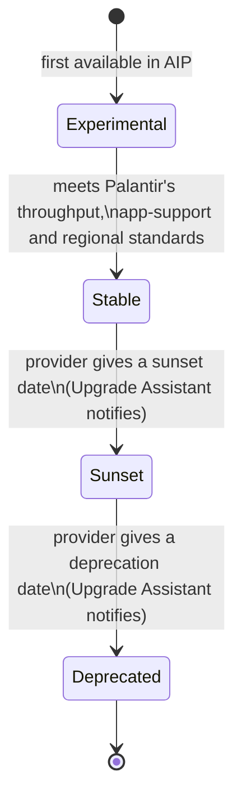

# 01 — Supported LLMs and the Model Catalog

*Sources: [Supported LLMs](https://www.palantir.com/docs/foundry/aip/supported-llms/) · [Model Catalog](https://www.palantir.com/docs/foundry/model-catalog/overview/) · [Model deprecation](https://www.palantir.com/docs/foundry/model-catalog/model-deprecation/) · checked October 14, 2026 · Ready for Review*

A model in AIP has a life: it arrives, gets promoted, is announced for retirement, and is switched off. Most practical questions ("why can't I pick model X?", "why did my function start failing?") are answered by knowing where a model is in that life and which gate is closed for your enrollment. This note follows that life.

## 1. What's on the list

**[Docs]** AIP supports LLMs and text embedding models from providers including xAI, OpenAI, Anthropic, Meta and Google, and availability "may differ across enrollments (for instance, due to georestriction)". The page also lists:

- **Text embedding models**: ada embedding, text-embedding-3-large, text-embedding-3-small and Snowflake Arctic Embed.
- **Audio models** in two kinds: realtime speech-to-speech over a streaming WebSocket, and transcription models that run in realtime or static (request-response) mode. Whisper Large V3 is Palantir-hosted and static only. The page asks you to set up notice and consent flows before recording or transcribing anyone's speech ([07 — Realtime audio](../07-end-user-apps/README.md)).
- A table of **availability by geography**: US, EU, UK, CA, AU, JP and KSA for commercial georestriction, and IL2, IL4 and IL5 for US government impact levels, per model *and* per provider route (for example the same Claude model through Anthropic, Amazon Bedrock, Azure or Google Vertex).

**[Recommendation]** Don't copy the model list into notes: it runs to over a hundred entries and changes as providers release and retire models. Check the [live page](https://www.palantir.com/docs/foundry/aip/supported-llms/) or the Model Catalog in your enrollment. What stays stable is *why* a model can be missing.

## 2. Why a model is missing

**[Docs]** A model family shows in Control Panel as **enabled**, **disabled** or **disallowed**. The page lists the conditions that decide it. Turned into a troubleshooting table:

| Symptom | Likely gate | State in Control Panel |
|---|---|---|
| The model isn't anywhere in AIP | Palantir hasn't integrated it yet | — |
| It's listed but greyed out | An administrator hasn't accepted the provider's legal terms | Disabled |
| It's in the docs but not on your enrollment | Your enrollment is georestricted and the model isn't available in that region | Disallowed |
| An open-source model (Llama, Mixtral) is unavailable | It needs an extra Palantir engineering review for your environment | Disallowed |
| It works in one app but not another, e.g. Logic but not Pipeline Builder's Use LLM | New models take time to reach every AIP product | — |
| An experimental model is hidden | Rollout is limited and may need an acknowledgement; admins can hide experimental models | — |
| You can't use any model in Logic, Functions or Pipeline Builder | Your group lacks the permission for AIP capabilities for custom workflows | — |

- **[Docs]** Georestriction is about the **enrollment's** setup, not where the user is. On an EU-georestricted enrollment, all LLM requests are processed in the EU.
- **[Docs]** "Experimental status may reflect the model provider or the model's integration with AIP", so Palantir can mark a model experimental too. "Experimental models are not intended for production use."

**[Example]** Kestrel's enrollment is not georestricted. If it were EU-restricted, Daniel would check the geography table for the **provider route** as well as the model: the same model can be available through one cloud provider in the EU and not through another.

## 3. The Model Catalog

**[Docs]** Model Catalog is an AIP application for discovering Palantir-provided models; an administrator enables it in Control Panel. It shows LLMs only. Custom ML models live in Modeling Objectives.

| View | What you do there |
|---|---|
| Homepage | Browse and filter models by lifecycle status, type and creator |
| Model entity page | **Playground** to try the model; **How to use it**, which creates a ready-made Function or Transform; a **description** with context window, training cutoff and legal disclaimer |
| Comparison page | Pick two LLMs and run the same completion or vision task on both |

- **[Docs]** Model types on the homepage: **completion**, **embedding** and **vision**.
- **[Docs]** A greyed-out model "is not enabled for your enrollment"; you ask your platform administrator or Palantir representative.

## 4. The lifecycle

| Stage | Can back new workflows? | Existing workflows? | Support |
|---|---|---|---|
| **Experimental** | Yes, for exploration | Yes | APIs may change, token capacity may be limited, AIP app support may be partial |
| **Stable** | Yes | Yes | Endorsed by provider and Palantir; for long-term production use |
| **Sunset** | No, after the prescribed date | May still work | Less technical support than stable |
| **Deprecated** | No | **No**, not even new API calls | Historical data and logs are kept |

**[Docs]** "All models will start as experimental when they are first available in AIP."

## 5. Runbook: a model you use is being retired

**[Docs]** Palantir notifies affected users and lists the resources that use the model in **Upgrade Assistant**. After the migration due date come **brownouts**: deliberate, temporary outages in stages, each model with its own schedule on its Upgrade Assistant page. During a brownout, calls fail with `LanguageModelService:LanguageModelNotAvailable` and the message says the model "is in planned deprecation and is currently under a brown-out". After the provider's deprecation date the same error says the model "is deprecated", and calls keep failing until you migrate.

**[Example]** Delivery Desk's `draftDelayMessage` calls a model through the alias `draftModel`. Upgrade Assistant flags its repository. What Daniel does:

1. **Find what's affected.** Open the model's page in Upgrade Assistant → *Resources*. **[Docs]** A resource is **PENDING** while it calls the deprecated model, and turns **COMPLETED** once it calls a different model and its last call to the old one is more than 24 hours old. A resource can flip back to PENDING if something calls the old model again.
2. **Check for silent users.** **[Docs]** Resources that are configured with the model but weren't used during the migration period don't appear. A pipeline that wasn't built won't be listed. Take your own inventory of production workflows.
3. **Pick the replacement with evidence.** **[Docs]** The Upgrade Assistant page suggests substitutes, but the docs "highly encourage" an AIP Evals suite to choose. Kestrel runs its draft-quality suite ([04](../04-aip-evals/README.md)) on the candidates.
4. **Change the model where it's chosen**, which is often upstream of where it's used:

| Where the model is used | Where you change it |
|---|---|
| Logic, Chatbot Studio, Evals, Pipeline Builder, Workshop, Quiver, Marketplace, Code Workspaces | The **model selector** in that resource's settings; an alert labels the model *Sunset* |
| Pipeline Builder | Upgrade Assistant links the whole pipeline. Search the graph for "use LLM", change each node, then save, deploy and rebuild |
| Workshop, through a function | Republish the function in its source app, then update the function version in the module (or in bulk from Workflow Lineage) |
| Workshop *AIP Chatbot* widget | In the chatbot's settings in Chatbot Studio, then publish |
| Workshop *AIP generated content* widget | In the widget if it uses *Direct to LLM* or *LLM via prompt function*; otherwise in its Logic function |
| Code (TypeScript v1) | The model is named in the import **and** at every call site |
| Code (TypeScript v2) | Import the new model, which creates a new alias, and change the one alias reference |
| Code (Python transform) | The model RID in the transform's input |

5. **Republish and re-point consumers.** **[Docs]** Workflow Lineage (Cmd/Ctrl + I) shows which functions call which models, flags deprecated ones, can bulk-update function versions in Workshop apps, and can replace the model in several Logic functions at once. Ontology Manager's function page shows *Usage history* by version.

- **[Docs]** You need **view and edit** permissions on the affected resources to trace them to the upstream model setting.
- **[Explanation]** This is the practical case for TypeScript v2 aliases in [Ontology 09-04](../../Ontology/09-functions/04-functions-on-models-and-llms.md): `draftDelayMessage` needs a one-line change, where a TypeScript v1 version would need the import and every call changed.
- **[Recommendation]** Don't wait for brownouts to find your dependencies. Workflow Lineage on the Delivery Desk Workshop app shows the whole chain (app → function → model) before any notice arrives.

---
[Module index](README.md) · Next: [02 — LLM-provider compatible APIs](02-llm-provider-compatible-apis.md)
