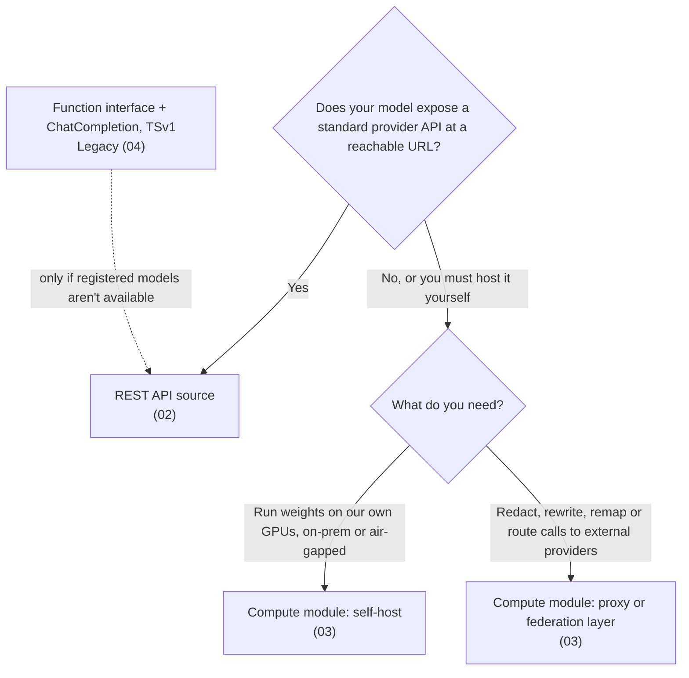

# 01 — Choosing a bring-your-own-model path

*Sources: [Bring your own model to AIP](https://www.palantir.com/docs/foundry/aip/bring-your-own-model/) · [Supported LLMs](https://www.palantir.com/docs/foundry/aip/supported-llms/) · checked October 14, 2026 · Ready for Review*

**The decision this note settles.** Kestrel Pay's compliance team requires a self-hosted model for anything that touches payment data ([Ontology 09-04](../../Ontology/09-functions/04-functions-on-models-and-llms.md)). The Ontology area recommended registered models but left them for later. This note covers them and picks a path.

## Should you bring a model at all?

**[Docs]** Palantir "generally" recommends its own models: from providers (OpenAI, Azure OpenAI, AWS Bedrock, xAI, GCP Vertex) or open-source models it self-hosts (such as Llama). It recommends registered models **only** when:

1. you **can't** use Palantir-provided models "for legal and compliance reasons", or
2. you have your **own fine-tuned or otherwise unique** LLM.

**[Explanation]** Kestrel Pay meets condition 1. Kestrel's customer service drafts don't meet either, so Delivery Desk stays on a Palantir-provided model.

## The paths

**[Docs]** Registered models (the docs also call this BYOM) can be backed by two sources:

| Source | The docs' description | Note |
|---|---|---|
| **REST API source** in Data Connection | An externally hosted provider or account; "the recommended path when your model exposes a standard provider API" | [02](02-rest-and-compute-module-backed-models.md) |
| **Compute module** | A model server you host, on your own hardware and GPUs, on-premise or air-gapped, or a custom proxy layer | [02](02-rest-and-compute-module-backed-models.md), [03](03-self-hosting-and-proxy-layers.md) |

**[Docs]** The current implementation dates from **March 2026**. It supports native tool calling and reasoning, rate limits, usage observability in Resource Management, permissions in Control Panel and the model selector. Palantir recommends it over the older function-interface method ([04](04-legacy-registered-llms.md)).

## Where a registered model works

| Works (the docs' list) | Doesn't work |
|---|---|
| AI FDE · AIP Analyst · AIP Chatbot Studio · AIP Logic · Workshop (through Chatbot Studio or Logic) · TypeScript functions in Code Repositories | AIP Assist, including code assist in Code Repositories · Pipeline Builder's *Generate* and *Explain* |

- **[Docs]** Assist and Pipeline Builder's assistant features rely on evaluations of Palantir-provided models, and there are "no plans" to support registered models there.
- **Open question** [RQ-03](../SOURCES.md#open-research-questions): the *Supported LLMs* page says BYOM works with Pipeline Builder, and the BYOM page's own introduction names Pipeline Builder too (as read October 14), but its *Supported applications* list still leaves it out (only *Generate* and *Explain* are explicitly excluded). Whether Pipeline Builder's **Use LLM** node and Python functions can use a registered model isn't stated.

## Who does what

| Task | Who | **[Docs]** detail |
|---|---|---|
| Register, edit or delete a model | **Enrollment administrator**, who also needs Owner or Editor on the Data Connection source | Done in Control Panel → AIP settings → *Registered models* |
| Set rate limits | The same administrator, at registration | Enrollment limits and per-user limits are **required** |
| Grant use | Administrator, in the registered-models enablement settings | To the whole enrollment or to groups |
| Use the model | Builders and end users with that enablement | They need **no** permission on the source: "source permissions are severed at registration" |
| Switch it off | Administrator | Disable in Control Panel; it stops working across AIP |

**[Example]** Daniel builds Kestrel Pay's functions but isn't an administrator, so he can't register the model. He writes the request: the source, the capabilities the model must declare, and the rate limits, and the enrollment administrator registers it.

## Three facts that change the design

- **[Docs] Cost.** No extra platform fee. Your provider bills you directly, and **registered-model costs don't appear in Resource Management**. **[Explanation]** Kestrel's cost view in [09](../09-cost-and-observability/README.md) will undercount Kestrel Pay's AI spend unless the provider bill is added.
- **[Docs] Rate limits.** Project-level limits default to **70 percent** of the enrollment limit and can be changed in Resource Management (*AIP usage and limits*). User limits apply in AI FDE, AIP Analyst and other user-attributed apps.
- **[Docs] Markings.** A registered model without its own policy uses the enrollment's LLM data-access policy. A model-specific policy **completely replaces** the enrollment policy, including when *Allow any data* overrides an enrollment allowlist. **[Explanation]** This is the setting that lets Kestrel Pay's self-hosted model, and only that model, see `Kestrel Pay – Financial` data ([08](../08-security-governance-and-admin/README.md)).

## Kestrel Pay's decision

**[Example]** Decision record, October 2026:

| | |
|---|---|
| **Need** | LLM drafting and classification on payment data, with no inference traffic leaving Kestrel's control |
| **Options** | REST source to a provider account (rejected: traffic leaves Kestrel's network) · self-hosted model in a compute module (chosen) · proxy layer that redacts payment fields before an external provider (kept as a fallback for tasks that don't need the payment fields) |
| **Model capabilities to declare** | Tool calling and structured outputs, so Logic and Chatbot Studio can use it |
| **Data access** | A model-specific policy allowing `Customer PII` and `Kestrel Pay – Financial`. Both are needed: the policy **replaces** the enrollment allowlist, and Lena's session carries both markings ([08-03](../08-security-governance-and-admin/03-llm-data-access-with-markings.md#kestrels-cases)). The enrollment policy stays unchanged for all other models |
| **Owner** | Enrollment administrator registers; Daniel builds; Lena's team uses |

---
[Module index](README.md) · Next: [02 — REST- and compute-module-backed models](02-rest-and-compute-module-backed-models.md)
