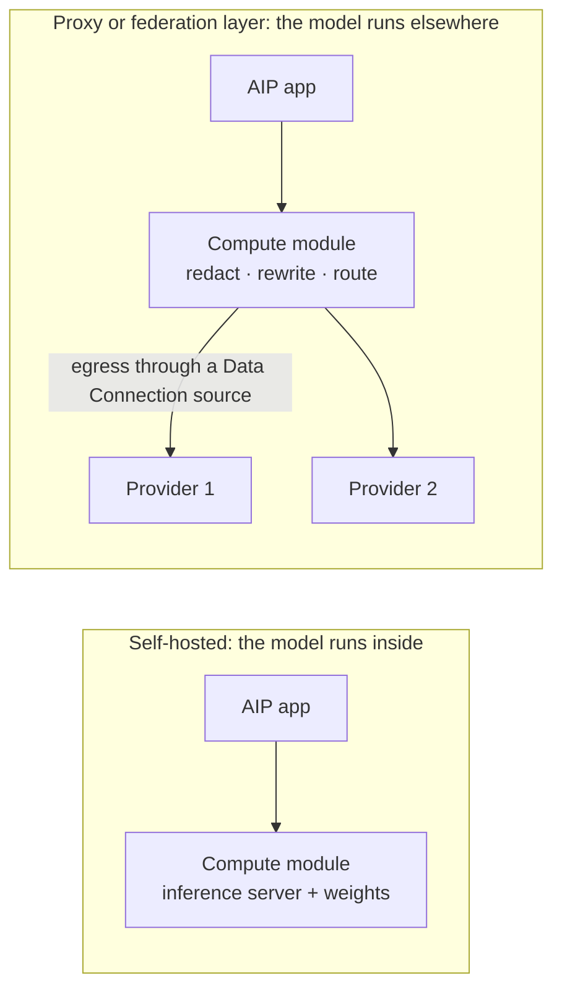

# 03 — Self-hosting and proxy layers

*Sources: [Self-host models with AIP](https://www.palantir.com/docs/foundry/aip/self-host-models/) · [Build a proxy or federation layer with AIP](https://www.palantir.com/docs/foundry/aip/build-a-proxy-or-federation-layer/) · [Models backed by compute modules](https://www.palantir.com/docs/foundry/aip/compute-module-backed-models/) · checked October 8, 2026 · Ready for Review*

A compute module can sit behind a registered model in two very different roles: it can **be** the model, or it can **stand in front of** other models. Same registration, opposite data flows.



## Self-hosting

**[Docs]** Reasons the page gives: **data sovereignty** (inference stays inside your network), **on-premise or air-gapped** deployments, **cost control** (your GPUs instead of per-token pricing), and **early access** to open-source models not yet offered by a hosted provider.

**[Docs]** Steps:

1. Build a container running an inference server, such as vLLM or Ollama, serving your weights through a supported provider API format.
2. Set the `application.port` label and publish the image to **Artifacts**.
3. Create a compute module from the image, with minimum replicas of at least one.
4. Register the model in Control Panel and declare its capabilities ([02](02-rest-and-compute-module-backed-models.md)).
5. Select it in any supported AIP application.

## Proxy or federation layer

**[Docs]** The compute module "receives inference requests from AIP, applies custom logic, and forwards them to external providers", so you control "exactly what data leaves your environment". The page's use cases:

| Use case | What the container does |
|---|---|
| PII redaction | Strips or masks sensitive data in prompts before they leave |
| Prompt injection | Prepends system prompts, appends instructions or transforms content |
| API format remapping | Translates between the format AIP expects and a provider's own format |
| Multi-provider federation | Routes across providers behind one registered model, by cost, latency or availability |

**[Docs]** Two prerequisites on top of the compute-module ones:

- **Network egress** through a Data Connection source with network policies that allow the providers.
- **Secrets** (API keys) attached to that source; the container reads them at runtime from the `SOURCE_CREDENTIALS` environment variable.

**[Docs]** Steps: build the container; create the source with egress and secrets; set the port label and publish to Artifacts; create the compute module **with the source attached**; register; select.

**[Explanation]** "Prompt injection" here means *you* inserting instructions on purpose, for example a company-wide system prompt. It is not the attack of the same name; a proxy can't stop malicious instructions hidden in retrieved documents unless you build that check.

## Kestrel Pay's fallback: a redaction proxy

**[Example]** Kestrel Pay chose a self-hosted model ([01](01-choosing-a-byom-path.md#kestrel-pays-decision)). For tasks that don't need payment fields, such as summarising a merchant's dispute letter, it also designed a proxy:

```text
AIP Logic → registered model "kestrel-pay-redacting-proxy"
              │
              ▼  compute module
         1. mask card numbers, IBANs and account IDs (regex + checksum)
         2. replace customer names with stable placeholders (CUST-1, CUST-2)
         3. forward to an external provider through the source's egress policy
         4. put the original names back into the answer before returning it
              │
              ▼
         external provider (only redacted text leaves Kestrel)
```

**[Explanation]** Two limits Kestrel wrote down:

- The proxy only sees what AIP sends it. The Foundry-side control is still the **markings policy** for this registered model, which decides what data AIP will send to it at all ([08](../08-security-governance-and-admin/README.md)).
- Step 4 means the proxy holds a mapping of names to placeholders in memory. That is personal data inside the container, and it must not be logged.

## Self-host or proxy?

| Question | Self-host | Proxy |
|---|---|---|
| Does any data leave your network? | No | Yes, after your processing |
| Who runs the GPUs? | You | The provider |
| Can you use frontier hosted models? | No, only weights you have | Yes |
| What you maintain | Inference server, weights, capacity | Redaction rules, routing, provider keys |
| Main risk | Capacity and model quality | A redaction gap |

---
[Module index](README.md) · Previous: [02 — REST- and compute-module-backed models](02-rest-and-compute-module-backed-models.md) · Next: [04 — Legacy registered LLMs](04-legacy-registered-llms.md)
