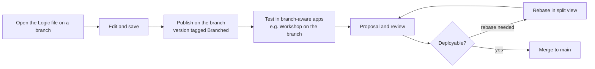

# 03 — Execution modes and branching

*Sources: [Execution mode settings](https://www.palantir.com/docs/foundry/logic/execution-mode-settings/) · [Branching AIP Logic](https://www.palantir.com/docs/foundry/logic/branching-logic/) · [Core concepts](https://www.palantir.com/docs/foundry/logic/core-concepts/) · checked October 8, 2026 · Ready for Review*

Two settings decide who a Logic function runs **as** and how a change to it **reaches** production. Both are quick to set and expensive to get wrong.

## Part 1 — Who the function runs as

**[Docs]**

| | User-scoped (default) | Project-scoped |
|---|---|---|
| Runs with the permissions of | The user running it | The project that contains the function |
| Who sees execution logs | Each user sees **only their own** | **Everyone with project access** |
| Log retention | 24 hours | Optional **run history dataset**: one row per run, the **last 10,000 runs** kept |
| Setup | None | Every resource the function uses must be **imported into the same project**; users also need access to those resources' **markings**. The settings screen flags missing imports and can import them |

**[Explanation]** The choice is about whose access the model's reads are filtered by.

- **User-scoped** keeps the guarantee from [01](01-logic-concepts.md#what-the-model-can-and-cant-see): the model sees only what the caller can see. Kofi's run sees Accra shipments only.
- **Project-scoped** makes the function behave the same for everyone who can run it, because it reads with the project's access. That's what you want for an automation or a shared service, and it is exactly what you must not want for a function that summarises regional data into a shared field.

**[Explanation]** The logs differ too. In user-scoped mode nobody, not even the function's owner, can read another user's run to debug it, and runs disappear after 24 hours. If you need to investigate "why did it draft that for Ama yesterday", either reproduce it with her inputs or use project-scoped mode with a run history dataset.

**[Example]** Kestrel's choices:

| Function | Mode | Why |
|---|---|---|
| Draft delay message (Logic) | User-scoped | Called by Ama's team on orders they can see; regional and PII policies must apply per user |
| A nightly function that tags new support tickets by topic | Project-scoped, with run history dataset | Runs from an automation; needs consistent behaviour and an audit trail |

## Part 2 — Developing on a branch

**[Docs]** Logic integrates with **Global Branching** ([Ontology 14-02](../../Ontology/14-lifecycle-and-operations/02-branching-and-proposals.md)).

### The lifecycle on a branch

- **[Docs]** A Logic function joins a branch when you edit and save it there. *Remove from branch* is in the bottom-right sidebar.
- **[Docs]** A version published on a branch carries the **Branched** pre-release tag and is **not** visible from other branches or main.
- **[Docs]** Branched functions work with Ontology objects on the same branch and with other branch-aware apps such as Workshop.

### Before it can merge

**[Docs]** A Logic function is deployable only if it is:

- [ ] up to date with main (no rebase needed),
- [ ] published on the branch,
- [ ] free of errors,
- [ ] without pending approvals.

### Protection and review

- **[Docs]** Protect main per file in Compass (**Branch protection → Protect with project policy**) or for every Logic file in a project at project level. Then all changes go through a branch and a proposal.
- **[Docs]** Reviewers are added in the Global Branching app, get an email, and see a side-by-side comparison of main and branch. They can approve, reject or edit their review.
- **[Docs]** Rebasing uses a split view (main on the left, branch on the right). Conflicts are resolved **by hand**.

### Known limitations

**[Docs]**

| Limitation | Consequence |
|---|---|
| Branches only from main | No branch-of-a-branch experiments |
| API names can't change on a branch | All branches share one API name; rename on main |
| Published functions can't be deleted on a branch | Delete on main |
| Manual conflict resolution | Keep branches short-lived |

**[Example]** Kestrel protects the `Delivery Desk [Workflow]` project's Logic files. Ama's lead edits the wording rules on a branch, runs the Evals suite on the branched version ([04](../04-aip-evals/README.md)), and Daniel reviews the proposal. This mirrors the review step of the Ontology change policy in [Ontology 14-01](../../Ontology/14-lifecycle-and-operations/01-saving-reviewing-and-restoring.md).

---
[Module index](README.md) · Previous: [02 — Building a Logic function](02-building-a-logic-function.md) · Next: [04 — Logic in production](04-logic-in-production.md)
