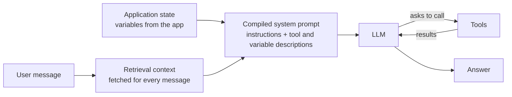

# 01 — Chatbot Studio concepts

*Sources: [AIP Chatbot Studio](https://www.palantir.com/docs/foundry/chatbot-studio/overview/) · [Core concepts](https://www.palantir.com/docs/foundry/chatbot-studio/core-concepts/) · [Getting started](https://www.palantir.com/docs/foundry/chatbot-studio/getting-started/) · checked October 8, 2026 · Ready for Review*

Delivery Desk was **designed** in the Ontology area: its context, application state and seven tools ([Ontology 16-03](../../Ontology/16-ai-and-agents/03-ontology-tools-for-agents.md)). This note is about the **studio** where it gets built: what a chatbot is made of, and the settings sheet you fill in.

## What a chatbot is

**[Docs]** AIP Chatbot Studio builds "interactive assistants, known as AIP Chatbots", equipped with enterprise information and tools. They run inside the platform and externally "through the Ontology SDK and platform APIs". It was previously **AIP Agent Studio**, and chatbots were **AIP Agents**; the session RIDs still start `ri.aip-agents..` ([03](03-chatbots-outside-the-studio.md)).

## The vocabulary

**[Docs]**

| Term | Meaning | Deep dive |
|---|---|---|
| **Application state** | Application variables used in prompts to steer the LLM; formerly *parameters* | [Ontology 16-01](../../Ontology/16-ai-and-agents/01-ontology-as-ai-context.md) |
| **Instructions and descriptions** | Instructions, tool descriptions and variable descriptions are **compiled into the raw system prompt** | Below |
| **Retrieval context / RAG** | Content fetched for **each** message from configured sources and sent with it | [Ontology 16-01](../../Ontology/16-ai-and-agents/01-ontology-as-ai-context.md), [16-02](../../Ontology/16-ai-and-agents/02-semantic-search-and-embeddings.md) |
| **Tools** | External functionality the LLM can use to act or retrieve information | [Ontology 16-03](../../Ontology/16-ai-and-agents/03-ontology-tools-for-agents.md), [02](02-commands-as-tools.md) |
| **Vector embeddings** | Numeric representations of text used to find similar content | [Ontology 16-02](../../Ontology/16-ai-and-agents/02-semantic-search-and-embeddings.md) |
| **Context window** | System prompt + conversation history + injected context, application state and tools. **Exceeding it is an error** and the user must start a new session | Below |
| **Chatbots as functions** | A chatbot published as a function, usable wherever functions run | [03](03-chatbots-outside-the-studio.md) |

**[Docs]** The getting-started page ranks the three ways to give a chatbot information: **retrieval context** ("simple and fast, recommended for most use cases"), **application state** (to fit the chatbot into Workshop) and **tools** ("used in complex and action-taking chatbots").

**[Explanation]** The context window grows with every turn, because the history is part of it. A long Delivery Desk conversation about several orders will eventually hit the limit and force a new session. Keep retrieval context small (listed properties, not whole objects) so conversations last longer.

## The settings sheet

**[Docs]** Open the studio from the workspace bar, with Cmd/Ctrl + J, from Files (**+ New → AIP Chatbot**), from inside the studio, or from AIP Threads. A chatbot is a **filesystem resource** with its own access control.

**[Example]** Delivery Desk's sheet, field by field:

| Setting | **[Docs]** rule | Delivery Desk |
|---|---|---|
| Name, description, avatar | White-label the chatbot; without an avatar you get a grey robot | "Delivery Desk", Kestrel logo |
| Information and tools | Retrieval context, application state, tools | T1 as Ontology context, the selected order as application state, tools T2–T7 ([Ontology 16-03](../../Ontology/16-ai-and-agents/03-ontology-tools-for-agents.md)) |
| Model | "A subset of those enabled on your enrollment" | The model chosen with Evals ([04-03](../04-aip-evals/03-runs-and-experiments.md)) |
| System prompt | Describe the business logic and when to use which tool; type `/` to reference tools and application state | Role, the confirm-before-send rule, when to ask Ama (T7) |
| Temperature | Default **0** (focused, deterministic) up to a maximum of **1** | 0 |
| Conversation starters | An input placeholder and suggested prompts | "Draft a delay update for this order", "Is a re-route possible?" |

**[Docs]** Writing instructions: start with the task overview, then the data, then guidance on application state and tools. For **each** tool and variable description, give "concrete steps on how and when to use" it; the LLM only knows what you give it.

## Save, view, publish, watch

**[Docs]**

- **Save** (with an optional version description from the arrow next to it) keeps your progress.
- **View** shows the chatbot as an end user would see it, at a chosen version.
- **Publish** makes it available for production. The settings icon next to Publish can also publish it **as a function**, for Automate and Evals.
- **Monitoring** and **Usage** tabs show metrics and user feedback (thumbs up or down in a conversation).
- Users reach it from AIP Threads, Workshop, view mode, or the OSDK through Developer Console and platform APIs.

**[Explanation]** Save and publish are separate on purpose: Ama's team keeps using the published version while Daniel saves work in progress. Treat **View** at the saved version as your test environment.

---
[Module index](README.md) · Next: [02 — Commands as tools](02-commands-as-tools.md)
