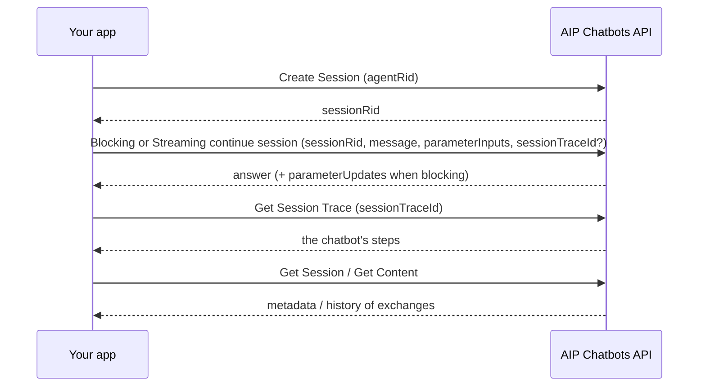

# 03 — Chatbots outside the studio

*Sources: [Chatbots as Functions](https://www.palantir.com/docs/foundry/chatbot-studio/chatbots-as-functions/) · [Use AIP Chatbots through Foundry APIs](https://www.palantir.com/docs/foundry/chatbot-studio/foundry-apis/) · [Distribute AIP Chatbots using Marketplace](https://www.palantir.com/docs/foundry/chatbot-studio/marketplace/) · checked October 8, 2026 · Ready for Review*

Three ways a chatbot leaves Chatbot Studio. They answer different needs, so the note starts with the choice.

| You need… | Use | Why |
|---|---|---|
| To **test** it with AIP Evals, **automate** it, or call it from code once | **Chatbot as a function** | **[Docs]** For "straightforward, single-use tasks that do not need extensive session management" |
| A **conversation** inside your own application, with streaming | **Sessions platform APIs** | **[Docs]** Built-in session state; blocking or streaming replies; traces |
| To install it in **another environment** or for another team | **Marketplace** | **[Docs]** Packaged as part of a Foundry DevOps product |

## 1. Chatbot as a function

**[Docs]** Publish settings (icon to the right of **Publish**) → **Publish function from chatbot** → choose an Ontology, function name, API name, description → **Publish chatbot and function**. Optionally release minor function versions on every **save**, not only on publish. The toast links to the function in Ontology Manager. Turning the toggle off stops future versions from registering a function.

**[Docs] The function's signature:**

| | Name | Notes |
|---|---|---|
| Input | `userInput` | The message to answer |
| Input (optional) | `sessionRid` | `ri.aip-agents..session.{uuid}`. **Omit it** for a new session; "Do not provide an empty string" |
| Inputs (optional) | One per application variable | Override defaults. An object-set variable defaults to **every object of the type** |
| Output | `markdownResponse` | The final answer, in Markdown |
| Output | `sessionRid` | Pass it back to continue the conversation |
| Outputs | One per application variable | Filled **only if the chatbot updated** that variable |

**[Explanation]** The object-set default is a trap. If Delivery Desk's selected-order variable is an object set and an automation calls the function without it, the chatbot's context becomes **all orders**, not one. Always pass every object-set variable explicitly when calling the function.

### Testing it with AIP Evals

**[Docs]** In the studio: **Evaluation** tab → **Create evaluation suite**. The suite must be in the **same project** as the chatbot. In test cases:

- set `sessionRid` to **null**, or each case continues an old session;
- object-set variables must be **null or a real value**, never empty.

**[Example]** Delivery Desk's chatbot suite reuses the draft-quality evaluators from [04-01](../04-aip-evals/01-evals-concepts-and-suites.md) on `markdownResponse`, and adds one case per tool: "Is order O-10442 late?" must produce a T2 lookup, visible in the debug view.

## 2. Sessions through platform APIs

**[Docs] Setup in Developer Console:**

1. The chatbot must use object, action and function types from **a single Ontology** to be used from an OSDK app.
2. **Resources** page: select that Ontology and every type the chatbot uses (application state, tools, retrieval context).
3. **Platform SDK** tab → **Projects access**: add the chatbot's project, and any project holding other resources it uses (for example a media set for document context).
4. **Client allowed operations**: enable the AIP Chatbots API operations; enable the **AIP Chatbots write** permission to create sessions and send messages.

**[Docs]** Developer Console resources **don't update automatically**. Add a new tool type or media set to the chatbot, and you must add it to the app's resources too.

**[Docs] The calls:**

- **[Docs]** `agentRid`: the chatbot's RID, copied from the file overview's Metadata.
- **[Docs]** Application state goes in through `parameterInputs`; changed values come back in `parameterUpdates` for blocking calls, or by loading the session exchange after streaming.
- **[Docs]** For a live trace, generate a **UUIDv4** as `sessionTraceId` in the continue call and poll *Get Session Trace*; for past exchanges, read `sessionTraceId` from *Get Content*.

## 3. Marketplace

**[Docs]**

- Add the chatbot to a product from **Add files**, or add a Workshop module that embeds it in the AIP Chatbot widget and it comes along.
- Everything is supported **except Assist agents**.
- A chatbot with **document context** brings its **whole media set**, including documents it doesn't use. To ship less, make a new media set with only the needed documents and point the chatbot at it.

**[Example]** Kestrel packages Delivery Desk for `kestrel-test` ([Ontology 14-04](../../Ontology/14-lifecycle-and-operations/04-marketplace-packaging.md)). Its policy search is function-backed context over `PolicyChunk` objects (T3), not document context, so no media set travels with it. If Ama's team later adds **document** context from the policy PDFs, the whole media set would ship, draft policies included; Priya would first create a media set holding only approved documents.

---
[Module index](README.md) · Previous: [02 — Commands as tools](02-commands-as-tools.md) · Next: [04 — Session logging](04-session-logging.md)
