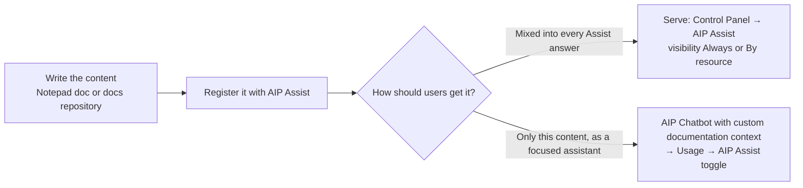

# 03 — Custom content sources for AIP Assist

*Sources: [Custom content sources in AIP Assist](https://www.palantir.com/docs/foundry/assist/aip-assist-custom-docs-overview/) · [Register custom content sources](https://www.palantir.com/docs/foundry/assist/aip-assist-registering-content/) · [Serve custom content sources](https://www.palantir.com/docs/foundry/assist/adding-documentation-to-aip-assist/) · [Deploy AIP Chatbots to AIP Assist](https://www.palantir.com/docs/foundry/assist/agents-in-aip-assist/) · [Custom content source best practices](https://www.palantir.com/docs/foundry/assist/custom-documentation-best-practices/) · checked October 8, 2026 · Ready for Review*

**The Kestrel case.** Kofi's team keeps asking the same questions about the re-route review page: what the risk band means, when to reject a proposal, who to call when a warehouse is full. The answers live in a Kestrel SOP. This note follows that SOP into AIP Assist, step by step, with the docs' rules at each step.

## The route, on one page



**[Docs]** Requirements: AIP enabled on the enrollment. Good candidates include program documentation, SOPs, company wikis, permission request procedures, data ingestion processes, best practices and workflow documentation.

## Step 1 — Write it so retrieval works

**[Docs]** Assist uses retrieval-augmented generation: it splits content into focused paragraphs and retrieves the most relevant ones, alongside public documentation. So:

- **One topic per heading.** Each heading should cover a single topic or question. Content "is segmented based on headings".
- **Avoid collisions with public documentation.** Define words that also mean something in Palantir's docs ("build", "code repository") in your own context.
- **No "deprecated" notes or "Update:" overrides.** Rewrite the content in its current form, or delete it.
- **Images:** Assist shows images only from Palantir's public docs and in-platform custom documentation, not from Notepad yet. Add descriptions below images; the text is retrieved and cited.

**[Example]** Kestrel's SOP before and after:

```text
Before:  ## Re-routes
         Risk bands come from the delay model and High means... Reject a proposal if...
         (Update Sept: call the warehouse lead instead of emailing.)

After:   ## What the delay risk band on a proposal means
         ## When to reject a re-route proposal
         ## What to do when the target warehouse is full      ← "call the warehouse lead", no update note
         ## Kestrel terms: "route" means a carrier route, not a Foundry pipeline
```

## Step 2 — Register it

**[Docs]** Two sources; Notepad is recommended because it can be embedded elsewhere, such as in Workshop.

| | Notepad document | In-platform custom documentation |
|---|---|---|
| Availability | May need enabling on your enrollment | A **documentation-type repository** in Code Repositories; may need enabling and allow-listing |
| Register | Document must be **in a project** → *Actions* → **Add to AIP Assist** → title and description → Save, wait for the success message | Create a "product" folder under `docs` with `overview.md` (`@name`, `@description`); rename `_aip-assist.json` to `aip-assist.json`; list the folder with a compact description; commit and let checks publish |
| Updates | Propagate automatically | Propagate automatically |
| Watch out | Empty documents can't be added; the project needs **organisation markings**; new documents take time to become discoverable | The description is what Assist uses to decide when to query your docs |

**[Docs]** Existing permissions are respected: configure who can see the Notepad documents first.

## Step 3a — Serve it inside normal Assist

**[Docs]** A platform administrator in **Control Panel → AIP Assist → + Add** picks the ingested document. By default it is visible **only in the document itself** (or its repository), which is how you test it. Then **Manage** → **Always**, or **By resource** with one or more resources such as a Workshop app.

**[Docs]** *Always* is recommended for platform-level content that is useful next to the platform and developer documentation.

## Step 3b — Or build a focused chatbot

**[Docs]** A source-backed AIP Chatbot answers **only** from the content you give it: narrower, but "more precise and targeted". In Chatbot Studio: *+ New AIP Chatbot* → name, description, icon → *Retrieval context* → **Custom documentation context** → pick the documents → model and instructions → **Publish** (version 1.0) → **Usage** → **AIP Assist** toggle. It then appears in Assist's mode selector.

**[Docs]** Users need read access to the chatbot's **location** and to the **content source**, and access to the chosen model. Adding a document to Assist doesn't change any chatbot until you build and publish one that uses it.

## Kestrel's choice

**[Example]**

| Content | Route | Why |
|---|---|---|
| Re-route review SOP | **Served By resource**: Kofi's re-route review Workshop app | Answers show up only where they are relevant, mixed with Palantir's docs for Workshop questions |
| Carrier-invoice dispute procedure for Lena's team | **Source-backed chatbot** "Invoice disputes" | The team wants answers from the procedure only, never from general documentation |

**[Explanation]** "Served" content adds to what Assist already knows; a chatbot replaces it. Choose by whether a mixed answer is helpful or risky.

---
[Module index](README.md) · Previous: [02 — AIP Assist](02-aip-assist.md) · Next: [04 — AIP Analyst](04-aip-analyst.md)
