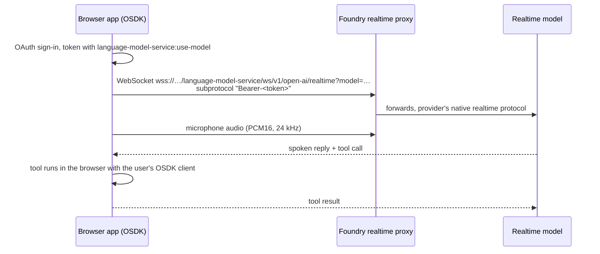

# 07 — Threads, Evolve and Realtime audio

*Sources: [AIP Threads](https://www.palantir.com/docs/foundry/threads/overview/) · [Threads: Getting started](https://www.palantir.com/docs/foundry/threads/getting-started/) · [AIP Evolve](https://www.palantir.com/docs/foundry/aip-evolve/overview/) · [Realtime audio](https://www.palantir.com/docs/foundry/realtime-audio/overview/) · [Build a voice-enabled OSDK application](https://www.palantir.com/docs/foundry/realtime-audio/build-a-voice-enabled-osdk-application/) · [Supported LLMs: audio models](https://www.palantir.com/docs/foundry/aip/supported-llms/) · checked October 8, 2026 · Ready for Review*

Three smaller products, each with its own short section: a **user's** tool, an **optimiser's** tool and a **developer's** tool.

## AIP Threads: chat with documents

**[Docs]** "A general productivity tool for enterprise" for tasks and ad-hoc analysis with LLMs, with no setup beyond AIP and **AIP custom workflows** being enabled. Drag in documents, pick previously uploaded ones, or pick an AIP Chatbot. The page's uses: technical manuals, vendor contracts, policy documents, regulatory guidelines, HR policies and similar. For repetitive, complex workflows it points you to other AIP tools.

**[Docs] How it works**

| Feature | Detail |
|---|---|
| Open it | Workspace bar or Cmd/Ctrl + J |
| Documents | **Native (non-scanned) PDFs** only; uploaded into a media set you choose |
| Document modes | **Full document text**, or **relevant document chunks** (beta): 4,096 characters per chunk (~1,024 tokens), 512 overlap, ada-002 embeddings by default |
| Citations | The model is instructed to cite page numbers; "users should verify the responses" |
| Model and prompt | Model from those enabled; editable system prompt; temperature 0 (default) to 1 |
| Export | JSON or PDF |
| **Upgrade to an AIP Chatbot** | Turns a useful thread configuration into a chatbot in Chatbot Studio |

**[Explanation]** Full text risks the context window on long PDFs; chunks risk missing the one paragraph that matters. Start with full text for short documents; switch to chunks when the error appears.

**[Example]** Lena compares two carriers' new rate cards in a thread before the bake-off in [06-01](../06-document-intelligence/01-extraction-strategies.md). DHL's PDFs work. The regional carrier's scanned card doesn't, because Threads takes native PDFs only; that document goes through Document Intelligence instead.

## AIP Evolve: let agents improve an AI workflow

**[Docs]** AIP Evolve "coordinates fleets of AI FDE agents to improve AI systems in Foundry". You set a **target**, a **goal**, a **validation strategy** and **limits**; it launches AI FDE to explore and validate changes and returns a proposal with the agents' activity. Goals: migrate models, reduce cost or latency, improve evaluation scores, or a custom goal.

**[Docs] Requirements:** AIP enabled with access to AI FDE; the **AIP Evolve** Marketplace product installed in an Ontology; access to the target and its data and evaluation suites.

**[Docs] The page's example:** an inventory-allocation workflow; goal *Optimize cost*; 10 representative test cases compared side by side; up to five iterations of model and prompt changes. The agents finished in three iterations and proposed a smaller model plus guardrails in two prompts. All 10 cases passed for both baseline and candidate, and the average cost fell **65%**, from 204.6 to 72.4 compute-seconds per call. You review in **Agent graph** and **Proposal**, then *Review in Branching*, or *Resume* with more instructions.

**[Explanation]** Evolve runs the [04-03](../04-aip-evals/03-runs-and-experiments.md) experiment loop for you, with AI FDE choosing the changes. Ten test cases is enough to show "no obvious regression", not enough to show "no regression". Before accepting a cheaper model for Delivery Desk, Kestrel would rerun its own 49-case suite on the proposal's branch.

## Realtime audio: voice as an interface

**[Docs]** Audio is "a modality for interacting with the rest of the platform through the Ontology": context comes from the Ontology, a realtime model listens, transcribes and can speak and call tools, and results are written back. Use cases: **dictation**, **meetings** (diarised), **live call assistance**, **voice-controlled interfaces**.

**[Docs] Consent first.** Many jurisdictions require notice, and some consent, before recording or transcribing anyone, including the other party on a call. The developer and deploying organisation are responsible: verify the rules, build notice and consent flows **before capture starts**, and document consent and retention.

**[Docs] Models:** realtime speech-to-speech (`gpt-realtime-1.5`, `gpt-realtime-2`) and transcription models ([01-01](../01-models-and-llms/01-supported-llms-and-model-catalog.md#1-whats-on-the-list)).

### The tutorial, as an architecture

**[Docs] Details that matter:**

- You need an **unrestricted** custom application in Developer Console; only those can include the `language-model-service:use-model` scope. Without it the WebSocket is rejected.
- Browsers can't set an `Authorization` header on WebSockets, so the token goes in the **subprotocol** as `Bearer-<token>`. It is visible in the browser's network panel: treat it as a credential, don't log it. Tokens are short-lived; long sessions may need reconnecting.
- The proxy is the WebSocket counterpart of the [LLM-provider compatible APIs](../01-models-and-llms/02-llm-provider-compatible-apis.md), so the OpenAI realtime SDK works unchanged.
- **Tools run in the browser** with the user's token: "The model never sees the Ontology directly — it sees only what the tool returns." Writes go through actions, with their usual permissions and validation.

**[Example]** Kofi's warehouse team asks for hands-free shipment lookups on the floor: "Where is shipment DHL 77812 going?" One read-only tool wraps an OSDK query on `Shipment` by `trackingNumber`; no write tools. Before the pilot, Kestrel adds a spoken and on-screen notice that the app transcribes speech, and keeps no audio.

---
[Module index](README.md) · Previous: [06 — Boardroom](06-boardroom.md) · Next module: [08 — Security, governance and administration](../08-security-governance-and-admin/README.md)
