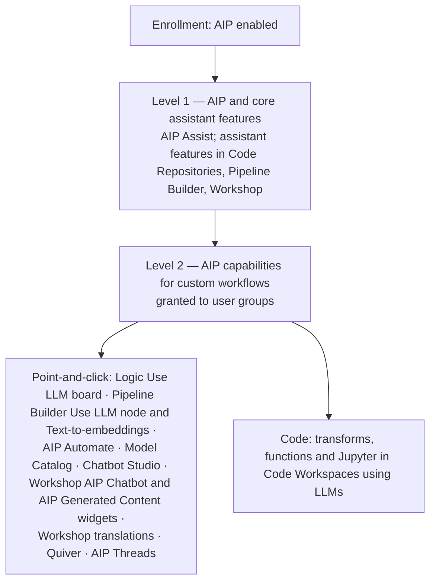

# 02 — Enabling AIP features

*Sources: [Enable AIP features](https://www.palantir.com/docs/foundry/aip/enable-aip-features/) · checked October 8, 2026 · Ready for Review*

"Why can't I see AIP Logic?" has a short list of possible answers. This note is that list, in the order an administrator would check it.

## The layers

**[Docs]** AIP is on by default for new enrollments; enrollments that began before 2024 may need to turn it on in **Control Panel → AIP settings**. Enabling AIP "may incur additional compute usage".

**[Docs]** AIP's features fall into three categories: **AIP Assist**, **AIP assistant features in platform applications** (native, specific helpers) and **AIP capabilities for custom workflows** (open-ended building blocks for developers). Two permission levels govern them:

## The checklist

| # | Check | **[Docs]** where |
|---|---|---|
| 1 | Is AIP enabled for the enrollment? | Control Panel → AIP settings |
| 2 | Is AIP restricted to certain **Organizations**, and is mine one? *Restrict AIP To Organizations* disables AIP for every organization not selected | Control Panel |
| 3 | Is my **user group** allowed? Options: Everyone, given groups, or Nobody | Control Panel |
| 4 | Do I have **capabilities for custom workflows**, not just Assist? | Control Panel (level 2) |
| 5 | Is the **application** itself enabled? Some, such as AIP Logic, also need *Application access* | Control Panel → Application access |
| 6 | Is AIP enabled for **every organization marking on this project**? "AIP is only considered enabled for a resource when AIP is enabled for all organization markings on the resource's project." | Project markings |
| 7 | Is a **model family** enabled, and an experimental model's toggle on? | Control Panel → AIP settings → Model enablement |
| 8 | Is the model family enabled for **my organization**? Families can be enabled per organization | Model enablement |

**[Example]** Lena can open AIP Threads but not AIP Logic. Checks 1–4 pass (Threads is a level-2 capability, so she has level 2); check 5 fails: AIP Logic isn't in the application access list for Kestrel Pay's group. A second case: Daniel's Logic file works in `Delivery Desk [Workflow]` but AIP is "not enabled" in a new project he made, because that project carries an organization marking for a partner organization not selected in check 2. Check 6 explains it.

## Model families

**[Docs]** In **Model enablement**, each model family is:

| State | Meaning | To use it |
|---|---|---|
| **Enabled** | Active | Nothing |
| **Disabled** | Available but not switched on | *Manage* and accept the terms and conditions |
| **Disallowed** | Legal, geographic or infrastructure restriction | Contact Palantir Support |

- **[Docs]** Enabling a family means accepting terms for the **subprocessors** that provide it. Once a subprocessor is accepted, Palantir may enable more eligible families, which doesn't add cost; a **new** subprocessor needs separate acceptance. Administrators can review and disable families.
- **[Docs]** "Disabling a model family group will break workflows that rely on a model in that specific group."
- **[Docs]** An experimental model is visible only if **both** *Enable experimental models* and its family are on.

**[Explanation]** Disabling a family has the same effect as a model's deprecation date, without the brownout warnings. Before switching one off, run the inventory steps from the [retirement runbook](../01-models-and-llms/01-supported-llms-and-model-catalog.md#5-runbook-a-model-you-use-is-being-retired).

Markings-based limits on what data may reach a model are a separate setting: [03](03-llm-data-access-with-markings.md).

---
[Module index](README.md) · Previous: [01 — Security, privacy and ethics](01-security-privacy-and-ethics.md) · Next: [03 — LLM data access with markings](03-llm-data-access-with-markings.md)
