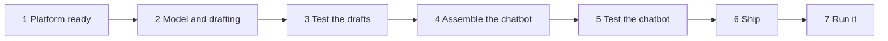

# 01 — Building Delivery Desk

*Sources: no new doc pages; every step links to the note that holds the docs' wording · written October 14, 2026 · Ready for Review. Everything here is **[Example]** unless a line says otherwise.*

Delivery Desk was **designed** in the Ontology area: what it may see, its seven tools, and which rung of the control ladder each operation sits on ([Ontology 16-03](../../Ontology/16-ai-and-agents/03-ontology-tools-for-agents.md), [16-04](../../Ontology/16-ai-and-agents/04-human-in-the-loop-and-staged-writes.md)). This page is the **release log** of building it, in the order the work happened, with a gate at the end of each stage. Nothing here changes the design.

## Stage 1 — Platform ready (administrator, with Daniel)

| Step | Done in | Note |
|---|---|---|
| AIP and capabilities for custom workflows enabled for Ama's team and Daniel's group | Control Panel | [08-02](../08-security-governance-and-admin/02-enabling-aip.md#the-checklist) |
| AIP Logic and Chatbot Studio in *Application access* | Control Panel | [08-02](../08-security-governance-and-admin/02-enabling-aip.md#the-checklist) |
| Model family for the drafting model enabled; experimental models off | Model enablement | [08-02](../08-security-governance-and-admin/02-enabling-aip.md#model-families) |
| LLM data-access allowlist `Customer PII` | AIP settings → Data access | [08-03](../08-security-governance-and-admin/03-llm-data-access-with-markings.md#kestrels-cases) |

**Gate:** Ama, from her own account, can open AIP Threads and get an answer from the chosen model. If she's rejected, check her session's markings first ([08-03](../08-security-governance-and-admin/03-llm-data-access-with-markings.md)).

## Stage 2 — Model and drafting (Daniel)

| Step | Note |
|---|---|
| Pick a candidate model in the Model Catalog; compare two on the comparison page | [01-01](../01-models-and-llms/01-supported-llms-and-model-catalog.md#3-the-model-catalog) |
| Import it into `kestrel-functions` with alias `draftModel` | [Ontology 09-04](../../Ontology/09-functions/04-functions-on-models-and-llms.md) |
| Write `shipmentFacts(order)` (deterministic facts) and `draftDelayMessage(order)` (the LLM call), returning `{subject, body}` | [03-02](../03-aip-logic/02-building-a-logic-function.md), [Ontology 09-04](../../Ontology/09-functions/04-functions-on-models-and-llms.md) |
| Prompt v2: role, rules, JSON output, one example | [01-03](../01-models-and-llms/03-prompt-engineering.md#worked-example-the-delay-message-prompt) |
| Build *Draft delay message (Logic)* as the wording sandbox for Ama's lead | [03-02](../03-aip-logic/02-building-a-logic-function.md#logic-version-vs-typescript-version) |

**Gate:** the TSv2 function is published and its version noted, because tool T4 will **pin** it ([Ontology 16-03 rule 3](../../Ontology/16-ai-and-agents/03-ontology-tools-for-agents.md#the-rules-kestrel-drew)).

## Stage 3 — Test the drafts

| Step | Note |
|---|---|
| Suite *Delivery Desk drafts*: 40 real late orders + 9 edge cases | [04-01](../04-aip-evals/01-evals-concepts-and-suites.md#test-cases-two-sources) |
| Evaluators: length, refund words, valid JSON, date present, two LLM-as-a-judge conditions | [04-01](../04-aip-evals/01-evals-concepts-and-suites.md#evaluators-from-rules-to-metrics) |
| Both targets in one suite: the TSv2 function and the Logic version | [04-01](../04-aip-evals/01-evals-concepts-and-suites.md#the-five-parts-of-a-suite) |
| Flask on the Logic version's facts block to separate data bugs from prompt bugs | [04-02](../04-aip-evals/02-intermediate-parameters.md) |
| Experiment: 3 models × 2 prompt variants, 3 iterations | [04-03](../04-aip-evals/03-runs-and-experiments.md#experiments) |
| Read failures; fix the tone judge's wording | [04-04](../04-aip-evals/04-reading-results.md#from-summary-to-cause) |

**Gate:** every case passes on all three iterations on the published version, in a project-scoped run Ama's lead can open. Decision recorded: current model, shorter prompt.

## Stage 4 — Assemble the chatbot

| Step | Note |
|---|---|
| Settings sheet: name, model, system prompt, temperature 0, conversation starters | [05-01](../05-chatbot-studio/01-chatbot-concepts.md#the-settings-sheet) |
| T1 as Ontology context from the selected order; T3 as function-backed policy search | [Ontology 16-01](../../Ontology/16-ai-and-agents/01-ontology-as-ai-context.md), [16-03](../../Ontology/16-ai-and-agents/03-ontology-tools-for-agents.md#the-delivery-desk-tool-sheet) |
| Tools T2, T4 (pinned), T5 (**confirm first**), T6 (writes `RerouteProposal` only), T7 | [Ontology 16-03](../../Ontology/16-ai-and-agents/03-ontology-tools-for-agents.md#the-delivery-desk-tool-sheet) |
| Inputs from application variables, not from the model, wherever the tool allows | [Ontology 16-03 rule 4](../../Ontology/16-ai-and-agents/03-ontology-tools-for-agents.md#the-rules-kestrel-drew) |
| No re-route tool, no `Payment` access, no command tools | [Ontology 16-03](../../Ontology/16-ai-and-agents/03-ontology-tools-for-agents.md#the-delivery-desk-tool-sheet) |

**Gate:** in **View** at the saved version, Daniel walks five scripted conversations, including "send it now" (must ask Ama to confirm) and "move this parcel to Kumasi" (must propose, not re-route).

## Stage 5 — Test the chatbot

| Step | Note |
|---|---|
| Publish as a function; Evaluation tab → suite in the **same project** | [05-03](../05-chatbot-studio/03-chatbots-outside-the-studio.md#1-chatbot-as-a-function) |
| Test cases: `sessionRid` null; the selected-order variable always set explicitly | [05-03](../05-chatbot-studio/03-chatbots-outside-the-studio.md#testing-it-with-aip-evals) |
| One case per tool, checked in the debug view | [05-03](../05-chatbot-studio/03-chatbots-outside-the-studio.md#testing-it-with-aip-evals) |

**Gate:** tool-choice cases pass; no case ends in a write without the expected confirmation.

## Stage 6 — Ship

| Step | Note |
|---|---|
| Workshop page for Ama's team with the AIP Chatbot widget | [05-01](../05-chatbot-studio/01-chatbot-concepts.md#save-view-publish-watch) |
| Project limit "Production"; reserved capacity for `Delivery Desk [Workflow]` | [08-04](../08-security-governance-and-admin/04-capacity-and-rate-limits.md#kestrels-design) |
| Session-log export with markings and 30-day retention | [05-04](../05-chatbot-studio/04-session-logging.md#before-you-export-anything) |
| Package for `kestrel-test`, then production, through Marketplace | [05-03](../05-chatbot-studio/03-chatbots-outside-the-studio.md#3-marketplace), [Ontology 14-04](../../Ontology/14-lifecycle-and-operations/04-marketplace-packaging.md) |

**Gate:** Ama's team uses it for a week in `kestrel-test` on copies of real cases; the session-log tool reliability view shows no unexplained failures.

## Stage 7 — Run it

| Recurring task | Where | Note |
|---|---|---|
| Weekly: tool reliability and retries from session logs | Logs dataset | [05-04](../05-chatbot-studio/04-session-logging.md#recipe-2--which-tools-are-unreliable-or-slow) |
| Monthly: cost per draft against the worksheet | Analysis page, token export | [09-01](../09-cost-and-observability/01-compute-usage.md#kestrels-worksheet) |
| On any wording change: branch the Logic sandbox, run the suite, then change the TS template | Logic, Evals | [03-03](../03-aip-logic/03-execution-modes-and-branching.md#part-2--developing-on-a-branch) |
| On a model retirement notice: the runbook; a one-line alias change in TSv2 | Upgrade Assistant | [01-01](../01-models-and-llms/01-supported-llms-and-model-catalog.md#5-runbook-a-model-you-use-is-being-retired) |
| On an incident: the drill | — | [09-02](../09-cost-and-observability/02-observability.md#kestrels-incident-drill) |
| Quarterly: ask AIP Evolve for a cheaper configuration; rerun the full suite on its proposal | Evolve | [07-07](../07-end-user-apps/07-threads-evolve-and-realtime-audio.md#aip-evolve-let-agents-improve-an-ai-workflow) |

## What this build used, by exam domain

| Exam domain | Stages |
|---|---|
| 3 — Ontology Functions (choosing TSv2 vs Logic) | 2 |
| 7 — AIP Logic and AI-powered applications (prompts, tools, retrieval context, evaluation, traces) | 2–5, 7 |
| 8 — Security, governance and operations | 1, 6, 7 |

---
[Module index](README.md) · Next: [02 — Carrier invoices](02-carrier-invoices.md)
