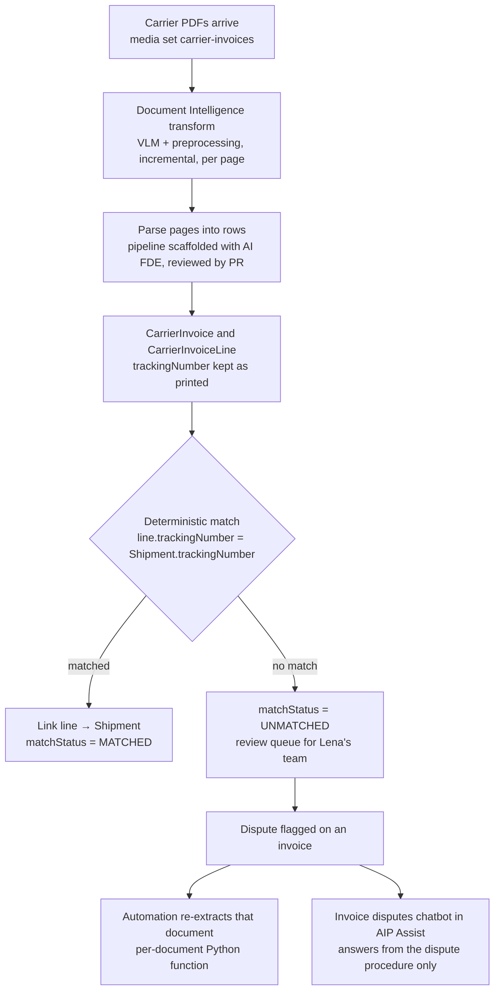

# 02 — Carrier invoices

*Sources: no new doc pages; every step links to the note that holds the docs' wording · written October 14, 2026 · Ready for Review. Everything here is **[Example]** unless a line says otherwise.*

The second Kestrel case is new in this area: carrier invoices arrive as PDFs, and Lena's team wants every invoice line matched to a shipment so overcharges can be disputed. Unlike Delivery Desk, the AI here does **extraction**, not conversation. This page is the **architecture record**: the flow, the decision behind each box, and what stays deterministic.

## The flow

## Decisions, box by box

| Box | Decision | Why | Note |
|---|---|---|---|
| Trying it out | Lena first compared two rate cards in AIP Threads | Zero setup; showed that scanned PDFs need something else (Threads takes native PDFs only) | [07-07](../07-end-user-apps/07-threads-evolve-and-realtime-audio.md#aip-threads-chat-with-documents) |
| B | **VLM with preprocessing**, chosen by a 30-invoice bake-off | Scans and long tables were where cheaper strategies failed | [06-01](../06-document-intelligence/01-extraction-strategies.md#kestrels-bake-off) |
| B | Deployed as a **transform**, incremental, `THREAD_NUMBER` 20 | Monthly batch; keep LLM capacity for interactive work | [06-02](../06-document-intelligence/02-deploying-extraction.md#runbook-the-transform) |
| B | Weekly rerun of `ERROR_RESPONSE_JSON_PARSING` rows by media item ID | **[Docs]** about 5% of layout-aware extractions can fail even with top models | [06-02](../06-document-intelligence/02-deploying-extraction.md#runbook-the-transform) |
| B | Prompt changes only in Document Intelligence, then redeploy | **[Docs]** editing `prompts.py` makes the app and batch disagree | [06-02](../06-document-intelligence/02-deploying-extraction.md#runbook-the-transform) |
| C | Parser scaffolded by AI FDE in Data integration mode; merged after review | Fast start; the review caught a link set before matching | [07-05](../07-end-user-apps/05-ai-fde.md#reviewing-ai-fdes-function-code-a-checklist) |
| D | Two object types, added to the reference model | One invoice, many lines | [06-01](../06-document-intelligence/01-extraction-strategies.md#where-the-data-goes), [Ontology 17-02](../../Ontology/17-case-studies/02-kestrel-reference-model.md) |
| E | **Matching is code, not AI** | A wrong match charges the wrong shipment; an unmatched line is visible and cheap to fix | [06-01](../06-document-intelligence/01-extraction-strategies.md#where-the-data-goes) |
| I | A **function**, triggered by an automation when a dispute is flagged | Per-document freshness without waiting for the batch; `retryable` results retried, the rest sent to a person | [06-02](../06-document-intelligence/02-deploying-extraction.md#runbook-the-functions) |
| J | A **source-backed chatbot** over the dispute procedure, published to AIP Assist | Answers only from Kestrel's procedure, never mixed with general documentation | [07-03](../07-end-user-apps/03-assist-custom-content-sources.md#kestrels-choice) |

## What is AI and what isn't

| Step | AI? | Check that catches its mistakes |
|---|---|---|
| Reading the PDF | Yes: vision model | Bounding-box view during the bake-off; totals checked by hand on 30 pages; weekly retry of parse failures |
| Turning pages into rows | No: reviewed parser | Pull request review; pipeline checks |
| Matching lines to shipments | No | Unmatched lines go to people |
| Answering "how do I dispute this?" | Yes: chatbot | Source-backed only; citations to the procedure |

**[Explanation]** The pattern is the same as Delivery Desk's control ladder ([Ontology 16-04](../../Ontology/16-ai-and-agents/04-human-in-the-loop-and-staged-writes.md#where-kestrel-puts-each-operation)): AI where reading or language is the hard part; deterministic code where a mistake moves money.

## Security, capacity and cost

| Concern | Setting | Note |
|---|---|---|
| Which model may see invoices | A Palantir-provided model: the invoice media set carries no Kestrel Pay marking. When Lena asks about invoices interactively (Threads, the disputes chatbot) she uses a scoped session, because her own session carries `Kestrel Pay – Financial` | [08-03](../08-security-governance-and-admin/03-llm-data-access-with-markings.md#kestrels-cases) |
| Capacity | The extraction project sits in the "Batch" limit (40%) | [08-04](../08-security-governance-and-admin/04-capacity-and-rate-limits.md#kestrels-design) |
| Cost | Highest-token strategy, chosen deliberately; revisit if it grows, with layout-aware OCR as the free fallback for electronic PDFs | [06-01](../06-document-intelligence/01-extraction-strategies.md#kestrels-bake-off), [06-03](../06-document-intelligence/03-document-to-text.md#kestrels-settings) |

## Open items

- **[Explanation]** The docs don't describe evaluation of extraction **business fields** (totals, tracking numbers); the built-in evaluation scores Markdown quality ([06-01](../06-document-intelligence/01-extraction-strategies.md#the-comparison-loop)). Kestrel keeps a hand-checked sample of 30 pages per quarter and would turn it into an AIP Evals suite on the parser's output.
- The disputes chatbot answers procedure questions only; it has no tools. Adding an action to file a dispute would need its own confirmation rule.

---
[Module index](README.md) · Previous: [01 — Building Delivery Desk](01-building-delivery-desk.md) · Next module: [11 — Practice](../11-practice/README.md)
