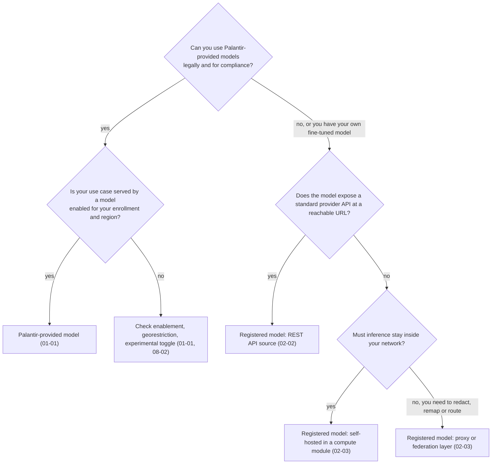
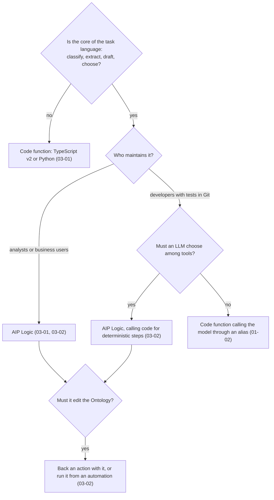
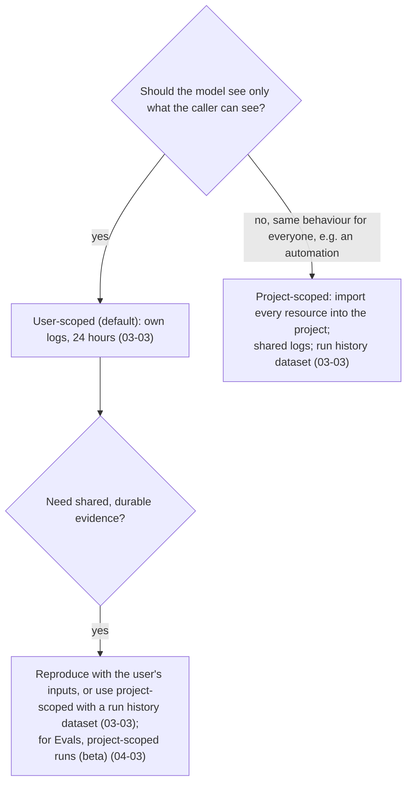
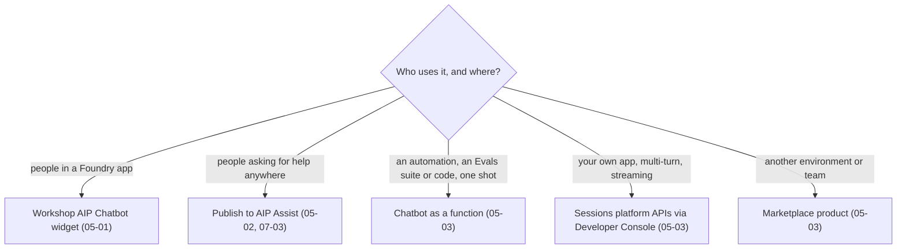
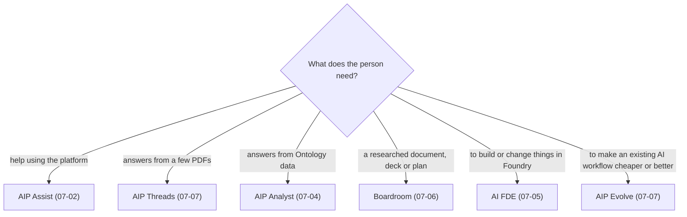

# Decision guide

*Sources: the notes each branch links to · compiled October 14, 2026 · Ready for Review. The flowcharts are ours; every leaf links to the note with the docs' wording.*

Five decisions that come up on almost every AIP project, as flowcharts. Each ends at the note to read next.

## 1. Which model setup?

[01-01](../01-models-and-llms/01-supported-llms-and-model-catalog.md) · [08-02](../08-security-governance-and-admin/02-enabling-aip.md) · [02-02](../02-bring-your-own-model/02-rest-and-compute-module-backed-models.md) · [02-03](../02-bring-your-own-model/03-self-hosting-and-proxy-layers.md)

## 2. AIP Logic or a code function?

[03-01](../03-aip-logic/01-logic-concepts.md#logic-or-code) · [03-02](../03-aip-logic/02-building-a-logic-function.md) · [01-02](../01-models-and-llms/02-llm-provider-compatible-apis.md)

## 3. User-scoped or project-scoped?

[03-03](../03-aip-logic/03-execution-modes-and-branching.md#part-1--who-the-function-runs-as) · [04-03](../04-aip-evals/03-runs-and-experiments.md)

## 4. How do people reach a chatbot?

[05-01](../05-chatbot-studio/01-chatbot-concepts.md) · [05-02](../05-chatbot-studio/02-commands-as-tools.md) · [05-03](../05-chatbot-studio/03-chatbots-outside-the-studio.md) · [07-03](../07-end-user-apps/03-assist-custom-content-sources.md)

## 5. Which end-user app?

[07-01 comparison](../07-end-user-apps/01-which-app-for-whom.md) · [07-02](../07-end-user-apps/02-aip-assist.md) · [07-04](../07-end-user-apps/04-aip-analyst.md) · [07-05](../07-end-user-apps/05-ai-fde.md) · [07-06](../07-end-user-apps/06-boardroom.md) · [07-07](../07-end-user-apps/07-threads-evolve-and-realtime-audio.md)

---
[Module index](README.md) · Previous: [Limits and thresholds](limits-and-thresholds.md) · Next: [Docs index](docs-index.md) · [AIP home](../README.md)
