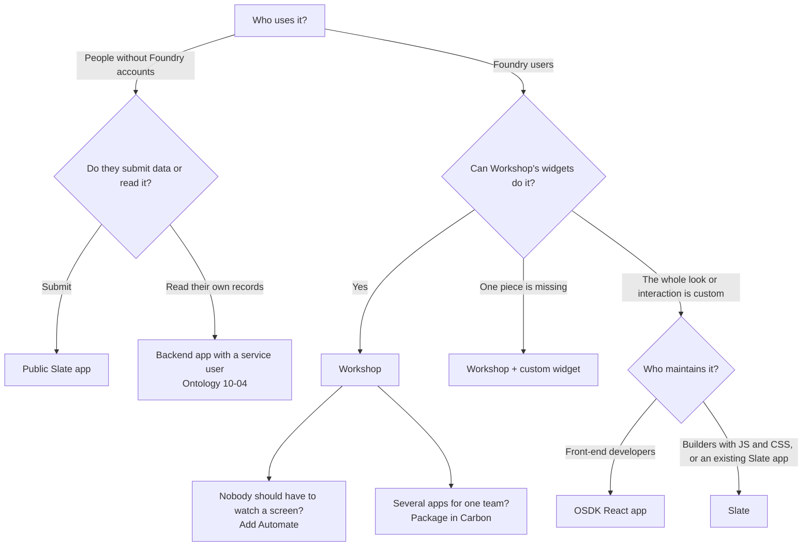

# 02 — Choosing a builder

*Sources: no new doc pages; each row links to the note that holds the docs' wording · written October 21, 2026 · Ready for Review*

**[Concept]** All five builders end at the same place: a user deciding something and an action recording it. They differ in **who builds**, **how much is ready-made**, and **where the app runs**. The usual mistake is reaching for more freedom than the job needs, then paying for it in maintenance.

| | Workshop | Slate | OSDK React app | Custom widget | Pilot |
|---|---|---|---|---|---|
| **Built by** | Builders without code; functions for the hard parts | Builders comfortable with JavaScript, CSS, SQL | Front-end developers | Front-end developers | Anyone who can describe the app; developers to review |
| **Starts from** | Ontology-aware widgets, variables, events | A blank canvas, queries and Handlebars | A React template with auth and the OSDK | A widget set template (React, Vite) | A prompt; generates an OSDK React app or a widget set |
| **Ontology** | Native: object sets, actions, functions | Panels, Foundry Functions, OSDK v1, Action widget; data arrives as JSON | TypeScript OSDK, `@osdk/react` hooks | OSDK inside the widget, with the viewer's token | Proposes object and action types; uses OSDK hooks |
| **Runs** | Inside Foundry, web and mobile | Inside Foundry; or public, without Foundry accounts | At its own subdomain, hosted by Foundry | Inside a Workshop module | As the app or widget it generated |
| **Ships through** | Module versions, branches, Marketplace | Versions, tags, Marketplace (API Gateway sources only) | Git tags and CI in Developer Console | Widget set versions; modules choose the version | Ontology proposal + code proposal + tagged release |
| **Covered in** | [01](../01-workshop-foundations/README.md)–[04](../04-workshop-in-production/README.md) | [05](../05-slate/README.md) | [06-01](../06-osdk-react-and-custom-widgets/01-osdk-react-apps.md) | [06-03](../06-osdk-react-and-custom-widgets/03-custom-widget-sets.md) | [07](../07-pilot/README.md) |

**[Explanation]** Around them: **Automate** ([08](../08-automate/README.md)) acts when nobody is looking; **Carbon** ([09](../09-carbon-workspaces/README.md)) packages apps for a group; **Workflow Lineage** and **Autopilot** ([10](../10-workflow-tools/README.md)) show what's built and what's running.

## A decision path

**[Recommendation]** Read the path top-down and stop at the first answer that fits:

1. **Workshop first.** It's the docs' primary no-code tool for operational apps, and a missing widget is cheaper to add as a custom widget than to leave Workshop.
2. **Slate** when a custom look matters more than ready-made Ontology widgets, for public submission forms, or to maintain an existing app. The FAQ itself warns it has few guard rails ([05-01](../05-slate/01-slate-apps.md)).
3. **OSDK React** for a fully custom product your developers will own, test and release like any web app.
4. **Pilot** to get to a first OSDK app or widget fast. Its output is still an OSDK app or widget set, reviewed and shipped like one ([07-02](../07-pilot/02-building-and-shipping.md)).

## Where Kestrel landed

| Need | Builder | Why |
|---|---|---|
| Ama's queue of at-risk orders | Workshop | Ontology-native, writeback, guided flow ([11-01](../11-kestrel-case/01-delivery-desk-queue-built-out.md)) |
| Kofi's warehouse floor | Workshop, mobile | Scanner and location widgets are built in ([11-02](../11-kestrel-case/02-warehouse-floor-mobile.md)) |
| A shipment's events on a timeline | Custom widget in Workshop | One missing visual, not a missing app ([06-04](../06-osdk-react-and-custom-widgets/04-custom-widgets-in-workshop.md#kestrel-the-shipment-timeline)) |
| Customers checking delivery status | Backend app outside Foundry | Customers aren't Foundry users ([Ontology 10-04](../../Ontology/10-applications/04-osdk-and-apis.md)) |
| Holding orders on high-risk payments | Automate | Nobody should have to watch a screen ([08-05](../08-automate/05-security-ownership-and-history.md)) |
| One home page for CS agents | Carbon | Packages what exists ([11-03](../11-kestrel-case/03-delivery-desk-workspace.md)) |

**[Explanation]** Kestrel uses no Slate and no internal React app. Nothing it needs has required either, which is the pattern the path predicts.

---
[Module index](README.md) · Previous: [01 — Operational applications](01-operational-applications.md) · Next: [03 — Kestrel's applications](03-running-example.md)
