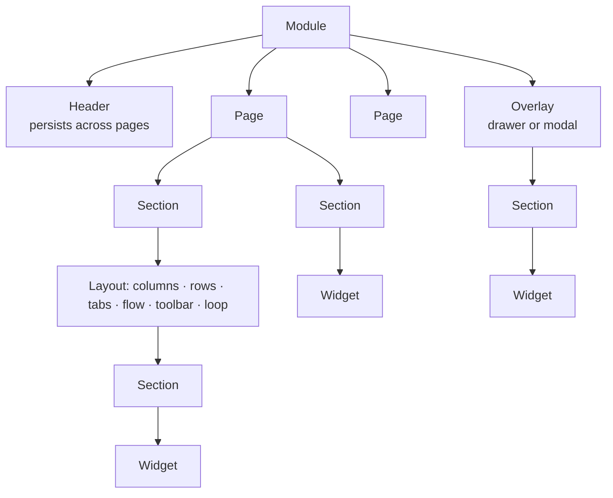

# 02 — Layouts, widgets and events

*Sources: [Layouts](https://www.palantir.com/docs/foundry/workshop/concepts-layouts/) · [Widgets](https://www.palantir.com/docs/foundry/workshop/concepts-widgets/) · [Events](https://www.palantir.com/docs/foundry/workshop/concepts-events/) · checked October 18, 2026 · Ready for Review*

A module has three moving parts: a **layout** that decides where things sit, **widgets** that show and capture data, and **events** that make things happen when a user clicks. Variables connect them and get their own note ([03](03-variables-and-interfaces.md)).

## The layout tree

**[Docs]** The pieces:

- **Header**: a persistent toolbar for titles, tabs and buttons. Its title also names the browser tab or **Carbon** workspace tab; without one, the module's resource name is used. It can be horizontal, or vertical on the left and collapsible (then Button Group and Tabs show icons only, and other widgets hide).
- **Pages**: separate canvases. Only the header persists between them. Page order in edit view "has no impact on module behavior"; users move between pages through **Layout events**, usually from Tabs or a Button Group.
- **Sections**: the boxes a page or overlay is divided into. A section holds widgets, or a **layout** containing more sections. The six layouts are columns, rows (optionally scrolling), tabs, flow (a vertically scrolling container), toolbar (for small widgets like buttons and metric cards) and **loop** (one embedded module per object or array entry, see [02-04](../02-workshop-data-and-logic/04-embedding-modules.md)).
- **Overlays**: sections that appear on top of a page only when needed. **Drawers** slide in from the left or right; **modals** sit in the centre. An overlay can be backed by a Boolean variable and can run an event when it closes.

**[Docs]** Sections can also be **drop zones** for drag-and-drop from other apps, and can be conditionally visible; the Layout panel marks conditionally visible sections even while they are hidden. Copying a section or widget offers two pastes: reuse the **same input variables**, or create **duplicate** ones.

**[Docs]** Styling is set per page, section and widget: header style (block, contained, floating), background colours (presets, Blueprint colours or a custom hex on pages and sections), borders (bordered, outer drop shadow, inner shadow, borderless) and padding. The padding presets are none, **Compact** (16 px), **Regular** (24 px top/bottom, 48 px sides), **Large** (40 px, 62 px) and custom.

## Widgets: inputs, outputs, three tabs

**[Docs]** Every widget has the same anatomy:

| Tab | Holds |
|---|---|
| **Widget setup** | Input variables (what the widget shows), output variables (what it produces, such as an Object Table's active object and selected objects), and display options |
| **Metadata** | The widget's name (used in the Layout panel and default variable names) and its **raw JSON** configuration |
| **Display** | Sizing: **Auto (max)**, **Absolute** pixels or **Flex** ratio; plus display optimization (when the widget mounts and unmounts) |

**[Docs]** A configured widget can be copied with Cmd/Ctrl+C and pasted into **Unused widgets** at the bottom of the Layout panel, then placed with *+ Add widget*. If the configuration will change often, the docs suggest an **embedded module** instead, so there is one copy to maintain.

**[Docs]** The widget families are core display, visualization, filtering, event-triggering and navigational, and embedded Foundry apps. They are covered one by one in [module 03](../03-workshop-widgets/README.md).

## Events

**[Docs]** An event runs when a user does something: a button click, a table row selection, a dropdown change, a tab switch. The available events vary by widget.

| Family | Events |
|---|---|
| **Layers** | Open or close a named overlay |
| **Layout** | Switch to a page; expand, collapse or toggle a section; switch to a tab |
| **Variables** | Reset a variable to its default; **Recompute** a non-static variable; **Set variable value** (copy source to target); stream an LLM response into a string variable |
| **AIP Assist** | Send a static or variable prompt to AIP Assist, optionally with a default chatbot |
| **Applications** | Open a Workshop module (mapping variables to its module interface), a Quiver analysis, an Object View, Object Explorer, a Notepad document (read-only) or a Vertex exploration, in a new tab (or a new Carbon tab) |
| **Data staleness** | Refresh all data in the module |
| **Module state** | Enable or disable auto-refresh updates |
| **Module appearance** | Toggle light and dark mode |

### Order of execution: the trap

**[Docs]** Events in a list run in their configured order, but they "do not wait for dependent computations from previous events to finish". After a *Set variable value* event, the target variable is up to date for the next event; anything **downstream** of the target is not. There is no setting that makes events wait. The docs' fix is to split the work into **separate user-triggered events**.

**[Example]** Ama's team wants one button that picks the riskiest order and opens the *Hold order* form for it. In one click:

1. *Set variable value*: `selectedOrder` ← the top row of `atRiskOrders` sorted by risk.
2. Open the *Hold order* overlay, whose form reads `orderSummary`, a variable computed **from** `selectedOrder`.

Step 2 can show the **previous** order's summary, because `orderSummary` hasn't recomputed yet. The fix is two clicks: *Pick riskiest order*, then *Hold*. **[Explanation]** If two clicks are wrong for the workflow, compute what the second step needs directly from the event's source, not from a variable downstream of the target.

### Which events keep a backing variable in sync

**[Docs]** Pages, sections, tabs and overlays can each be driven by a variable ([variable-backed layouts](../02-workshop-data-and-logic/04-embedding-modules.md#variable-backed-layouts)). Whether the matching Layout event updates that variable differs by component:

| Component | Layout event updates the backing variable? | To keep them in sync |
|---|---|---|
| Page (string variable) | **No** | Use *Set variable value* instead of *Switch to page* |
| Section collapse state (Boolean) | **No** | Use *Set variable value* |
| Section visibility (Boolean) | No event is offered | Use *Set variable value* |
| Tab selection (string) | **Yes** | — |
| Overlay open state (Boolean) | **Yes** | — |

**[Explanation]** The mismatch matters wherever something else reads the variable. If a parent module, a URL parameter or a conditional section uses the page variable, a button that runs *Switch to page* changes the screen but leaves the variable, and everything reading it, on the old page.

### The LLM streaming event

**[Docs]** *Stream LLM response into variable* takes a target string variable, a prompt (string or function), a model, a temperature between 0 and 1 and an update delay. The page lists only three OpenAI models: GPT-3, GPT-4 and GPT-4 32K. **Open question** [RQ-02](../SOURCES.md#open-research-questions): that list looks older than the models AIP offers today ([AIP 01-01](../../AIP/01-models-and-llms/01-supported-llms-and-model-catalog.md)).

---
[Module index](README.md) · Previous: [01 — Workshop at a glance](01-workshop-at-a-glance.md) · Next: [03 — Variables and interfaces](03-variables-and-interfaces.md)
