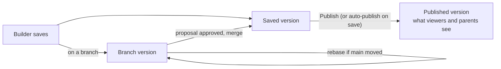

# 01 — Publishing, versions and branching

*Sources: [Publishing and versioning](https://www.palantir.com/docs/foundry/workshop/versions/) · [Branching Workshop modules](https://www.palantir.com/docs/foundry/workshop/branching-integration/) · [Changelog panel](https://www.palantir.com/docs/foundry/workshop/changelog/) · [Add Workshop application to a Marketplace product](https://www.palantir.com/docs/foundry/workshop/marketplace-workshop/) · checked October 18, 2026 · Ready for Review*

**[Concept]** A module has three layers of "which version": **saved** versions (every save), the **published** version (what viewers get), and **branches** (isolated work that merges back to main through a proposal). Getting them straight is most of shipping a module safely.

## Saving and publishing

**[Docs]** The **Versions** dialog lists every saved version (time, editor, description). For each you can **publish** it, **view** it (with a warning banner if unpublished) or **revert** to it (saved as a new version with a generated description). Two settings live there:

- **Automatically publish when saving**: if on, every save reaches viewers.
- **Always prompt to add a version description when saving**.

**[Docs]** To edit an older version without losing the latest: turn auto-publish off, revert to the old version, *File › Duplicate File*, revert the original back to the newest version, and edit the duplicate.

**[Docs]** A URL with `/dev/` instead of `/latest/` opens the last **saved** version ([02-04](../02-workshop-data-and-logic/04-embedding-modules.md#the-module-interface)), and embedded modules always use the child's **published** version.

**[Recommendation]** Turn auto-publish **off** for any module people work in. Then "save" means "save my work" and "publish" means "ship it", and a half-finished edit can't reach Ama's team mid-shift.

## The Changelog panel

**[Docs]** Compares versions, either a **range** (start to end) or a **single** version against the one before. Each node is one of five change types: **changed**, **addition**, **deletion**, **moved**, or **made unused** (a widget taken off the canvas but kept in *Unused widgets*). Nodes open to a JSON diff, and a hierarchy shows which section contains which changed widget.

**[Recommendation]** When a module "broke yesterday", pick a range from the last good published version to today's, and read the *made unused* and *deletion* nodes first: a removed widget's output variable is often what something else was reading.

## Branching

**[Docs]** Workshop modules join **Global Branching**: switch to a branch, open the module, save. Parts that can't be branched (Quiver dashboards, for example) can't be changed on the branch.

**[Docs]** On a **protected** module, main offers **Save to new branch** instead of *Save and publish*. Changes reach main through a **proposal**; reviewers land on the Changelog tab and approve or reject there.

### Rebasing

**[Docs]** If main changed after you saved on the branch, you must **rebase** before merging. Save first: unsaved edits are lost by a rebase. Then either **Start rebasing** (non-conflicting changes from main are taken automatically; conflicts are shown) or **Reject all changes from main** (the branch replaces main when merged).

**[Docs]** Workshop merges edits to **different** fields automatically (main changes a section title, the branch its colour: both kept). It flags a **conflict** when the same field, variable definition or layout position changed on both, for example the same widget edited twice, a section deleted on main but edited on the branch, or a widget moved to different places. For each conflict, switch between **Latest main**, **Current branch** and **Current session** (your combined edit), then **Resolve**. Saving finishes the rebase.

**[Example]** Daniel adds the Delivery Desk drawer ([03-06](../03-workshop-widgets/06-ai-observability-and-embedding.md#aip-chatbot)) on a branch. Meanwhile a colleague adds an "On hold" metric to the queue's Metric Card on main. Daniel's branch added a "Due today" metric to the same card, so the rebase flags a conflict on that widget. He picks **Latest main**, adds his metric back by hand (the comparison switches to **Current session**), resolves, saves, and merges. Both metrics survive.

## Packaging with Marketplace

**[Docs]** Add a module to a Marketplace product as a file output; DevOps finds its dependencies. Everything generally available is supported **except static or object-backed scenarios**. Turn on **Installation configuration** in the module's settings to get:

- the **packaging linter** (errors appear top right after about 5–10 seconds): unresolved object-type properties on variables (fix: set the type through the variable's module interface setting), deleted or renamed properties and primary keys, custom widgets not set up for packaging, and **Resource List** widgets, whose Compass resources must be added as dependencies by hand;
- **installation parameters**: strings (for example a title with the installer's organisation name) and Booleans (show or hide content), connected to variables.

**[Example]** Kestrel ships the Delivery Desk queue from `kestrel-dev` to `kestrel-test` and `kestrel` as a product, adding the app first as the furthest-downstream resource ([Ontology 14-04](../../Ontology/14-lifecycle-and-operations/04-marketplace-packaging.md)). A string installation parameter sets the header title ("Delivery Desk queue (TEST)" in test), so nobody mistakes the test install for production.

---
[Module index](README.md) · Next: [02 — Performance](02-performance.md)
