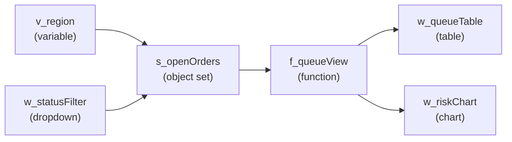

# 03 — Functions, variables and Handlebars

*Sources: [Logic overview](https://www.palantir.com/docs/foundry/slate/logic-overview/) · [View application dependencies](https://www.palantir.com/docs/foundry/slate/applications-dependencies/) · [Understand dependencies](https://www.palantir.com/docs/foundry/slate/best-practices-app-functionality/) · [Define and run Slate functions](https://www.palantir.com/docs/foundry/slate/concepts-functions/) · [Convert between row and column schemas](https://www.palantir.com/docs/foundry/slate/references-convert-rows-columns/) · [Store values in variables](https://www.palantir.com/docs/foundry/slate/concepts-variables/) · [Access values with Handlebars](https://www.palantir.com/docs/foundry/slate/concepts-handlebars/) · [Handlebar helpers](https://www.palantir.com/docs/foundry/slate/references-helpers/) · checked October 18, 2026 · Ready for Review*

**[Concept]** A Slate app is a **graph**. Every widget, query, function and variable is a node that evaluates to JSON. A `{{reference}}` from one node to another is an edge. When a node's value changes, Slate re-evaluates whatever depends on it. Learning Slate is mostly learning to read and shape this graph.

## The dependency graph

**[Docs]** Rules the docs stress:

- **The graph is the app.** If the Dependencies view shows something that seems wrong, find out why; don't assume the view is wrong.
- **It's lazy.** A node re-evaluates only when an upstream value **changes**. Setting a variable to the value it already has does nothing downstream: no query rerun, no re-render. Reset patterns work around this by adding "entropy" such as `Math.random()` ([04](04-events-and-interaction.md#reset-to-defaults)).
- **It's acyclic.** Slate stops you from configuring loops, but events that set variables or run queries can still create one, with non-deterministic results.
- **On page load the whole graph resolves.** Every query with no upstream query runs at once, which is the usual cause of slow loads and timeouts ([06](06-troubleshooting-and-query-performance.md)).

**[Docs]** The **Dependencies** viewer draws the graph, minus function libraries and styles. Highlight a node's neighbours, upstream or downstream chain, or show it as a hierarchy. The expanded table adds performance columns:

- **Time in node**: for queries, server time plus latency plus queueing. Chrome runs **six** queries at once, so a seventh waits. For functions, setup plus computation.
- **Server time**: queries only.
- **Load time**: from the first node starting to this node finishing.

## Slate functions

**[Docs]** Slate functions are JavaScript snippets for **data transformation only**:

- no DOM access, no Slate state, nothing saved between runs;
- async syntax is supported, but functions run **one at a time from a queue**, so a long `await` delays every function behind it;
- bundled libraries: **Lodash, Math.js, Moment, Numeral, es6-shim**. Add others per app in the Functions panel, or platform-wide through the admin panel;
- **function libraries** hold reusable pure JavaScript shared across the app's pages. They can't contain Handlebars; pass values in as parameters;
- a function with no inputs doesn't rerun on recalculation: Slate returns the cached result. To rerun on a schedule, give it an input that changes, such as a timer variable.

**[Docs]** Slate functions are not **Foundry Functions**, which live in repositories and are available platform-wide ([02](02-reading-and-writing-data.md#reading-the-ontology)). The docs advise against calling `f_name.run` from events: update an upstream dependency instead and let the graph rerun the function.

**[Recommendation]** Return **one object with several fields** instead of writing one function per value. The docs' pattern derives all display columns in one function that keeps the query's column structure, so widgets can reference `{{f_deriveDisplayColumns}}` in place of `{{q_myQuery}}`.

**[Docs]** Widgets such as charts and tables expect **parallel arrays** (one array per column), not a list of row objects. The row/column conversion page gives the two Lodash helpers to convert between them.

**[Example]** `f_queueView` takes the rows from `ff_atRiskOrders` ([02](02-reading-and-writing-data.md#reading-the-ontology)) and returns `{ columns, statusClasses, counts }`. `columns` are the parallel arrays for the table, `statusClasses` the CSS class for each row ([05](05-styles-and-widgets.md#dynamic-styles)), and `counts` the numbers for the header. Three widgets read one node.

## Variables

**[Docs]** Variables hold app state, inputs and defaults. Their type is inferred from the default value: Number, String, Boolean, Array, Object or Null. Scope is **shared** (all pages; names unique app-wide) or **local** (one page).

- **Values reset on reload.** Only the user storage variable persists.
- **Set** a variable with its `.set` action from an event, returning the new value. The old value is still readable as `{{name}}` during the event.
- **URL parameters** override defaults (`?v_region=EMEA&v_tab=2`). They're case-sensitive and always arrive as **strings**.
- **Tabular variables** hold column-oriented JSON, edited in a spreadsheet view or loaded from CSV. They count towards the app's **2 MB** size limit (the FAQ gives the save limit as 2,000,000 bytes of JSON), so fetch large data with queries or the OSDK instead.
- **Marketplace parameters**: local variables on the home page only ([01](01-slate-apps.md#import-export-save-as-and-marketplace)).

**[Docs]** Two system variables can't be set from the URL:

| Variable | Holds | Notes |
|---|---|---|
| `$global` | `locale`, `app.isEditMode`, `app.rid`, user attributes (`user.email`, `user.groups`, `user.id`…), `window.origin` | Read-only environment information |
| `sl_user_storage` | Per-user value kept across loads | **10 kB**; set with `slate.setUserStorage`; `slate.refreshUserStorage` pulls changes from other tabs. It may not be loaded when `slate.ready` fires, so initialise from it on `slate.userStorageChanged` |

**[Example]** Ama's team wants the queue to remember each agent's preferred region and sort column. That's two fields in `sl_user_storage`, read on `slate.userStorageChanged`. A link from a team-lead dashboard that opens the queue pre-filtered uses `?v_region=EMEA` instead, and the function converts the string where needed.

## Handlebars

**[Docs]** `{{ }}` templates read variables (`{{var1.a.[0]}}`), query results (with a hidden `_response` metadata field), function results and widget **leaf** properties. How they're replaced depends on where they are:

| Where | Replaced with | Helpers? |
|---|---|---|
| **Queries** | Always a **string**. Objects become `[object Object]` unless you use `jsonStringify` | Yes |
| **Functions** | The **evaluated value** | **No** helpers. You can't set state from a function |
| **Widget properties** | A string, unless the template is the **only** content of the value, with no other characters or spaces; then the raw value. Wrap templates in `""` because braces aren't valid JSON | Yes |
| **Events** | Event JavaScript reads values; `{{slEventValue}}` and `{{slDisableAction}}` are special ([04](04-events-and-interaction.md)) | **No** helpers |
| Variables editor, Styles editor, view mode | Not evaluated | — |

**[Docs]** Helper families:

- **built-in** Handlebars helpers: `if`, `unless`, `each`;
- **core** helpers, in queries and widgets: conversions (`toString`, `toNumber`, `jsonParse`, `jsonStringify`), maths (`add`, `max`…), comparisons (`eq`, `lt`…), `concat`, `substring`, `contains`, `lookup`, `and`/`or`/`not`, URI encoding, selected display values;
- **widget** helpers, in widgets only;
- **Foundry** helpers, in Foundry queries only;
- **SQL** helpers, in SQL queries only ([02](02-reading-and-writing-data.md#queries)).

Comparison helpers throw "type mismatch" when given arrays or mixed types.

**[Recommendation]** Keep logic out of templates. A `{{#if}}` in a query is fine for guarding a null; anything longer belongs in a function, which you can test and the debugger can stop in ([06](06-troubleshooting-and-query-performance.md)).

---
[Module index](README.md) · Previous: [02 — Reading and writing data](02-reading-and-writing-data.md) · Next: [04 — Events and interaction](04-events-and-interaction.md)
