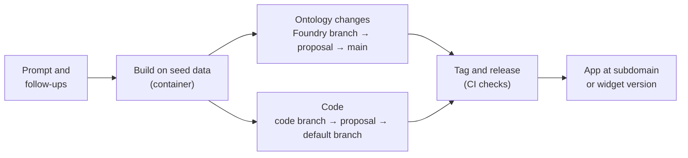

# 02 — Building and shipping with Pilot

*Sources: [Branches, changes, and proposals](https://www.palantir.com/docs/foundry/pilot/branches-and-proposals/) · [Build an application](https://www.palantir.com/docs/foundry/pilot/build-an-application/) · [Build a custom widget](https://www.palantir.com/docs/foundry/pilot/build-a-widget/) · [Deploy an application](https://www.palantir.com/docs/foundry/pilot/deploy-an-application/) · [Deploy a custom widget](https://www.palantir.com/docs/foundry/pilot/deploy-a-widget/) · [Troubleshooting](https://www.palantir.com/docs/foundry/pilot/troubleshooting/) · checked October 18, 2026 · Ready for Review*

**[Concept]** A Pilot build has **three things to ship**, and they travel separately:

1. **Ontology definitions** Pilot proposed, through a **Foundry branch** and a Global Branching proposal.
2. **Code**, through **code branches** and code proposals in the app's repository.
3. A **release**: a tag that CI builds, published to Developer Console (apps) or the Widget Registry (widgets).

Merging one doesn't do the others. The docs say it directly: a code proposal alone doesn't publish the app, deploy the Ontology or change the preview's data source.

## The build loop

**[Docs]** What a build produces:

- **Ontology**: the ontology architect searches for existing entities first, then proposes object, action and link types, explaining each in the chat. Attach the entities you mean, so it picks the right ones.
- **Design**: with Custom components, a specification (palette, typography, layout, interaction patterns). With Blueprint, no separate specification.
- **Front end**: a React app using OSDK hooks, with create, update, filter and delete components.
- **Seed data** in the container, so production values aren't hard-coded into the code.

Iterate with follow-up prompts, direct edits in the Code tab, uploaded references, or a different model or mode. **Fix with Pilot** appears on build errors.

**[Docs]** Widget builds differ in a few ways:

- Pilot defines **parameters** and **events** as it builds ([06-04](../06-osdk-react-and-custom-widgets/04-custom-widgets-in-workshop.md#parameters-and-events)).
- The preview runs in Workshop's widget sandbox. **Configure widget** sets test parameter values, and **Reload widget dev mode** applies parameter or event changes.
- The widget reads and writes with the **viewing user's** permissions.
- Several widgets in one project publish as one widget set.

## Branches, versions and proposals

**[Docs]** Code work in Pilot:

- **Code branches** come from the selector in the content header. Save or discard changes before switching.
- **Versions**: `v5*` means unsaved. Save, discard, and **roll back** to a saved version; on a protected branch, rollback creates a new branch instead. A saved version **isn't a release**.
- **Code proposals** come from the **Changes** tab, with title and description. Reviewers comment on files or lines, and *Address all comments with Pilot* makes the requested changes. **Update branch with Pilot** resolves conflicts. Merge once checks and the approval policy pass.
- **Protected branches** accept changes only through proposals, and block direct edits and Ontology-permission changes. Plans can still be made there and implemented on a new branch.

**[Explanation]** For Kestrel, protect the default code branch of any Pilot-built app. Then Pilot's act mode can't push straight to what gets released, and every change gets a human review, the same way Ontology changes do.

## Shipping an application

**[Docs]** Check the status indicator first. **Deployability** reports only an Ontology dry run. Type-checking and edit-permission errors show separately in the Ontology tab, and dependency, dev-server and CI errors are separate again. Switch to the repository's **default code branch**, then open **Deploy**. Three steps:

**1. Implement Ontology entities.** Proposed entities must reach main before the hosted app can use them. Pilot creates a **deployment branch** (Global Branching must be enabled), pushes the definitions and indexes them. You test in the Deploy view against real data on that branch, where action edits stay on the branch. Then **View branch → Create proposal → Merge proposal** in Global Branching, and switch back to main. Approval is automatic or manual depending on the enrollment's configuration.

**[Explanation]** That proposal is an ordinary Global Branching proposal ([Ontology 14-02](../../Ontology/14-lifecycle-and-operations/02-branching-and-proposals.md#day-5--proposal-and-review)). If the new types land in a protected project such as `Commerce [Ontology]`, Kestrel's custom policy applies: two approvals from *ontology-governance*, and the contributor can't approve their own change. The contributor would be the person running Pilot, so they couldn't approve it themselves. Whether every Pilot-created entity lands in a protected project depends on the save location; see [RQ-07](../SOURCES.md#open-research-questions).

**2. Configure application and subdomain.** Give the Developer Console app a name and organization, and choose a subdomain (`<subdomain>.<enrollment>.palantirfoundry.com`). Pilot creates the app and sets its **restrictions** to the needed object and action types. An enrollment administrator approves the subdomain in **Control Panel → Approvals**; timelines vary, and some enrollments add a security review.

**3. Pass CI checks, then tag and release.** *Generate deployment files* writes `.env.production`, `ci.yml`, `foundry.config.json` and build scripts. Wait for **SUCCEEDED** on the commit you'll release, then **Tag and release** with a patch, minor, major or custom version. A tag doesn't mean the site is up: follow the release build to the end.

**[Docs]** On first visit, users see an **OAuth consent screen** for the app's Ontology entities and media datasets.

**[Docs]** Permissions needed:

- **Editor** on the project;
- permission to create the Developer Console app and its OAuth client (usually **Third-party application administrator**);
- someone with domain-approval rights;
- no markings on the project that block dataset creation.

The token model behind this is in [Ontology 10-04](../../Ontology/10-applications/04-osdk-and-apis.md).

### Two traps after the first release

**[Docs]** **Submission criteria**: actions Pilot creates allow only **the user who created them** to submit them. Change that in Ontology Manager before anyone else tests the app.

**[Docs]** **Action RIDs** can differ between the deployment branch and main. If the app breaks after the merge, switch to main and ask Pilot to update the action references.

**[Recommendation]** Before the first release, check the generated action types against [Ontology 08-03](../../Ontology/08-actions/03-submission-criteria.md) and [08-06](../../Ontology/08-actions/06-action-permissions.md) as you would hand-written ones. The default criteria are safe for a prototype, but they aren't the criteria your users need.

## Shipping a widget set

**[Docs]** Deploying a widget set skips Developer Console and the subdomain:

1. Merge code into the default branch.
2. Implement any Ontology changes, as for an app.
3. **Generate SDK** (or update or regenerate it), then install it until the panel shows *On latest*. A working local preview doesn't prove the production SDK includes the new entities.
4. Pass CI.
5. **Tag and release**: CI publishes a new widget set version to the Widget Registry.
6. Add the widget in Workshop and bind its parameters and events.

**[Docs]** As with any widget set, existing modules keep their configured version until updated ([06-03](../06-osdk-react-and-custom-widgets/03-custom-widget-sets.md#publish)). **Pause or stop dev mode** before checking the release: choosing a version doesn't turn off your personal override.

## Troubleshooting

| Symptom | Check |
|---|---|
| Actions in the preview changed real data | The preview was on **Production data** on main. That's expected; test on a deployment branch |
| Widget invisible in Workshop | Row height *Auto (max)* gives a fill-the-container widget zero height; use *Flex* or *Absolute* ([06-04](../06-osdk-react-and-custom-widgets/04-custom-widgets-in-workshop.md#fitting-into-the-page)) |
| Widget preview blank or blocked | Browser console first. A CSP violation means an administrator must allow the container origin; *Unable to load widget preview* can be a timeout |
| Parameter changes not showing | **Reload widget dev mode** |
| Not deployable | Deployability (dry run), then the Ontology tab, then dependency, server and CI errors: each is reported separately |
| Container won't start or shows *Disconnected* | Refresh; check the status popover and diagnostics logs |
| npm install failed | *Fix with Pilot*, the logs, or ask Pilot to reinstall dependencies |
| A control is disabled | Pilot is busy, the branch is protected or deleted, the repository or enrollment lacks the feature, or no model is available |

**[Example]** For Lena's line matcher ([01](01-what-pilot-is.md#steering-it)), the route is the widget path:

1. If she lets Pilot propose *Match line to shipment*, that action goes through the Global Branching proposal and Kestrel's review.
2. Its submission criteria are widened from the creator alone to her team.
3. The SDK is regenerated so the widget sees the action.
4. A tagged release, then the Workshop module owner selects the new version and republishes the module.

Until step 4, the agents' module still shows the read-only version.

---
[Module index](README.md) · Previous: [01 — What Pilot is](01-what-pilot-is.md) · Next module: [08 — Automate](../08-automate/README.md)
