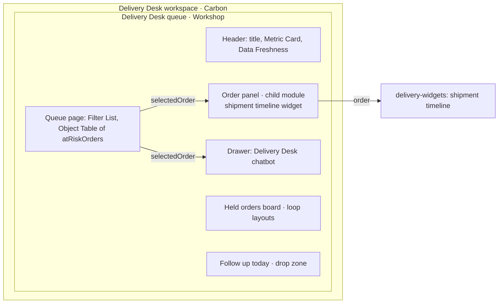

# 01 — The Delivery Desk queue, built out

*Sources: no new doc pages; every row links to the note that holds the docs' wording · written October 21, 2026 · Ready for Review. Everything here is **[Example]** unless a line says otherwise.*

The queue started in [Ontology 10-03](../../Ontology/10-applications/03-workshop-and-slate.md) as one page: at-risk orders, a panel, two buttons. Modules 01–09 each added a piece. This page is the **assembled record**: what the module contains, which note decided each piece, and what's still open.

**The decision it serves:** which at-risk orders Ama's agents act on today, and how (hold, re-route, contact the customer). That's step 1 of the docs' operational-app checklist ([00-01](../00-orientation/01-operational-applications.md)).

## The structure

## What's in it, and who decided

| Piece | Decision | Note |
|---|---|---|
| Variables | `atRiskOrders` (Order: PAID, PICKING or ON_HOLD, promised within 3 days), `orderFilters`, `selectedOrder`, `customerCases` (interface `Case`) | [01-03](../01-workshop-foundations/03-variables-and-interfaces.md) |
| Layout and design | *Hold order* primary, *Re-route shipment* de-emphasised; a count in the section header; action forms in modals; the panel as a collapsible section | [01-05](../01-workshop-foundations/05-design-best-practices.md) |
| Permissions | Agents and Kofi see what the Ontology lets them; Kofi's region filter doesn't travel with exports, so CSV export stays off | [01-04](../01-workshop-foundations/04-permissions.md), [03-01](../03-workshop-widgets/01-core-display-widgets.md) |
| *Hold order* | `order` defaulted from `selectedOrder` and disabled; `reason` picked; criteria (CS agents; not SHIPPED or DELIVERED) come with the action. Afterwards, clear the selection and collapse the panel; held orders stay listed | [02-01](../02-workshop-data-and-logic/01-actions-in-workshop.md) |
| Bulk holds | Inline Action table pre-filled from a multi-selection, one row per order | [03-05](../03-workshop-widgets/05-buttons-forms-and-navigation.md) |
| Risk column | Function-backed column of the latest shipment's `deliveryRisk`, with runtime input so only the visible page is scored | [03-01](../03-workshop-widgets/01-core-display-widgets.md) |
| Customer metric | *Open orders for this customer*, a TSv2 count on the server | [02-02](../02-workshop-data-and-logic/02-functions-and-derived-properties.md) |
| Filtering | Linked filter Order → Shipment for carrier; date window shared with shipments through filter value extraction | [03-04](../03-workshop-widgets/04-filtering-widgets.md), [02-03](../02-workshop-data-and-logic/03-variable-types.md) |
| Order panel | A child module (`order`), also embedded in the re-route review page; carries the **shipment timeline** widget | [02-04](../02-workshop-data-and-logic/04-embedding-modules.md), [06-04](../06-osdk-react-and-custom-widgets/04-custom-widgets-in-workshop.md#kestrel-the-shipment-timeline) |
| Held orders board | Three loop layouts, one per hold reason | [02-04](../02-workshop-data-and-logic/04-embedding-modules.md) |
| Chatbot | Delivery Desk in a drawer, `selectedOrder` mapped to its application variable; drawer kept mounted | [03-06](../03-workshop-widgets/06-ai-observability-and-embedding.md), [04-02](../04-workshop-in-production/02-performance.md) |
| Freshness | Data Freshness for Order and Shipment in the header | [03-03](../03-workshop-widgets/03-media-documents-and-history.md) |
| Live data | Auto-refresh on `atRiskOrders`, plus a zero-size Object Set Title so Shipment changes refresh too; paused while Comments is open | [04-02](../04-workshop-in-production/02-performance.md) |
| Saved queues | States such as *DHL at risk* save `orderFilters` and the column layout, in `Delivery Desk [Workflow]/Saved queues` | [04-03](../04-workshop-in-production/03-routing-state-and-presentation.md) |
| Shared links | Routing on; `selectedOrder` in the module interface, so a link opens the same order (first-row behaviour untested) | [04-03](../04-workshop-in-production/03-routing-state-and-presentation.md) |
| Follow-ups | A drop zone writing `followUps`, kept only if saved in state | [04-04](../04-workshop-in-production/04-cross-application-interactivity.md) |
| Health page | Observability Charts for `draftDelayMessage` and *Hold order* | [03-06](../03-workshop-widgets/06-ai-observability-and-embedding.md) |

## Shipping and operating it

| Concern | Decision | Note |
|---|---|---|
| Changes | On branches; rebase conflicts resolved per widget | [04-01](../04-workshop-in-production/01-publishing-versions-and-branching.md) |
| Environments | A Marketplace product from `kestrel-dev` to `kestrel-test` and `kestrel`; an installation parameter labels the test header | [04-01](../04-workshop-in-production/01-publishing-versions-and-branching.md) |
| Widget versions | The Order panel pins a `delivery-widgets` version; a new release reaches agents only when Daniel selects it and republishes the panel. Workflow Lineage can bulk-upgrade custom widgets across modules | [06-03](../06-osdk-react-and-custom-widgets/03-custom-widget-sets.md#publish), [10-01](../10-workflow-tools/01-workflow-lineage.md#bulk-changes) |
| Usage | Usage metrics show *Customer cases* and *Re-route shipment* barely used from the queue: candidates to remove | [04-02](../04-workshop-in-production/02-performance.md) |
| Debugging | Workflow Lineage on the queue: *Debug permissions* for *I can't hold this order* | [10-01](../10-workflow-tools/01-workflow-lineage.md#security-and-debugging) |
| Delivery to users | The anchored module in the Delivery Desk workspace, discoverable from Object Explorer for `Order` sets | [11-03](03-delivery-desk-workspace.md) |

## Open items

- **[Explanation]** The *Pick riskiest order → Hold* shortcut needs two clicks, because the form reads a variable computed from `selectedOrder` ([01-02](../01-workshop-foundations/02-layouts-widgets-and-events.md)).
- Whether a shared link selects the linked order or the table's first row is **untested** ([04-03](../04-workshop-in-production/03-routing-state-and-presentation.md)).
- The timeline widget's live updates depend on [RQ-06](../SOURCES.md#open-research-questions).

---
[Module index](README.md) · Next: [02 — Kofi's warehouse-floor module](02-warehouse-floor-mobile.md)
