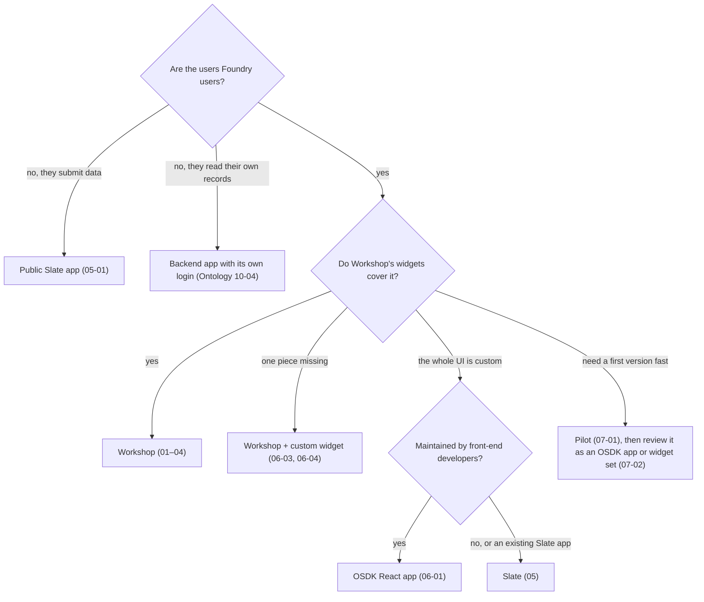
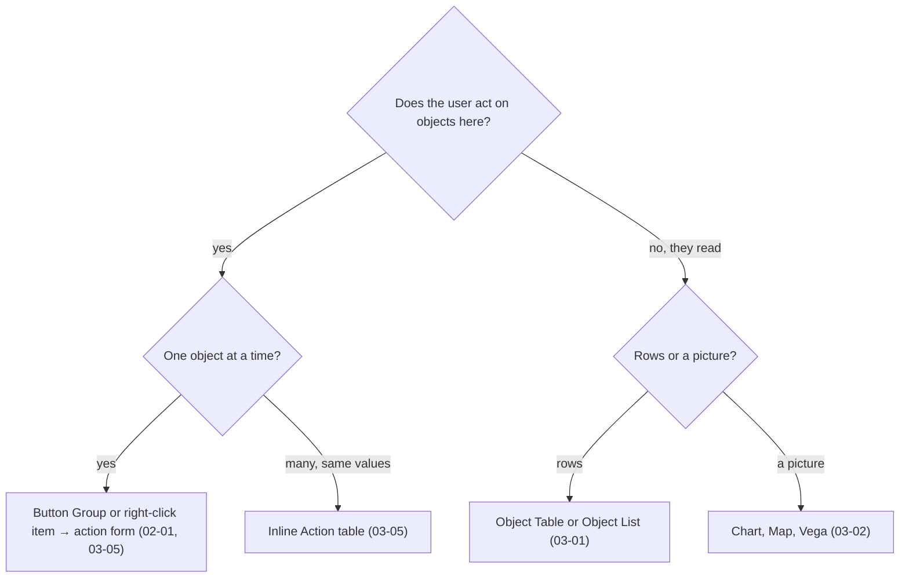
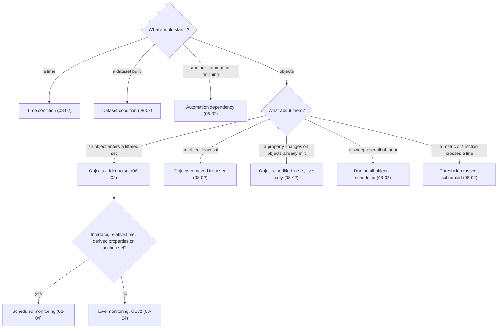
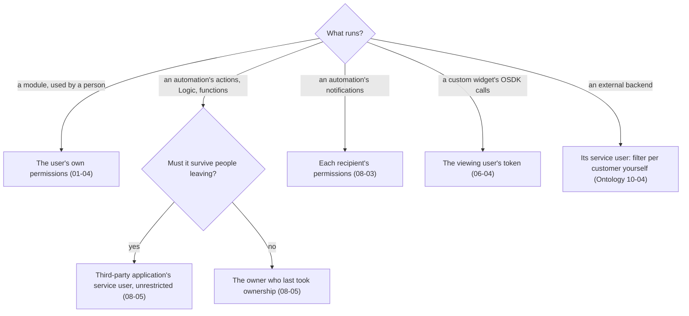
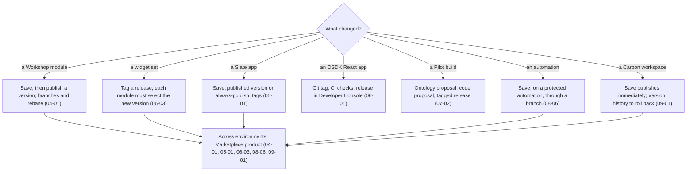

# Decision guide

*Sources: the notes each branch links to · compiled October 21, 2026 · Ready for Review. The flowcharts are ours; every leaf links to the note with the docs' wording.*

Five decisions that come up on almost every application project, as flowcharts. Each ends at the note to read next.

## 1. Which builder?

[00-02](../00-orientation/02-choosing-a-builder.md) · [07-02](../07-pilot/02-building-and-shipping.md) · [05-01](../05-slate/01-slate-apps.md) · [06-01](../06-osdk-react-and-custom-widgets/01-osdk-react-apps.md) · [06-03](../06-osdk-react-and-custom-widgets/03-custom-widget-sets.md) · [07-01](../07-pilot/01-what-pilot-is.md)

## 2. Which widget?

The [widget finder](../03-workshop-widgets/README.md) in module 03 maps needs to widgets. Two questions decide most cases first:

[01-02](../01-workshop-foundations/02-layouts-widgets-and-events.md) · [02-01](../02-workshop-data-and-logic/01-actions-in-workshop.md) · [03-01](../03-workshop-widgets/01-core-display-widgets.md) · [03-02](../03-workshop-widgets/02-charts-and-maps.md) · [03-05](../03-workshop-widgets/05-buttons-forms-and-navigation.md)

## 3. Which Automate condition?

[08-02](../08-automate/02-conditions.md) · [08-04](../08-automate/04-execution-settings.md#evaluation-frequency)

## 4. Whose identity does it run as?

[01-04](../01-workshop-foundations/04-permissions.md) · [06-04](../06-osdk-react-and-custom-widgets/04-custom-widgets-in-workshop.md#the-osdk-inside-a-widget) · [08-03](../08-automate/03-effects.md#notifications) · [08-05](../08-automate/05-security-ownership-and-history.md)

## 5. How does a change reach users?

[04-01](../04-workshop-in-production/01-publishing-versions-and-branching.md) · [05-01](../05-slate/01-slate-apps.md#versions-tags-and-merging) · [06-01](../06-osdk-react-and-custom-widgets/01-osdk-react-apps.md#building-one) · [06-03](../06-osdk-react-and-custom-widgets/03-custom-widget-sets.md#publish) · [07-02](../07-pilot/02-building-and-shipping.md) · [08-06](../08-automate/06-operating-automations.md#branches-scenarios-and-marketplace) · [09-01](../09-carbon-workspaces/01-carbon-workspaces.md#creating-and-editing)

---
[Module index](README.md) · [Limits and thresholds](limits-and-thresholds.md) · [Docs index](docs-index.md)
