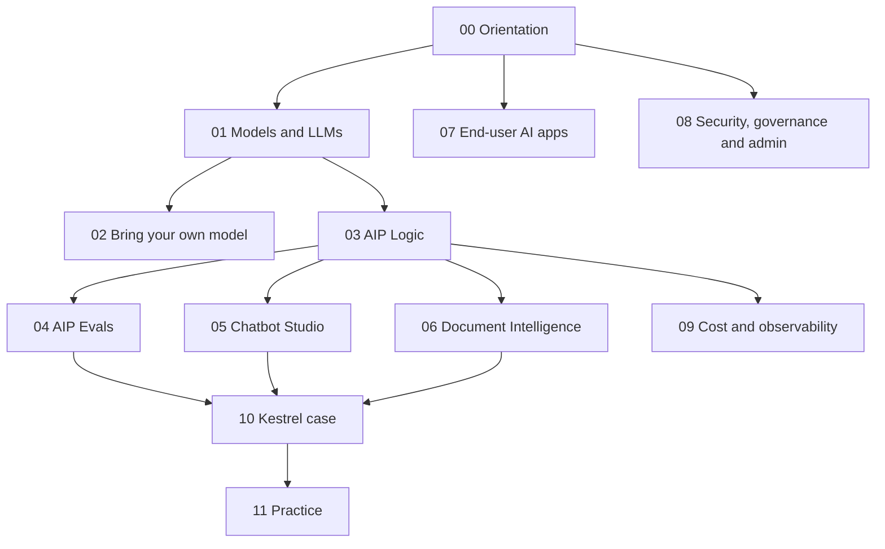

# AIP

A course and working reference for **Palantir AIP**, the AI Platform section of the Foundry docs. Every page in that section is covered here or, where the Ontology area already explains it, pointed to.

| | |
|---|---|
| Structure | Created October 7, 2026 (Phase 2). Modules 00–09 written October 8, 2026 (Phases 3–5); case, practice and reference pages October 14 (Phase 6). Built from scratch from the official docs; the previous compiled reference was set aside, see [MIGRATION](MIGRATION.md) |
| Notes written | 44 of 44: modules [00](00-orientation/README.md)–[09](09-cost-and-observability/README.md), the [Kestrel case](10-kestrel-case/README.md), [practice](11-practice/README.md) and [reference](99-reference/README.md) pages. Module READMEs list every planned note and the official pages it covers |
| Scope | The 95 pages of the docs' *AI Platform (AIP)* sidebar, counted in the browser on October 7, 2026 ([docs index](99-reference/README.md)). AIP features documented in other sections (LLMs in Pipeline Builder and transforms, Palantir MCP, Automate) are outside this area |
| Sources | Official Palantir documentation first. Register, corrections and open questions: [SOURCES](SOURCES.md) |
| Quality | Reviewed October 14, 2026: 116 doc quotes re-matched against the 95 live pages (2 quote fixes), 50 limit values re-verified, 18 diagrams parsed, links clean. Details and known limitations: [QUALITY-REVIEW](QUALITY-REVIEW.md) |
| Why it matters | Exam domain 7 of the Application Developer Associate guide is AIP Logic and AI-powered applications, and domain 3 asks when to use AIP Logic instead of code |

## How this area relates to the Ontology area

The [Ontology area](../Ontology/README.md) explains AI from the data model's side in [module 16](../Ontology/16-ai-and-agents/README.md): what an agent can see, the tools it gets, and how its writes are staged and reviewed. This area explains the AIP products themselves. Where an AIP docs page is already explained in the Ontology area, the module README links there under *Covered in the Ontology area* and the note is not repeated.

## Learning path

| # | Module | What you learn | Status |
|---|---|---|---|
| 00 | [Orientation](00-orientation/README.md) | AIP's parts, builder tools vs end-user apps, Kestrel's AI workload | **Ready for Review** |
| 01 | [Models and LLMs](01-models-and-llms/README.md) | Supported LLMs, the Model Catalog and deprecation, provider-compatible APIs, prompting | **Ready for Review** |
| 02 | [Bring your own model](02-bring-your-own-model/README.md) | REST, compute-module, self-hosted and proxied models; the legacy route | **Ready for Review** |
| 03 | [AIP Logic](03-aip-logic/README.md) | Logic functions, blocks, execution modes, branching, metrics, cost | **Ready for Review** |
| 04 | [AIP Evals](04-aip-evals/README.md) | Suites, evaluators, intermediate parameters, experiments, results | **Ready for Review** |
| 05 | [AIP Chatbot Studio](05-chatbot-studio/README.md) | Building, sharing and operating chatbots | **Ready for Review** |
| 06 | [AIP Document Intelligence](06-document-intelligence/README.md) | Extraction strategies and where to deploy them | **Ready for Review** |
| 07 | [End-user AI apps](07-end-user-apps/README.md) | Assist, Analyst, AI FDE, Boardroom, Threads, Evolve, Realtime audio | **Ready for Review** |
| 08 | [Security, governance and administration](08-security-governance-and-admin/README.md) | Security and privacy, enabling features, LLM markings, capacity and rate limits | **Ready for Review** |
| 09 | [Cost and observability](09-cost-and-observability/README.md) | AIP compute and observability | **Ready for Review** |
| 10 | [Kestrel case](10-kestrel-case/README.md) | Delivery Desk built and tested; carrier invoices | **Ready for Review** |
| 11 | [Practice](11-practice/README.md) | Review questions tagged by exam domain | Written (not attempted) |
| 99 | [Reference](99-reference/README.md) | Limits, decision guide, docs index | **Ready for Review** |

## Conventions

The same conventions as the Ontology area: the labels **[Docs]**, **[Concept]**, **[Analogy]**, **[Explanation]**, **[Recommendation]**, **[Example]** and **[Observed]**; open questions with an ID in [SOURCES](SOURCES.md#open-research-questions); no fixed note template, only a one-line *Sources* header, labels and footer navigation; self-check questions only in [11 — Practice](11-practice/README.md).

**Names:** the docs' current product names, with a former name mentioned once where it helps, for example *AIP Chatbot Studio (formerly Agent Studio)*.

**Running example:** Kestrel Commerce, as defined in the Ontology area's [reference model](../Ontology/17-case-studies/02-kestrel-reference-model.md). This area builds on the Delivery Desk agent designed in [Ontology 16-03](../Ontology/16-ai-and-agents/03-ontology-tools-for-agents.md) and does not redesign it.

**Course notes stay where they are.** The Speedrun and course notes are records of what each course taught. Module READMEs link to them under *Seen in our courses*.

---
[Learn home](../../README.md) · [Study plan](../../STUDY-PLAN.md) · [Progress](../../PROGRESS.md) · [Ontology area](../Ontology/README.md)
