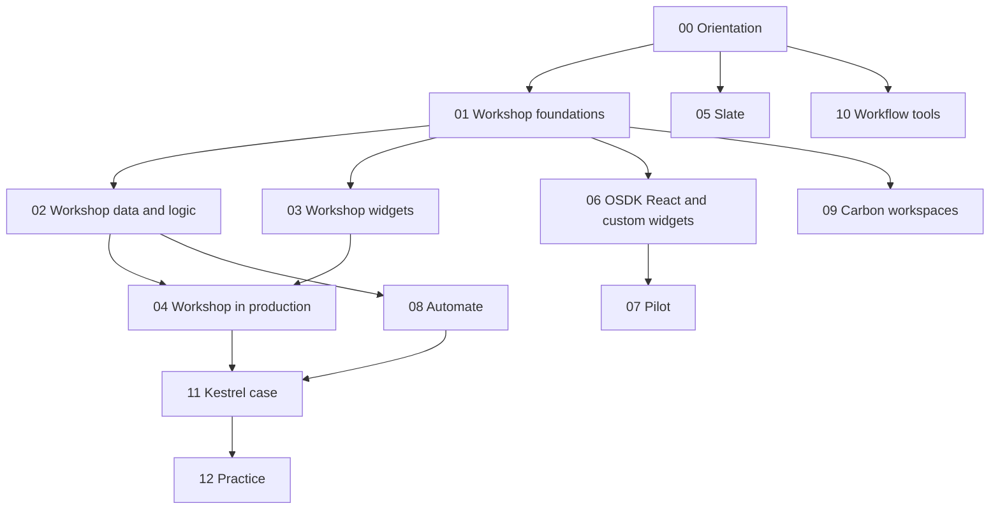

# Apps

A course and working reference for **Use case development**, the part of the Foundry docs about building applications: Workshop, Slate, OSDK React apps, custom widgets, Pilot, Automate, Carbon and the workflow tools around them. Every page in that section is assigned to a planned note here; the [docs index](99-reference/docs-index.md) shows which.

| | |
|---|---|
| Structure | Created October 18, 2026 (Phase 2). Built from the official docs; the course notes listed in each module are linked, not reused as sources. |
| Notes written | **56 of 56** (October 21, 2026): all fourteen modules, the [Kestrel case](11-kestrel-case/README.md), [practice questions](12-practice/README.md) and the [reference pages](99-reference/README.md). Module READMEs list every note and the official pages it covers. |
| Scope | The 315 pages of the docs' *Use case development* sidebar (URL prefix `app-building`), read from the page DOM in the built-in browser on October 18, 2026 ([docs index](99-reference/README.md)). OSDK basics (application registration, OAuth, scopes) sit in the *Developer toolchain* section and are explained in [Ontology 10-04](../Ontology/10-applications/04-osdk-and-apis.md). |
| Sources | Official Palantir documentation first. Register, corrections and open questions: [SOURCES](SOURCES.md) |
| Why it matters | The Application Developer Associate exam's domain 4 is Workshop application development and domain 6 is Automate and operational workflows; parts of domain 5 (external apps) and domain 8 (security and operations) are here too |

## How this area relates to the others

The [Ontology area](../Ontology/README.md) explains what applications **use**: object types, actions, functions, permissions. Its module [10](../Ontology/10-applications/README.md) walks one Workshop app ([10-03](../Ontology/10-applications/03-workshop-and-slate.md)) and one automation ([10-06](../Ontology/10-applications/06-automate-and-ontology-events.md)) from the data model's side. This area explains the **builders themselves**, page by page, and links back to those worked examples instead of repeating them. AI widgets in Workshop link to the [AIP area](../AIP/README.md).

## Learning path

## Modules

| # | Module | What you learn | Status |
|---|---|---|---|
| 00 | [Orientation](00-orientation/README.md) | Operational apps; choosing a builder; Kestrel's apps | **Ready for Review** |
| 01 | [Workshop foundations](01-workshop-foundations/README.md) | Layouts, widgets, variables, events, permissions, design | **Ready for Review** |
| 02 | [Workshop data and logic](02-workshop-data-and-logic/README.md) | Actions, functions, variable types, embedded modules | **Ready for Review** |
| 03 | [Workshop widgets](03-workshop-widgets/README.md) | Every built-in widget, by job | **Ready for Review** |
| 04 | [Workshop in production](04-workshop-in-production/README.md) | Versions, branching, performance, routing, mobile, legacy scenarios | **Ready for Review** |
| 05 | [Slate](05-slate/README.md) | Pages, queries, functions, Handlebars, events, styles, debugging | **Ready for Review** |
| 06 | [OSDK React and custom widgets](06-osdk-react-and-custom-widgets/README.md) | React apps on the OSDK; custom widget sets in Workshop | **Ready for Review** |
| 07 | [Pilot](07-pilot/README.md) | The AI app builder | **Ready for Review** |
| 08 | [Automate](08-automate/README.md) | Conditions, effects, settings, ownership, operations | **Ready for Review** |
| 09 | [Carbon workspaces](09-carbon-workspaces/README.md) | Workspaces, modules, navigation, configuration, Applications Portal | **Ready for Review** |
| 10 | [Workflow tools](10-workflow-tools/README.md) | Workflow Lineage, Autopilot, Solution Designer, Workflow Builder, Use Cases [Sunset] | **Ready for Review** |
| 11 | [Kestrel case](11-kestrel-case/README.md) | Kestrel's apps built out | **Ready for Review** |
| 12 | [Practice](12-practice/README.md) | Review questions tagged by exam domain | **Ready for Review** |
| 99 | [Reference](99-reference/README.md) | Limits, decision guide, docs index | **Ready for Review** |

## Conventions

Same as the Ontology and AIP areas. Each note has a one-line *Sources · checked · status* header and footer navigation; otherwise its shape follows its topic. Labels: **[Docs]** (only real doc wording goes in quote marks), **[Concept]**, **[Explanation]**, **[Recommendation]**, **[Example]**, **[Analogy]**, **[Observed]**. Open questions are numbered RQ-NN in [SOURCES](SOURCES.md). Self-checks live only in [12 — Practice](12-practice/README.md). Examples use **Kestrel Commerce**, as defined in [Ontology 17-02](../Ontology/17-case-studies/02-kestrel-reference-model.md).

---
[Learn home](../../README.md) · [Topic map](MAP.md) · [Sources](SOURCES.md) · [Glossary](GLOSSARY.md)
