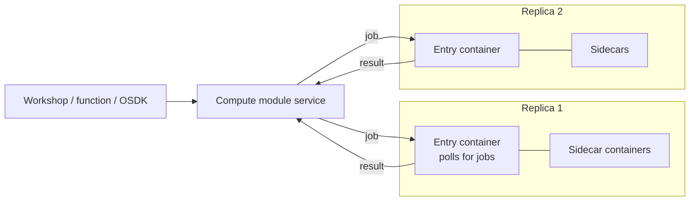

# 01 — Compute module concepts

*Sources: [Compute modules](https://www.palantir.com/docs/foundry/compute-modules/overview/) · [Getting started](https://www.palantir.com/docs/foundry/compute-modules/get-started/) · [Execution modes](https://www.palantir.com/docs/foundry/compute-modules/execution-modes/) · [Functions](https://www.palantir.com/docs/foundry/compute-modules/functions/) · checked October 22, 2026 · Ready for Review*

**[Concept]** A compute module runs **your own Docker image** inside Foundry and scales it horizontally with demand. It's the escape hatch for code that doesn't fit TypeScript or Python functions: an existing code base, another language, or a model you host yourself. Administrators enable it in Control Panel.

## What it's for, and what it isn't

**[Docs]** Three uses:

- **container-backed functions** called from Workshop, Slate or other functions;
- **container-based data integration** into streams, datasets or media sets;
- **hosting custom or open-source models** queried from Foundry apps.

**[Docs]** The case for it: reuse code that would be "risky or expensive to rewrite", any language, dynamic and **predictive horizontal** scaling, and access to Foundry and external systems.

**[Docs]** The page warns against two uses:

- **dynamic vertical scaling**, where single requests vary hugely in size (its example: 1MB to 100GB). Resources per replica are fixed by hand.
- **rebuilding features Foundry already has**, which tends to give a more complicated solution.

## Architecture

**[Docs]** A compute module is a set of **replicas**, whose number follows request volume. Each replica runs the same **one or more containers**:

- one container is the **entry point** and must run a client that "forever polls for events to process" (the SDKs provide it; see [02](02-configuration-and-sdks.md#writing-your-own-client));
- the others can contain anything, and talk to each other over local networking or shared volumes;
- containers **can't talk across replicas**, and you shouldn't rely on state a replica builds up.

## Two execution modes

**[Docs]** The choice is made on the **Configure** page:

| | Function mode | Pipeline mode |
|---|---|---|
| What it does | Hosts logic as **functions** called from Workshop, the OSDK, Developer Console apps or other functions | Reads Foundry **inputs** and writes Foundry **outputs**, for streaming and real-time media |
| Can you query it? | Yes | **No**: it runs on its own; the build system feeds it |
| Identity | **No platform permissions**, or **Application permissions** (a service user) | A **job token** scoped to the declared inputs and outputs |
| Data provenance | — | Tracked in **Data Lineage** through the build system |
| Choose it when | You need an interactive call | Data is sensitive and must follow provenance and marking controls, or you need lineage |

**[Docs]** Function mode details:

- **No platform permissions:** no OSDK or platform APIs at all, but you can still reach external systems through a source.
- **Application permissions:** saving this setting **creates a third-party application** and shows its client ID and service user. The module exchanges `CLIENT_ID` and `CLIENT_SECRET` for a token. Permissions are the same whoever calls the function. Restrict the service user further (for example to some markings) in Control Panel > **Third party applications**, which needs **Manage OAuth 2.0 clients**. Not available on every enrollment.
- Either way, reaching your own Foundry URL needs a **source** with a network policy for it, because egress is off by default ([02](02-configuration-and-sdks.md#sources)).

**[Docs]** Pipeline mode details:

- By default the module can touch **nothing**. Add each input and output explicitly; they must be in the **same project** as the module. Supported: datasets, streaming datasets and media sets.
- The token is in a file named by `BUILD2_TOKEN`; a map of your identifiers to `{rid, branch}` is in the file named by `RESOURCE_ALIAS_MAP`.
- The build system opens transactions on outputs and commits them when the pipeline succeeds.
- No queries arrive, so the autoscaler may scale to **zero**: set **minimum replicas to 1** to keep it running. You don't need a client.

**[Explanation]** The examples on these pages request old-style scopes such as `api:datasets-read`. For a service user created as a Developer Console-style third-party application, the scope rules in [02-01](../02-developer-console-and-apis/01-applications-scopes-and-restrictions.md#api-level-security-and-the-two-scope-prefixes) should apply; prefer `api:use-*` scopes and test what the service user actually gets.

## A first module

**[Docs]** Create one with **+ New > Compute Module** in a folder, then either build locally or in Code Repositories.

**Locally:**

1. Install Docker and Python **3.9+**, Java **21+** or Node.js **18+**.
2. Write a `Dockerfile` that builds for `linux/amd64` and runs as a **non-root numeric user** (`USER 5000`), plus the SDK dependency (`foundry-compute-modules`, `com.palantir.computemodules:lib`, or `@palantir/compute-module`).
3. Register functions in the SDK (Python `@function`, Java `ComputeModule.builder().add(...)`, Node `computeModule.register(...)`).
4. Create an **Artifacts repository** from the module's **Documentation** tab, **Publish to DOCKER**, push.
5. **Configure > Add Container**, pick the image, **Update configuration**, then start the module and test it in the **Query** panel.

**In Code Repositories:** create a **Python Compute Module** repository, write functions in `src/app.py`, add libraries in **Settings > Libraries** or `meta.yaml`, **Tag version** to build the image, link it under **Add Container**, then **Functions > Import** once the module is running.

**[Docs]** Every function receives a **context** (metadata and credentials, such as a user token for OSDK calls) and an **event** (the parameters). The result travels as JSON, so it must be serialisable.

## Functions: registering and typing

**[Docs]** In function mode, functions must be **registered** before Foundry can call them. Three ways:

- **Manually** on the **Functions** page: name, inputs (packed into one JSON object), output, and an **API name** in the form `com.<namespace>.computemodules.<MyApiName>` (lower-case namespace, camel-case name). Changing the API name breaks callers.
- By **posting a JSON schema** from the module at start-up (needed for custom clients).
- By **automatic inference** from typed SDK code, then **Functions > Import**. Imported schemas appear only once the module is **running and responsive**.

**[Docs]** Compute module functions are always registered as version **`0.0.0`**; an update overwrites it. **[Explanation]** There's no version pinning, so treat the API name and its schema like a public API, the same discipline as API-gateway queries ([Ontology 09-02](../../Ontology/09-functions/02-query-functions-and-ontology-edits.md#queries-and-the-api-gateway)).

**[Docs]** For inference in Python, the input must be a **complex type**: a `TypedDict`, a `dataclass`, or a class with type hints on both the class **and** the constructor. Classes without class-level hints, or with `*args` or `**kwargs` in the constructor, raise an exception. Wrap a single primitive input in a complex type.

**[Docs]** How types travel over HTTP: `Timestamp` as milliseconds since epoch (int); `Date`, `Decimal`, `Byte` and `Binary` as strings; arrays as JSON arrays, or a stream of JSON when streaming; maps and structs as JSON.

**[Explanation]** The Python type table maps `str` to Foundry **Byte**. That looks like an error for String (the file-plugin type list has `string`); check the imported schema before relying on it.

**[Docs]** **Streaming** output: `@function(streaming=True)` with any `Iterable` (except `dict`) as the return type, registered as an Array. A **generator without** `streaming=True` registers fine but **throws when executed**, because it can't be serialised as one JSON value.

## Other ways in

**[Docs]** **Integrate a server** (experimental): run a plain HTTP server and attach an **OpenAPI 3.0+** spec as the image label `server.openapi`, then **Detect from OpenAPI specification**. The spec must have one `http://localhost:port` server, an `operationId` per operation (the function name), only `GET`/`PUT`/`POST`/`DELETE`, schemas on every parameter (no cookies), no `anyOf`/`oneOf`/`allOf`, and **one** `application/json` response per endpoint. Don't edit the detected functions by hand.

**[Docs]** **Functions CLI**: a standalone binary that infers function specs from source (`functions-cli infer --opt functions --plugin python_cm --dir ./src`), or reads them from a JSON file, and builds and publishes images from a plan file. It can authenticate with an OAuth client or a token, bump tags with `-t`/`-tt`/`-ttt`, and build without Docker using the **GoCR** engine, which suits CI without Docker-in-Docker.

## Calling a compute module function from TypeScript

**[Docs]** Set `enableResourceGeneration: true` in `functions.json`, then **Resource imports > Add > Query Functions**, pick any Ontology (required by the dialog even though compute modules aren't tied to one), search for the API name and confirm. Then import it like a package: `import { add } from "@mycustomnamespace/computemodules"`.

**[Docs]** Keep the module in the **same project** as the TypeScript code for live preview, keep return types consistent, and use `async`/`await`. Calls through TypeScript functions go through the function executor, so they **time out after five minutes**.

## For Kestrel

**[Example]** Kestrel already runs one compute module: `kestrel-pay-llm`, the self-hosted model behind Kestrel Pay's registered LLM ([AIP 02-01](../../AIP/02-bring-your-own-model/01-choosing-a-byom-path.md#kestrel-pays-decision)). It is a model host, which the AIP area covers end to end; the compute-module-specific settings it depends on (minimum replicas, GPUs, no egress) are in [02](02-configuration-and-sdks.md#for-kestrel) and [03](03-debugging-history-and-cost.md#for-kestrel).

**[Recommendation]** Don't add more compute modules for Kestrel's ordinary logic. Everything in the model so far is covered by TypeScript functions, actions and Logic; a compute module would only earn its place for code Kestrel can't rewrite, such as a carrier's routing library shipped as a binary.

---
[Module index](README.md) · Next: [02 — Configuration and SDKs](02-configuration-and-sdks.md)
