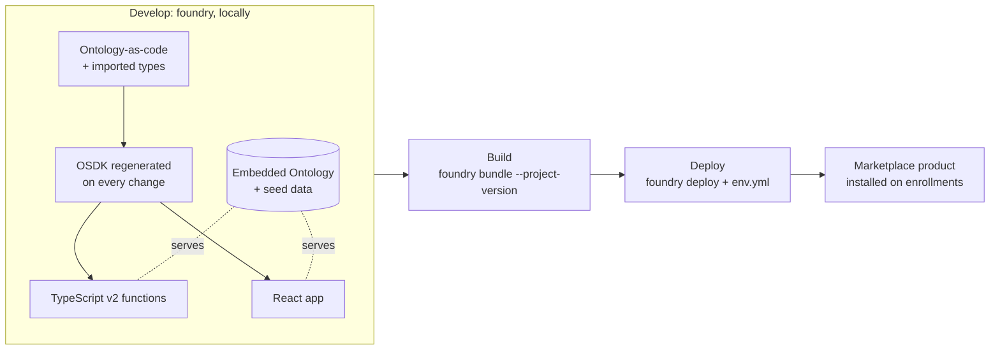

# 04 — SuperRepo and the Foundry CLI

*Sources: [SuperRepo: Overview](https://www.palantir.com/docs/foundry/superrepo/overview/) · [SuperRepo: Core concepts](https://www.palantir.com/docs/foundry/superrepo/core-concepts/) · [Create a SuperRepo](https://www.palantir.com/docs/foundry/superrepo/create-a-superrepo/) · [Foundry CLI](https://www.palantir.com/docs/foundry/superrepo/foundry-cli/) · [Tutorial: Develop with a SuperRepo](https://www.palantir.com/docs/foundry/superrepo/tutorial-develop-with-a-superrepo/) · [Prepare for your first deployment](https://www.palantir.com/docs/foundry/superrepo/prepare-first-deploy/) · [Advanced workflows](https://www.palantir.com/docs/foundry/superrepo/advanced-workflows/) · [Coming in the future](https://www.palantir.com/docs/foundry/superrepo/in-development/) · [SuperRepo: FAQ](https://www.palantir.com/docs/foundry/superrepo/faq/) · checked October 22, 2026 · Ready for Review*

**[Concept]** A **SuperRepo** is one pro-code repository for a full-stack application built around the Ontology: **Ontology-as-code**, functions and a React app side by side, previewed together on your machine with the **Foundry CLI**, then bundled into a Marketplace product and deployed. The docs expect it to become "the preferred way of interacting with platform features in a pro-code manner".

**[Docs]** SuperRepo is **beta**: it "may not be available on your enrollment", and functionality may change.

## The lifecycle

**[Docs] Develop.** The CLI runs local servers that mock part of Foundry. The **embedded Ontology** approximates the Ontology's behaviour, functions run in local preview runtimes, and the OSDK app runs against them. Ontology-as-code (TypeScript definitions in `ontology/src/ontology.mts`) "acts as the source of truth" for your entities and is materialized on the enrollment when the product is deployed. The OSDK is regenerated whenever the definitions change.

**[Docs] Build.** `foundry.yml` at the root declares the components (`ONTOLOGY`, `TYPESCRIPT_FUNCTIONS`, `APP`, each with a path), imports, the bundle (name, Maven coordinate, install mode) and the OSDK output folder. The default template orchestrates builds with Nx, but the CLI reads neither `nx.json` nor `project.json`, so you can use any build system. `foundry bundle --project-version <VERSION>` produces the artifact; the version becomes the **Marketplace product version**.

**[Docs] Deploy.** `foundry deploy` uploads the product version and installs it with the inputs in `env.yml` (Marketplace input mappings such as markings and the website subdomain, plus an optional store RID). Create the file with `foundry deploy configure` and **commit it**.

## The Foundry CLI

**[Docs]** `foundry` runs on macOS, Windows and Linux and is always downloaded **from your enrollment**, not from a package manager. Prefer the in-platform installer at `/workspace/code/superrepo`, which provisions a more restricted token than the user-generated token the manual steps use. Then:

| Command | Does |
|---|---|
| `foundry create` | Scaffolds a SuperRepo (or **New > Code repository > Applications > SuperRepo** in the platform) |
| `foundry login` | Stores the credentials every later command uses; in CI, set `FOUNDRY_TOKEN` and pass `--foundry-url` |
| `foundry login refresh` | Re-authorizes when commands start failing with authorization errors |
| `foundry import ontology` | Imports existing types (including ones made in Ontology Manager) and writes a **lock file** to commit |
| `foundry bundle`, `bundle product`, `bundle store` | Builds the artifact (single product, or per product then the store) |
| `foundry deploy`, `deploy configure` | Installs through Marketplace; creates `env.yml` |
| `foundry run-with-auth` | Injects `FOUNDRY_HOSTNAME` and `FOUNDRY_TOKEN` around Node installs if you leave Nx |
| `foundry update self` | Upgrades the CLI |

## What the tutorial shows

**[Docs]** The default template is a task tracker. In one repository you import an object type (`foundry import ontology`, or the extension's **Import** sidebar), use the template's `defineLink` between workers and tasks, preview `completeTask` (a TypeScript v2 function returning an edit), expose it with `defineFunctionBackedAction`, and call it from React with `useOsdkAction`. Changing `ontology.mts` regenerates the OSDK while `pnpm run dev` is running. The docs' point: without a SuperRepo this meant "jumping between four applications", waiting for CI and republishing the OSDK.

## Deploying

**[Docs]**

- **From the platform:** in the in-platform VS Code editor, **Tag version**. Every semantic-version tag triggers a deployment job (follow it in **Tags > Checks**).
- **From elsewhere** (GitHub Actions, CircleCI, your terminal): `pnpm run build && foundry deploy`, with `FOUNDRY_TOKEN` set to a token with **Foundry DevOps publishing** permissions. Both paths read the same `env.yml`.
- **Then verify** in Marketplace. For a React app, also check in the installed Developer Console application that the **website domain** is approved and the latest asset is **deployed to production**.

## Advanced settings

**[Docs]**

- **Several products** in one `foundry.yml`: a `products` list, each with its own `components` and `bundle`. Pass `--product <bundle name>` to every command. `foundry bundle` refuses multi-product files: run `foundry bundle product --product … --project-version …` per product (independent versions), then `foundry bundle store`. `foundry deploy` doesn't bundle for you. `includeInBundle: false` leaves a product out.
- **Seed data** for preview: top-level `.mts` files in the Ontology component, compiled in filename order (hence `001-`, `002-`), each default-exporting `createSeed`. Every non-nullable property is required, primary keys must be unique across the directory, and the local database is **fresh on every start**. Seed data is never deployed.
- **`contentSecurityPolicyAdditions`** extends the managed website's CSP for `connect-src`, `frame-src`, `img-src`, `media-src`, `script-src`, `style-src`, `font-src` and `frame-ancestors`. It applies only to products with an `APP` component.
- **`platformApiProxy`** passes chosen platform API paths (for example the LLM proxy) through to the enrollment during **preview only**, with the `foundry login` credentials.

## Limits today

**[Docs]**

- Functions: **TypeScript v2 only**. Python functions, pro-code agents, external sources, Automate and data pipelines are listed under *Coming in the future*.
- **No PySpark transforms and no compute modules.**
- **Installed types are locked.** You can't edit a SuperRepo-created object type in Ontology Manager unless you unlock the project, and the next deployment overwrites those edits.
- **No managed upgrades.** The template is a starting point; after creation the repository, its dependencies and generated files are yours to maintain.
- Streams can back object types (through custom datasources), and media sets work through a `mediaReference` property.

## For Kestrel

**[Example]** The Delivery Desk product is the closest thing Kestrel has to a SuperRepo: Ontology types (`Case`, `Message`), functions and an app that ship together as one Marketplace product ([Ontology 14-04](../../Ontology/14-lifecycle-and-operations/04-marketplace-packaging.md)). Moving it into a SuperRepo is *considered, not adopted*:

- SuperRepo is **beta**.
- Its front end is a **Workshop** module, while a SuperRepo's `APP` component is an OSDK React app.
- Functions must be **TypeScript v2**; any Python function in `kestrel-ml` would have to stay outside.
- Installed types would be **locked**, while Kestrel changes `Case` in Ontology Manager on a global branch with two-approval review ([Ontology 14-02](../../Ontology/14-lifecycle-and-operations/02-branching-and-proposals.md)).

**[Explanation]** A SuperRepo fits a product that starts in code: a new OSDK React app whose object types are defined with it and only ever changed through it. Kestrel has none today; revisit when one is proposed or when Python functions are supported.

---
[Module index](README.md) · Previous: [03 — The Palantir extension for VS Code](03-palantir-extension-for-vs-code.md) · Next module: [06 — Branching and cross-app interactivity](../06-branching-and-cross-app/README.md)
