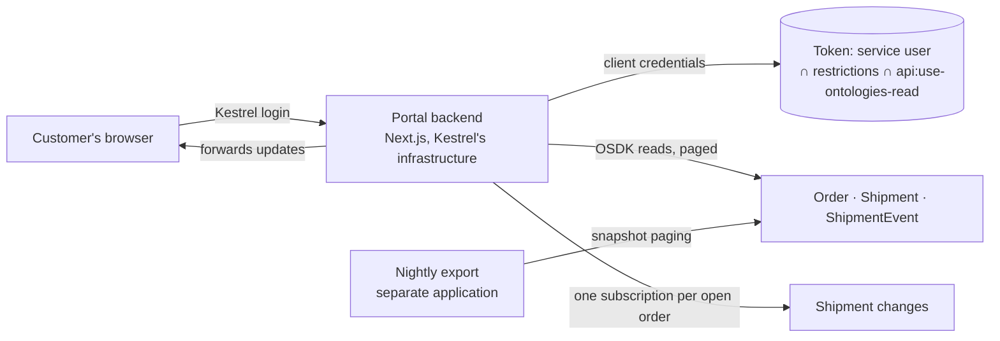

# 01 — The customer portal, built out

*Sources: no new doc pages; every row links to the note that holds the docs' wording · written October 22, 2026 · Ready for Review. Everything here is **[Example]** unless a line says otherwise.*

Daniel's delivery-status portal passed design review in [Ontology 10-04](../../Ontology/10-applications/04-osdk-and-apis.md) with three conditions: a per-customer filter test in CI, an application restricted to three object types, and TypeScript only. This page is the **build record**: each decision the DevTools notes added, and the one that holds the doc rule behind it.

**What it serves:** Kestrel's customers (not Foundry users) check where their orders are. They sign in with Kestrel's own customer login; Foundry never sees them.

## The shape

## Registration and identity

| Decision | Choice | Note |
|---|---|---|
| Application type | **Backend service**, application permissions (client credentials, a service user) | [02-01](../02-developer-console-and-apis/01-applications-scopes-and-restrictions.md#for-kestrel) |
| Restrictions | **Restricted** to `Order`, `Shipment`, `ShipmentEvent` and the backing datasets Developer Console adds with them; fix any *outdated restrictions* warning before the portal breaks | [02-01](../02-developer-console-and-apis/01-applications-scopes-and-restrictions.md#for-kestrel) |
| Scope requested | `api:use-ontologies-read` only, requested explicitly (the docs conflict on what an empty scope gets: [RQ-03](../SOURCES.md#open-research-questions)) | [02-01](../02-developer-console-and-apis/01-applications-scopes-and-restrictions.md#for-kestrel) |
| Service user's data access | An explicit branch for it in `Shipment`'s regional policy; without one it sees no shipments | [Ontology 10-04 Q2](../../Ontology/10-applications/04-osdk-and-apis.md#q2--who-is-the-user-and-what-token-do-they-get) |
| Organization | Kestrel's default organization | [02-01](../02-developer-console-and-apis/01-applications-scopes-and-restrictions.md#for-kestrel) |
| Secret | In the backend's secret store, never in the repository; rotated on a schedule by someone holding only the rotate-secret role | [02-01](../02-developer-console-and-apis/01-applications-scopes-and-restrictions.md#for-kestrel) |
| Hosting | Not on Foundry: hosting is for client-facing apps, and the portal is a backend | [02-02](../02-developer-console-and-apis/02-bootstrapping-and-hosting.md#for-kestrel) |

**[Explanation]** Once the service user can see shipments, it can see **every** customer's. The per-customer filter on every call is Kestrel's code, not Foundry's, which is why 10-04 made it a CI test. Each feature below repeats that filter.

## The code

- **Bootstrap** from the back-end TypeScript quick start: `createClient` with `createConfidentialOauthClient(CLIENT_ID, CLIENT_SECRET, STACK_URL)`, `CLIENT_ID` and `CLIENT_SECRET` in a `.env` that is never checked in ([02-02](../02-developer-console-and-apis/02-bootstrapping-and-hosting.md)).
- **Language:** TypeScript keeps `Order.deliveryAddress`, a struct the Python OSDK would drop ([01-01](../01-ontology-sdk/01-languages-and-generation.md#what-wont-generate)).
- **Reads:** one `Shipment` page per customer request, **without** snapshot, because customers want current status ([02-04](../02-developer-console-and-apis/04-platform-apis.md#for-kestrel)). `pageSize` is only a suggestion, and page tokens are short-lived, so the page loop never stores a token between requests ([02-04](../02-developer-console-and-apis/04-platform-apis.md#paging)).
- **Live updates:** one subscription per open order, a **filter** on `Shipment` for that order (a pivot from `Order` can't be subscribed to), properties limited to `eta`, `isLate` and `trackingUrl`. The backend forwards changes over its own connection; the browser never talks to Foundry. A removal means *stop showing*; an out-of-date signal or a dropped connection means reload with `fetchPage` ([01-02](../01-ontology-sdk/02-subscriptions.md#for-kestrel)). Whether a TypeScript `DELETED` update also fires when a shipment leaves the filter is [RQ-02](../SOURCES.md#open-research-questions).
- **Parsing:** ignore unknown response fields and keep a default branch for unknown enum values, since both can arrive without a new API version ([02-04](../02-developer-console-and-apis/04-platform-apis.md#versioning)).

## Errors, limits and monitoring

| Situation | Handling | Note |
|---|---|---|
| 429 or 503 | Shared retry helper: exponential backoff with jitter | [02-04](../02-developer-console-and-apis/04-platform-apis.md#limits) |
| Any error | Log the `errorInstanceId`, so Support can trace it | [02-04](../02-developer-console-and-apis/04-platform-apis.md#errors) |
| 404 on an order | Treat as *not visible to this token* first: a 404 often means the token can't see it | [02-04](../02-developer-console-and-apis/04-platform-apis.md#errors) |
| 403 `ApiUsageDenied` | **Page the portal team**: a deploy needs a scope or restriction change, and retrying won't help | [02-04](../02-developer-console-and-apis/04-platform-apis.md#for-kestrel) |
| Trends and capacity | Developer Console metrics count this app's calls (it uses `ConfidentialClientAuth`), with about 24 hours' latency, so they're for trends, not incidents | [02-03](../02-developer-console-and-apis/03-operating-an-application.md#metrics) |

## The nightly export

A delivery-performance export runs as a **separate** backend-service application with its own secret and scope: the customer-facing identity shouldn't run internal batch jobs. It uses **snapshot** paging so no shipment is counted twice while the night's scans arrive ([02-04](../02-developer-console-and-apis/04-platform-apis.md#for-kestrel)).

## Environments

Only the application and its OAuth client move between `kestrel-dev`, `kestrel-test` and `kestrel`, as Marketplace application packaging; the portal's code ships on Kestrel's own infrastructure. Each environment's client arrives **without a secret** and rotates its own after install. Because the code calls `Order`, `Shipment` and `ShipmentEvent` by API name, and Marketplace doesn't remap API names, a rename of any of them in one environment breaks the portal there ([02-03](../02-developer-console-and-apis/03-operating-an-application.md#for-kestrel)).

## Considered, not adopted

- A **custom endpoint** for the support portal: beta, and it needs an unrestricted application ([03-04](../03-compute-modules-and-custom-endpoints/04-custom-endpoints.md)). The customer portal doesn't need one either: the OSDK already gives it a typed client.
- Hosting any part of it on Foundry: not possible for a backend, and the customers aren't Foundry users ([02-02](../02-developer-console-and-apis/02-bootstrapping-and-hosting.md#for-kestrel)).

## Open items

- [RQ-02](../SOURCES.md#open-research-questions): subscription update states.
- [RQ-03](../SOURCES.md#open-research-questions): what a token with no requested scope gets; the portal sidesteps it by always requesting one.

---
[Module index](README.md) · Next: [02 — Daniel's developer setup](02-daniels-developer-setup.md)
