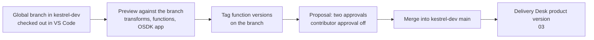

# 02 — Daniel's developer setup

*Sources: no new doc pages; every row links to the note that holds the docs' wording · written October 22, 2026 · Ready for Review. Everything here is **[Example]** unless a line says otherwise.*

Daniel builds Kestrel's Workshop apps, functions and OSDK integrations; Priya builds the pipelines. This page records **where their code is written, how a change travels, and what their AI tools can reach**, as decided across modules 04–08. It's the developer-side companion to Kestrel's change policy ([Ontology 14-01](../../Ontology/14-lifecycle-and-operations/01-saving-reviewing-and-restoring.md)).

## Where code is written

| Work | Where | Why | Note |
|---|---|---|---|
| TypeScript v2 functions (`kestrel-functions`, by domain) and Python functions (`kestrel-ml`) | **VS Code workspace**, local SDK on | Kestrel's functions house rule; live preview, resource imports and branches through the Palantir extension | [Ontology 09-05](../../Ontology/09-functions/05-writing-functions-in-practice.md), [05-02](../05-development-environments/02-vs-code-workspaces.md#for-kestrel) |
| Kestrel Pay work | VS Code workspace, never a local IDE | `Payment` data is marked `Kestrel Pay – Financial`; in-platform tools keep outputs in Foundry | [04-02](../04-mcp-and-pro-code-agents/02-palantir-mcp.md#for-kestrel) |
| Priya's Python transforms | VS Code workspace, with **local preview off** for everyone | Local preview needs **Download** on every input, which for marked data is a grant to export it | [05-03](../05-development-environments/03-palantir-extension-for-vs-code.md#for-kestrel) |
| Pull request review | Code Repositories | The docs' intended tool for review and repository management | [05-02](../05-development-environments/02-vs-code-workspaces.md#three-environments-one-comparison) |
| Notebook analysis | JupyterLab in Code Workspaces; payments analysis in its own workspace | A workspace inherits the markings of every input | [05-01](../05-development-environments/01-code-workspaces.md#for-kestrel) |
| Compute | The free default VS Code profile; a larger profile only for full-dataset previews over big inputs | Cost | [05-02](../05-development-environments/02-vs-code-workspaces.md#for-kestrel) |

**[Explanation]** If Priya's transforms turn out to be Java (the model doesn't record it), they stay in Code Repositories: VS Code workspaces don't support Java transforms.

## How a change travels

| Step | Rule | Note |
|---|---|---|
| Branch | **Palantir: Checkout Global Branch** in VS Code; add the repository to the branch when prompted; resolve uncommitted changes first | [05-02](../05-development-environments/02-vs-code-workspaces.md#global-branching-in-the-editor) |
| Preview | Transforms and functions preview against the active branch; an OSDK app's requests must carry the branch's `branch` parameter, or it is silently reading `main` | [02-03](../02-developer-console-and-apis/03-operating-an-application.md#branching-the-application) |
| Publish on the branch | **Tag Version** creates the tag against the branch | [06-01](../06-branching-and-cross-app/01-global-branching.md#for-kestrel) |
| Review | Two approvals from *ontology-governance* on `Commerce [Ontology]`, contributor approval off; **new files are protected automatically**, so a new type or action can't skip review | [Ontology 14-02](../../Ontology/14-lifecycle-and-operations/02-branching-and-proposals.md), [06-01](../06-branching-and-cross-app/01-global-branching.md#for-kestrel) |
| Keep it alive | A branch goes inactive after **35 days** without activity, and its data is deleted 7 days later; after reactivating, a transform needs a no-op commit and a build **from the repository** | [06-01](../06-branching-and-cross-app/01-global-branching.md#code-and-builds-on-a-branch) |
| Ship | Merged changes reach test and production only as a product version | [03](03-delivery-desk-product-release.md) |

## What the AI tools can reach

| Tool | Where | Reach | Note |
|---|---|---|---|
| **Continue** with Palantir-provided models | VS Code workspaces | The user's session and the workspace credential; adds no permissions | [05-02](../05-development-environments/02-vs-code-workspaces.md#ai-development-tools) |
| **Palantir MCP** (built in) | VS Code workspaces | Context, transform preview, Ontology management on a branch, OSDK regeneration, SQL; writes are non-destructive or need approval, and Ontology changes go through proposals | [04-02](../04-mcp-and-pro-code-agents/02-palantir-mcp.md#security-and-data-flow) |
| **Palantir MCP** (local) | Daniel's group only, commerce work only | Tool outputs go to the IDE's model provider, so it's enabled only if Kestrel's agreement with that provider allows it; the model doesn't record that agreement yet | [04-02](../04-mcp-and-pro-code-agents/02-palantir-mcp.md#for-kestrel) |
| JupyterLab AIP agent | Code Workspaces | The same session boundary; chat history is lost on restart | [05-01](../05-development-environments/01-code-workspaces.md#ontology-models-and-ai) |

**[Explanation]** The common rule: every assistant acts as the developer, within the workspace credential. The controls that matter are therefore Daniel's own permissions and the branch review, not the tool.

## Considered, not adopted

- A **SuperRepo** for the Delivery Desk: beta, TypeScript v2 functions only, and installed types would be locked ([05-04](../05-development-environments/04-superrepo-and-foundry-cli.md#for-kestrel)).
- A **build-fixing pro-code agent** on failed builds of datasets behind `Shipment` ([04-03](../04-mcp-and-pro-code-agents/03-pro-code-agents.md#for-kestrel)).
- **Delay-risk modelling** in JupyterLab, since the model doesn't record where that model is trained ([05-01](../05-development-environments/01-code-workspaces.md#for-kestrel)).

## Open items

- Record Kestrel's agreement with Daniel's IDE model provider before local Palantir MCP is switched on.
- Record the language of Priya's transforms.

---
[Module index](README.md) · Previous: [01 — The customer portal, built out](01-customer-portal-built-out.md) · Next: [03 — The Delivery Desk product release](03-delivery-desk-product-release.md)
