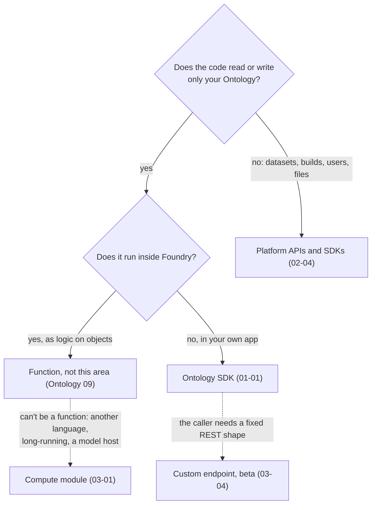
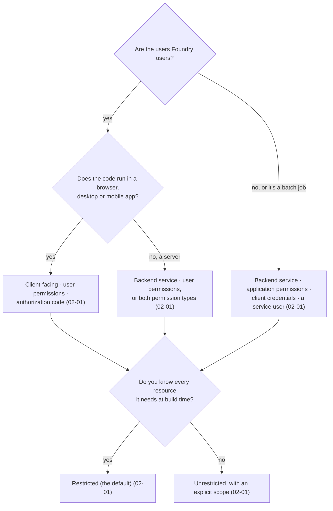
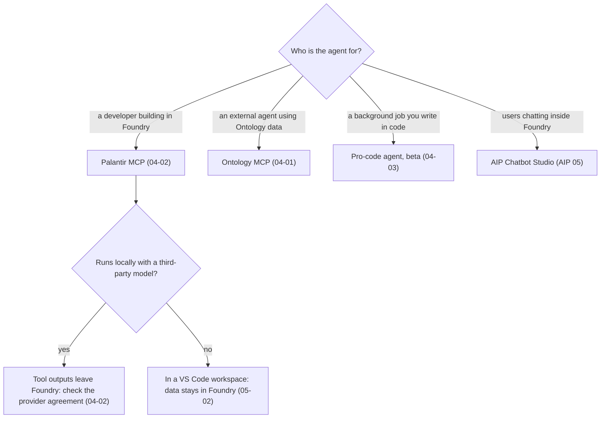
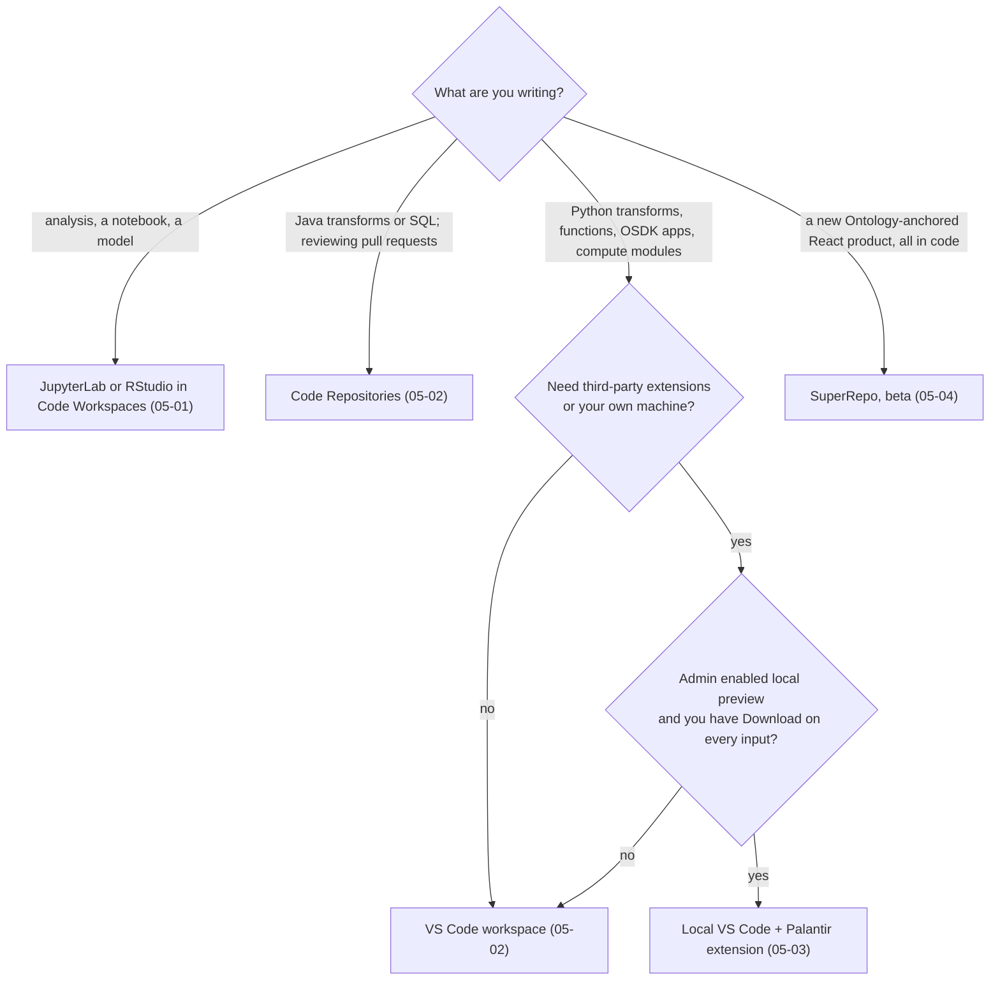
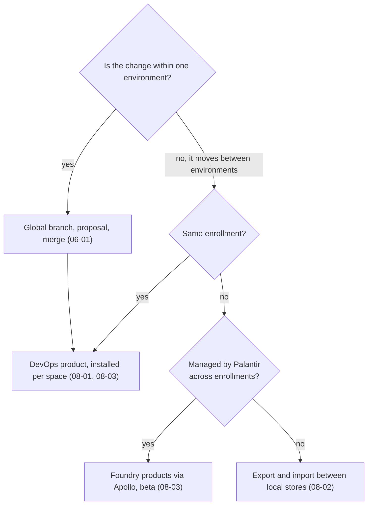

# Decision guide

*Sources: the notes each branch links to · compiled October 22, 2026 · Ready for Review. The flowcharts are ours; every leaf links to the note with the docs' wording.*

Five decisions that come up on almost every developer-toolchain project, as flowcharts. Each ends at the note to read next.

## 1. Which tool runs the code?

[Ontology 09](../../Ontology/09-functions/README.md) · [01-01](../01-ontology-sdk/01-languages-and-generation.md) · [02-04](../02-developer-console-and-apis/04-platform-apis.md) · [03-01](../03-compute-modules-and-custom-endpoints/01-compute-module-concepts.md) · [03-04](../03-compute-modules-and-custom-endpoints/04-custom-endpoints.md)

## 2. Which application type and grant?

**[Explanation]** Two checks after the flowchart: a backend service can't be hosted on Foundry ([02-02](../02-developer-console-and-apis/02-bootstrapping-and-hosting.md#hosting-on-foundry)), and a service user only sees rows that its object security policies let it see ([09-01](../09-kestrel-case/01-customer-portal-built-out.md)).

[02-01](../02-developer-console-and-apis/01-applications-scopes-and-restrictions.md) · [02-02](../02-developer-console-and-apis/02-bootstrapping-and-hosting.md)

## 3. Which agent connector?

[04-01](../04-mcp-and-pro-code-agents/01-ontology-mcp.md) · [04-02](../04-mcp-and-pro-code-agents/02-palantir-mcp.md) · [04-03](../04-mcp-and-pro-code-agents/03-pro-code-agents.md) · [AIP 05](../../AIP/05-chatbot-studio/README.md) · [05-02](../05-development-environments/02-vs-code-workspaces.md#ai-development-tools)

## 4. Which development environment?

[05-01](../05-development-environments/01-code-workspaces.md) · [05-02](../05-development-environments/02-vs-code-workspaces.md) · [05-03](../05-development-environments/03-palantir-extension-for-vs-code.md) · [05-04](../05-development-environments/04-superrepo-and-foundry-cli.md)

## 5. How does a change reach production?

**[Explanation]** The two usually work together: branch within `dev`, merge, then publish a product version and install it in `test` and `prod` ([09-03](../09-kestrel-case/03-delivery-desk-product-release.md)).

[06-01](../06-branching-and-cross-app/01-global-branching.md) · [08-01](../08-product-delivery/01-devops-products.md) · [08-02](../08-product-delivery/02-stores-groups-and-export.md) · [08-03](../08-product-delivery/03-marketplace-installs-and-releases.md)

---
[Module index](README.md) · [DevTools home](../README.md)
