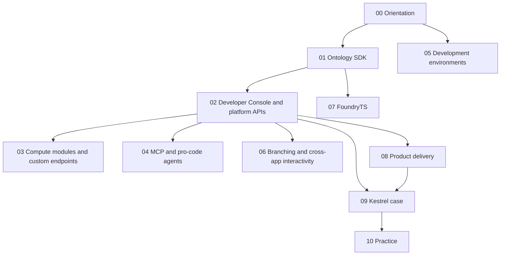

# DevTools

A course and working reference for the **Developer toolchain** and **Product delivery** parts of the Foundry docs: the Ontology SDK, Developer Console and the platform APIs, compute modules and custom endpoints, MCP and pro-code agents, development environments, Global Branching, FoundryTS, and packaging with DevOps and Marketplace. Every page in scope is assigned to a planned note; the [docs index](99-reference/docs-index.md) maps them.

| | |
|---|---|
| Structure | Created October 21, 2026 (Phase 2). Built from the official docs; the course notes listed in each module are linked, not reused as sources. |
| Notes written | **34 of 34** (October 22, 2026): [00 Orientation](00-orientation/README.md), [01 Ontology SDK](01-ontology-sdk/README.md), [02 Developer Console and platform APIs](02-developer-console-and-apis/README.md), [03 Compute modules and custom endpoints](03-compute-modules-and-custom-endpoints/README.md), [04 MCP and pro-code agents](04-mcp-and-pro-code-agents/README.md), [05 Development environments](05-development-environments/README.md), [06 Branching and cross-app interactivity](06-branching-and-cross-app/README.md), [07 FoundryTS](07-foundryts/README.md), [08 Product delivery](08-product-delivery/README.md), [09 Kestrel case](09-kestrel-case/README.md), [10 Practice](10-practice/README.md), [99 Reference](99-reference/README.md). Module READMEs list every note and the official pages it covers. |
| Scope | 208 pages: the docs' *Developer toolchain* sidebar (177) and *Product delivery* sidebar (23), read from the live page DOM in the built-in browser on October 21, 2026, plus the 8 general pages of the API Reference (authentication, paging, versioning, limits, errors). The API endpoint pages and the two release-notes links are out of scope. |
| Sources | Official Palantir documentation first. Register, corrections and open questions: [SOURCES](SOURCES.md) |
| Why it matters | The Application Developer Associate exam's domain 5 is OSDK, APIs and external applications; domain 8 (security and operations) covers branching, application permissions and delivery; parts of domains 3 and 7 (compute-module functions, MCP) are here too |

## How this area relates to the others

The [Ontology area](../Ontology/README.md) explains what the SDK and APIs **reach**: object types, actions, functions and their permissions. Its note [10-04](../Ontology/10-applications/04-osdk-and-apis.md) walks Kestrel's customer portal end to end, and [14-02](../Ontology/14-lifecycle-and-operations/02-branching-and-proposals.md) and [14-04](../Ontology/14-lifecycle-and-operations/04-marketplace-packaging.md) cover branching and packaging for Ontology resources. This area explains the **tools** in full and links back to those notes for the worked example instead of repeating it. The [Apps area](../Apps/README.md) covers the front ends built on top: OSDK React apps and custom widgets ([Apps 06](../Apps/06-osdk-react-and-custom-widgets/README.md)) and Workshop branching ([Apps 04-01](../Apps/04-workshop-in-production/01-publishing-versions-and-branching.md)). The [AIP area](../AIP/README.md) covers compute-module-backed models ([AIP 02-02](../AIP/02-bring-your-own-model/02-rest-and-compute-module-backed-models.md)) and AIP's own agents.

## Learning path

## Modules

| # | Module | What you learn | Status |
|---|---|---|---|
| 00 | [Orientation](00-orientation/README.md) | The toolchain map; Kestrel's developer resources | **Ready for Review** |
| 01 | [Ontology SDK](01-ontology-sdk/README.md) | OSDK languages, subscriptions, migration and testing | **Ready for Review** |
| 02 | [Developer Console and platform APIs](02-developer-console-and-apis/README.md) | Registration, scopes, hosting, metrics; REST API auth, paging, errors | **Ready for Review** |
| 03 | [Compute modules and custom endpoints](03-compute-modules-and-custom-endpoints/README.md) | Containers in Foundry; endpoint sets | **Ready for Review** |
| 04 | [MCP and pro-code agents](04-mcp-and-pro-code-agents/README.md) | Ontology MCP, Palantir MCP, pro-code agents | **Ready for Review** |
| 05 | [Development environments](05-development-environments/README.md) | Code Workspaces, VS Code workspaces and extension, SuperRepo | **Ready for Review** |
| 06 | [Branching and cross-app interactivity](06-branching-and-cross-app/README.md) | Global Branching; apps exchanging objects | **Ready for Review** |
| 07 | [FoundryTS](07-foundryts/README.md) | Time-series queries in Python | **Ready for Review** |
| 08 | [Product delivery](08-product-delivery/README.md) | DevOps products, stores, Marketplace installs and upgrades | **Ready for Review** |
| 09 | [Kestrel case](09-kestrel-case/README.md) | Kestrel's developer resources built out | **Ready for Review** |
| 10 | [Practice](10-practice/README.md) | Review questions tagged by exam domain | **Ready for Review** |
| 99 | [Reference](99-reference/README.md) | Limits, decision guide, FoundryTS functions, docs index | **Ready for Review** |

## Conventions

Same as the Ontology, AIP and Apps areas. Each note has a one-line *Sources · checked · status* header and footer navigation; otherwise its shape follows its topic. Labels: **[Docs]** (only real doc wording goes in quote marks), **[Concept]**, **[Explanation]**, **[Recommendation]**, **[Example]**, **[Analogy]**, **[Observed]**. Open questions are numbered RQ-NN in [SOURCES](SOURCES.md). Self-checks live only in [10 — Practice](10-practice/README.md). Examples use **Kestrel Commerce**, as defined in [Ontology 17-02](../Ontology/17-case-studies/02-kestrel-reference-model.md).

---
[Learn home](../../README.md) · [Topic map](MAP.md) · [Sources](SOURCES.md) · [Glossary](GLOSSARY.md)
