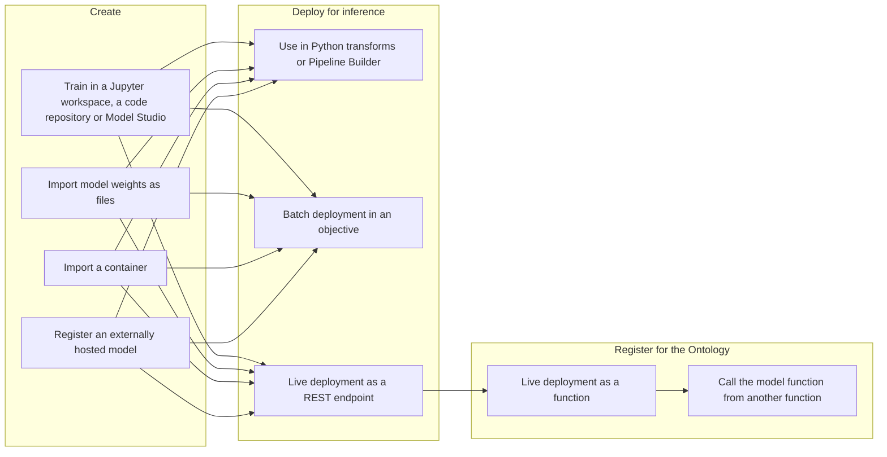

# 01 — The modelling map

*Sources: [Model connectivity and development](https://www.palantir.com/docs/foundry/model-integration/overview/) · [Getting started](https://www.palantir.com/docs/foundry/model-integration/getting-started/) · [Models](https://www.palantir.com/docs/foundry/model-integration/models/) · [Selecting the right modeling tool](https://www.palantir.com/docs/foundry/model-integration/what-to-use/) · checked October 23, 2026 · Ready for Review*

Four short pages that say what the whole sidebar is for. The overview sets the ambition, the *Models* page says what the unit of work is, *Getting started* lists the paths through it, and *Selecting the right modeling tool* is the decision sheet the rest of the area keeps coming back to. This note draws the map once, then says what the word *model* means here, because three earlier areas use it for other things.

## What a model is here

**[Docs]** "a model is an artifact for inference that contains machine learning, forecasting, optimization, physical models, or business rules". The overview is wider still: models "can be leveraged across workflows in data pipelines, Ontology, and application layers", and every step "is subject to platform guarantees around lineage, security, versioning, reproducibility, and auditing".

**[Docs]** A model resource has two parts, and the pair is repeated on almost every page in the sidebar:

| Part | What the docs say | What to remember |
|---|---|---|
| **Model artifacts** | "The model weights or container where the trained model is saved" | The thing that was trained, or pointed at |
| **Model adapter** | "The logic that describes how the platform can interact with the model artifacts to load, initialize, and perform inference with the model"; published "as part of a Python library" | The thing Foundry talks to. Every model has one, whether it was trained here, uploaded as files, pushed as a container or hosted elsewhere |

**[Explanation]** The adapter is the idea to hold on to. Foundry never calls a scikit-learn object or a container directly; it calls the adapter's `load`, `api` and `predict` methods, and the adapter does the rest. That is why one Models application, one objective workflow and one function-publishing path can serve a tabular regression, a Hugging Face pipeline and an API in another cloud. [01-01](../01-models-and-model-adapters/01-what-a-model-asset-is.md) and [01-02](../01-models-and-model-adapters/02-writing-a-model-adapter.md) take the adapter apart.

**[Docs]** What a model in the platform gets for free, from the *Models* page: version history, "granular model permissioning, automatic dependency management, model lineage, and API management"; no-code hosting for live inference through deployments; no-code batch and streaming inference in Pipeline Builder through the trained model node; management, evaluation and deployment through Modeling Objectives; binding to the Ontology through Functions on models and Scenarios; and a place in Workflow Lineage, "including the functions that use a trained model and its live deployment API, health, logs, and metrics".

## The lifecycle, in the order the docs give it

**[Docs]** *Getting started* lists the common workflows under three headings, and they are the spine of this area:

| Stage | Pages | Module here |
|---|---|---|
| Create: train inside the platform | code workspaces, Code Repositories, Model Studio, Spark, GPUs | [02](../02-training-models-in-foundry/README.md) |
| Create: bring a model in | files, containers, externally hosted | [03](../03-bringing-models-in/README.md) |
| Record how it went and how good it is | experiments, evaluations | [04](../04-experiments-and-evaluations/README.md), [06](../06-evaluating-in-the-objective/README.md) |
| Manage, release, serve | Modeling Objectives, batch and live deployments, direct deployments | [05](../05-modeling-objectives-and-deployments/README.md) |
| Register for the Ontology | models in the Ontology, functions on models | [05-05](../05-modeling-objectives-and-deployments/README.md) |

**[Docs]** The overview's two framing sentences for the middle and the end of that path. Modeling Objectives are the "mission control" for "model management, evaluation, review, release, and deployment for a defined problem", with "a governance and permissions layer, an automation layer (e.g. uniform evaluation of model candidates), and a CI/CD layer for continuous and downtime-free deployment for models". And the point of the Ontology step: operational workflows "backed by high-trust models to power quick, critical decision-making", with feedback loops "from production data, outcomes, applications, and user actions".

**[Docs]** *Getting started* also sets expectations: before modelling, have "a high-level understanding of core Foundry concepts", Code Repositories, Python transforms, the Ontology and Functions. **[Explanation]** The Ontology and DevTools areas cover three of those; transforms and Code Repositories belong to the Data integration docs, which this area explains only as far as the model pages go ([README](../README.md#how-this-area-relates-to-the-others)).

## Which tool for which job

**[Docs]** *Selecting the right modeling tool* is a page of tables. Condensed, with the caveats the page attaches:

| Job | Tools the page names | Caveats on the page |
|---|---|---|
| Feature engineering | Pipeline Builder (point-and-click at scale), Code Workspaces (interactive, JupyterLab), Python transforms (PySpark in Code Repositories) | — |
| No-code training | Model Studio, "a simple point-and-click interface for creating production-grade machine learning models" | — |
| Pro-code training | `palantir_models` in Code Workspaces (interactive notebooks) or Code Repositories ("native CI/CD features"; "less interactive than notebooks") | `foundry_ml`, the predecessor, "has been formally deprecated as of October 2025" ([07-02](../07-language-models-migration-and-products/README.md)) |
| Training metrics | Experiments, logging metrics and hyperparameters during a training job | — |
| Post-training evaluation | Evaluations, logging evaluation metrics back to the model | — |
| Batch inference | Pipeline Builder's trained model node; Python transforms; objective batch deployments; a scheduled job from a Jupyter notebook | Pipeline Builder uses "the latest available model version for each build"; transforms support pinning a version, and `@lightweight` with model sidecars is recommended; objective batch deployments do not support "multi-output and external models", models as sidecars, or deployment through Marketplace; a notebook job only runs models created in that notebook |
| Streaming inference | Pipeline Builder, with partition keys and windows | A running streaming pipeline keeps its loaded version: "Restart or redeploy the pipeline to update to the latest model version" |
| Deployment behind a REST API | Model direct deployments ("Auto-upgrading model deployments; best for quick iteration and deployment") or objective live deployments ("Production-grade modeling project management") | Objective deployments do not support "deployment via Marketplace" |
| Functions | Direct function publication (no code, from a model or an objective with a live deployment) or importing model functions into TypeScript v1, v2 or Python repositories to process predictions further | — |

**[Docs]** The page opens with a newer path: AI FDE's *Machine learning mode* "helps you train, evaluate, deploy, and tune models", using "either Model Studio or pro-code repositories". **[Observed]** Nothing else in the sidebar mentions it; the notes treat it as an assistant over the tools below, not a tool of its own.

**[Explanation]** Two choices on that page decide most designs, and both come back in [99 — Decision guide](../99-reference/README.md): *direct deployment or objective* (quick and self-upgrading, or governed by releases) and *which batch path* (Pipeline Builder's node for no-code and latest-version, a transform for a pinned version, an objective batch deployment for release management). [Ontology 15-03](../../Ontology/15-advanced-patterns/03-models-in-the-ontology.md) already made the first choice for Kestrel's delay model; [05-03](../05-modeling-objectives-and-deployments/README.md) checks it against the deployment pages.

## Three words that mean something else elsewhere

**[Explanation]** The earlier areas use *model*, *evaluation* and *container* for different things. The table is the disambiguation the rest of this area relies on:

| Word | In this area | Elsewhere in Learn | Tell them apart by |
|---|---|---|---|
| **Model** | A model asset: artifacts plus an adapter, usually a predictive, forecasting or optimisation model; versioned in the Models application | An **LLM** in the AIP model catalog ([AIP 01-01](../../AIP/01-models-and-llms/01-supported-llms-and-model-catalog.md)) or brought in through BYOM ([AIP 02](../../AIP/02-bring-your-own-model/README.md)) | Does it have a model adapter and a version in the Models application? Then it is a model in this sense. A language model can be wrapped in one too ([07-01](../07-language-models-migration-and-products/README.md)), which is the one place the two meet |
| **Evaluation** | Metrics, images, plots and tables for one model version against test data ([04-02](../04-experiments-and-evaluations/README.md)); and, inside an objective, the automatic evaluation of every submission ([06](../06-evaluating-in-the-objective/README.md)) | An **AIP Eval**: a test suite over a Logic function or an LLM's outputs ([AIP 04](../../AIP/04-aip-evals/README.md)) | What is being scored: a model version's predictions against ground truth, or a function's behaviour against test cases |
| **Container model** | A container image registered as the artifacts of a model, with an adapter that calls it ([03-02](../03-bringing-models-in/README.md)) | A **compute module**: a container run as a service with its own API ([DevTools 03](../../DevTools/03-compute-modules-and-custom-endpoints/README.md)) | Whether you want the model lifecycle (versions, objectives, deployments, functions on models) or a general-purpose service. Kestrel's Kestrel Pay LLM is a compute module, by the AIP area's decision ([17-02](../../Ontology/17-case-studies/02-kestrel-reference-model.md)); [03-02](../03-bringing-models-in/README.md) records why it stays one |

**[Explanation]** One more collision the exam guide creates on its own: domain 7 is *AIP Logic and AI-powered applications*. The AIP area covered its language-model half; the pages here are its predictive-model half, and the seam between them is a function in the Ontology ([Ontology 09-04](../../Ontology/09-functions/04-functions-on-models-and-llms.md)).

## Where this sits in the exam

**[Explanation]** Domain 7 for the whole lifecycle; domain 3 (Ontology functions) for functions on models and model functions in code; domain 6 (recovery and monitoring) where live deployments meet the monitoring rules from [Observability 01-02](../../Observability/01-monitoring-views/02-monitoring-rules-reference.md). The practice note ([10-01](../10-practice/README.md)) tags each question.

## For Kestrel

**[Example]** What Kestrel has today, before this area adds anything:

- A **delivery-delay model** with a decided shape and no recorded lifecycle: [Ontology 15-03](../../Ontology/15-advanced-patterns/03-models-in-the-ontology.md) (ADR-007) gives it a batch property `Shipment.delayRisk` (a struct with `probability`, `band`, `modelVersion`, `scoredAt`), a live function `deliveryRisk` for the shipment on screen, prediction history in a dataset, and a recommendation that it be served through a Modeling Objective rather than a direct deployment, because Ama's queue thresholds were tuned against one version. Who trains it, where, how it is evaluated and how a version is released is not recorded.
- A **fraud model** behind the `liveFraudScore` wrapper and the *Record fraud score* action ([Ontology 09-04](../../Ontology/09-functions/04-functions-on-models-and-llms.md)), with a one-tabular-input, one-tabular-output API (`df_in` with `amount`, `cardCountry`, `ipCountry`, `merchantCategory`; `df_out` with `score` and `modelVersion`). Trained where, evaluated how, deployed as what: not recorded.
- The **Kestrel Pay LLM** in the compute module `kestrel-pay-llm` ([AIP 02-01](../../AIP/02-bring-your-own-model/01-choosing-a-byom-path.md)), which is *not* a model in this area's sense.

**[Example]** *Proposed* for the modules ahead, and settled in [00-02](README.md) once they are written: the delay model is the running example for training, experiments, evaluation and the objective lifecycle; the fraud model for the live deployment path and inference history; the Kestrel Pay LLM appears only to be told apart.

---
[Module index](README.md) · Next: [02 — Kestrel's modelling posture](README.md)
