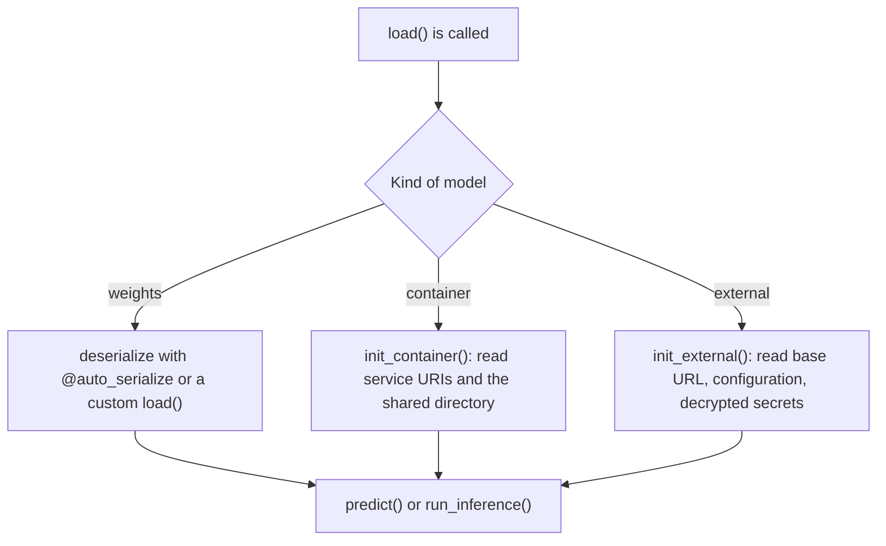

# 01 — What a model asset is

*Sources: [Models](https://www.palantir.com/docs/foundry/integrate-models/integrate-overview/) · [Model adapter overview](https://www.palantir.com/docs/foundry/integrate-models/model-adapter-overview/) · checked October 23, 2026 · Ready for Review*

Two pages, one idea: Foundry talks to every model the same way, through its adapter. This note says what the adapter must provide (initialisation, an API, inference), how the three kinds of model initialise differently, and why the *sidecar* setting exists. The mechanics of writing one are in [02](02-writing-a-model-adapter.md).

## Four sources, one interface

**[Docs]** The *Models* page: Palantir "provides a common interface to integrate models from a range of different sources":

| Source | The page's wording | Module here |
|---|---|---|
| Trained in the platform | "Models trained in Palantir" | [02](../02-training-models-in-foundry/README.md) |
| Files | "Model files trained outside of Palantir and uploaded as an unstructured dataset" | [03-01](../03-bringing-models-in/README.md) |
| Containers | "Models containerized outside of Palantir and pushed into the Foundry Docker registry" | [03-02](../03-bringing-models-in/README.md) |
| Externally hosted | "Models trained and hosted outside of Palantir" | [03-03](../03-bringing-models-in/README.md) |

**[Docs]** And the sentence that joins them to module 05: "All models can be productionized and connected to operational applications through the Modeling Objectives application."

**[Docs]** The two components, in this page's slightly fuller wording: model artifacts are "The model files, parameters, weights, container, or credentials where a trained model is saved"; the adapter is "The logic and the environment dependencies that describe how Foundry should interact with the model artifacts to load, initialize, and perform inference with the model".

**[Explanation]** *Credentials* in the artifacts list is the externally hosted case: for a model Foundry does not run, the saved thing is how to reach it. *Environment dependencies* in the adapter definition matters later: an adapter is a Python library with its own packages, and that is the root of the sidecar question below.

## What the adapter does

**[Docs]** "Palantir interacts with all models in the same way by interfacing with the model adapter class of that model version." Three duties:

| Duty | What the page says | Method |
|---|---|---|
| **Initialization** | Because a model is "created once, and used in multiple places within the platform", the adapter "needs to be aware of how to initialize an instance of models from either the weights or the underlying container" | `load()`, or `@auto_serialize` for weights ([03](03-serialization-save-and-load-upgrading-an-adapter.md)) |
| **API** | "Each adapter is required to declare an API description" of "the expected inputs, outputs, column names and type"; the platform relies on it "for enabling integrations with other applications for a variety of model consumption patterns" | `api()` ([02](02-writing-a-model-adapter.md)) |
| **Inference** | "the adapter can be used for inference for either batch or interactive workloads"; the platform "uses the provided API definition to call the predict() method with the defined names and types" | `predict()`, or `run_inference()` for several outputs ([04](04-modeladapter-api-reference.md)) |

**[Explanation]** Read the API duty as a contract with everything downstream. A transform, a batch deployment, a live endpoint and a published function all learn the model's shape from `api()`, not from the code. That is why the API page spends half its length on what the API may contain if the model is to become a function ([02](02-writing-a-model-adapter.md#what-the-api-must-look-like-downstream)).

## How the three kinds initialise

**[Docs]** Weights trained in the platform: "users should use the @auto_serialize annotation to leverage built-in serializers that should work with most model types"; explicit `load()` and `_save()` are for "advanced cases where serialization / deserialization logic must be explicitly specified".

**[Docs]** Container and external models: initialised through `init_container()` or `init_external()`. `load()` is still called, "but it then calls init_container() or init_external() in the background so that only the context that is relevant to these types of models" (a `ContainerizedApplicationContext` or an `ExternalModelContext`) reaches the model instance. Overriding `load()` is the alternative.

**[Explanation]** The diagram is the whole of module 03 in miniature: the adapter does not care where the model lives, but what it receives at load time differs, and [04](04-modeladapter-api-reference.md) lists the two context objects field by field.

## The sidecar setting

**[Docs]** "To use a model in a transform, the environment must contain the model adapter's dependencies." To avoid conflicts between the adapter's packages and the transform's, "set use_sidecar = True in ModelInput to run the model in an isolated container"; `predict()` requests are "automatically routed to the sidecar without additional code changes".

**[Explanation]** This is the practical consequence of the adapter being a library. Two models with different package versions, or a model whose packages fight the transform's own, would otherwise share one Python environment. The sidecar gives the model its own. The evaluations pages recommend it whenever the model comes from a repository other than the one running the transform ([04-02](../04-experiments-and-evaluations/02-evaluations.md#which-version-is-evaluated)), and the tool-selection page recommends `@lightweight` with sidecars for batch inference in transforms ([00-01](../00-orientation/01-the-modelling-map.md#which-tool-for-which-job)).

**[Analogy]** An adapter is a power plug with a label on it. The label (`api()`) says what current comes out; the plug (`load()`) fits one kind of socket (weights, a container, an API); and the appliance (Foundry) never needs to know what is behind the wall. A sidecar is an extension lead into the next room when the two appliances' cables would otherwise tangle.

## For Kestrel

**[Example]** Both of Kestrel's predictive models will be *Models trained in Palantir*: the delay model from Priya's pipeline data and the fraud model from the Kestrel Pay ledger. Neither needs a container or an external connection, and the Kestrel Pay LLM, which is served from a compute module, is not a model asset at all ([00-01](../00-orientation/01-the-modelling-map.md#three-words-that-mean-something-else-elsewhere)). *Proposed*: both adapters use `@auto_serialize`, and every transform that consumes a model from another repository sets `use_sidecar=True`, so Priya's transform environments and the adapters' environments stay apart.

---
[Module index](README.md) · Next: [02 — Writing a model adapter](02-writing-a-model-adapter.md)
