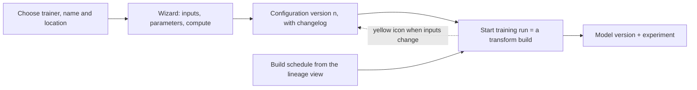

# 01 — Model Studio

*Sources: [Model Studio (concept)](https://www.palantir.com/docs/foundry/model-integration/model-studio/) · [Model Studio](https://www.palantir.com/docs/foundry/model-studio/overview/) · [Core concepts](https://www.palantir.com/docs/foundry/model-studio/core-concepts/) · [Navigation](https://www.palantir.com/docs/foundry/model-studio/navigation/) · [Inputs](https://www.palantir.com/docs/foundry/model-studio/configuration-inputs/) · [Compute resources](https://www.palantir.com/docs/foundry/model-studio/configuration-compute-resources/) · [Troubleshooting](https://www.palantir.com/docs/foundry/model-studio/troubleshooting/) · [FAQ](https://www.palantir.com/docs/foundry/model-studio/faq/) · checked October 23, 2026 · Ready for Review*

Eight short pages on the no-code trainer. The useful way to read them: a model studio is a *saved training configuration* that runs as an ordinary transform and publishes an ordinary model with an experiment attached. Everything downstream (objectives, deployments, functions) treats the result like any other model; the trainers themselves are in [02](02-model-studio-trainers.md).

## What it is

**[Docs]** "Model Studio is Foundry's no-code model development tool." Users "choose a training task, select input datasets, and optionally configure parameters to train and deploy production-grade machine learning models without writing code." The overview's feature list adds built-in trainers "tailored for common use cases such as time series forecasting, regression, and classification", "Smart defaults and guided workflows", experiment tracking, and lineage and access controls "built on top of the Palantir platform".

**[Docs]** The four-step workflow: choose a trainer; provide data ("training and optional testing data"); configure parameters or "stick with the defaults"; launch the build and "visualize training metrics in the experiment created at runtime". The result "can be used for inference in downstream applications like" Python transforms, Pipeline Builder and functions, "and shipped via Marketplace", and training jobs "can also be integrated with build schedules to automatically retrain the model whenever new data is available".

## The four concepts

**[Docs]** From *Core concepts*:

| Concept | What the page says | What to remember |
|---|---|---|
| **Models** | Training runs "produce a model that can be used in downstream applications" | The same model asset as [01-01](../01-models-and-model-adapters/01-what-a-model-asset-is.md); no special kind |
| **Experiments** | "Each model version produced by Model Studio will have an associated experiment that displays representative parameters and metrics about the training job"; some trainers render "a graph of a model ensemble" under *Plots* | The experiment of [04-01](../04-experiments-and-evaluations/01-experiments.md), written for you |
| **Trainers** | "the actual model training implementation"; each "targeted at a specific task": time series forecasting, regression, classification | [02](02-model-studio-trainers.md) |
| **Training jobs** | "always run against the latest training configuration"; repeated runs use the same configuration "although outputs may change due to changing input data"; jobs "run as standard transforms in Foundry, meaning that data lineage is respected and any markings applied to input datasets will be applied to the output model"; usage "reported as Foundry compute-seconds" | A model studio is a transform with a form in front of it |

**[Explanation]** The markings sentence is the governance point of the whole tool: a model trained on a dataset marked `Customer PII` is itself marked `Customer PII`, with no configuration, because it is a transform output ([Security area](../../Security/README.md)). The *configuration version* that the navigation page describes is what makes repeated runs comparable: same number, same recipe, different data.

## The interface, as a map

**[Docs]** Set-up: choose a trainer, then "a name and location for the output model"; *Next* opens the configuration wizard. The **home page** has *Start training run* ("a build with the latest configuration"), *Edit configuration*, and *Explore data lineage*, from which a build schedule is set up. A card shows the output model; its icon "may appear yellow, indicating that source data has updated and the model is considered out of date".

**[Docs]** The **training runs** table: *Name* (of the configuration), *Started at*, *Status*, *Configuration version* ("increments every time a change is made to the configuration"), *Build*. The **sidebar** for a selected run links to the model version and *View experiment*, and lists the run's *Inputs* (datasets and column mappings), *Parameters*, *Resources* and an optional *Changelog*.

**[Docs]** The **configuration wizard** has three steps, *Inputs*, *Parameters* (with "in-platform documentation" per option) and *Compute resources* (vCPU and memory), and ends by asking for "a name and an optional changelog for the configuration version".

## Inputs

**[Docs]** "Model Studio accepts Foundry datasets as inputs for a training job." Some are required, some optional: "test datasets tend to be optional, since the training job will split 20% of the data to be used as a testing dataset". Columns are mapped to the roles a trainer needs (for forecasting, "one target column, one timestamp column, and an optional item_id column"), each role with its own type requirements; a column can be *ignored*, which drops it during training. Datasets can be previewed with column statistics.

**[Docs]** Filtering removes rows by condition. **Pushdown filtering**, available for Parquet datasets, applies filters "before the data is downloaded during a job", which cuts memory; datasets produced in Foundry "will generally support pushdown filtering, while those that are uploaded, such as CSVs, will not", and for the latter "You may need to provision more memory".

**[Docs]** The FAQ closes two doors: "the only inputs accepted in Model Studio are datasets", so an object type is used through "the object's backing datasource", and media sets are not accepted.

## Compute

**[Docs]** vCPU and memory per job; "By default, the maximum allowed values are 8 cores and 64 GBs of memory", raised through Palantir Support. More vCPUs help because trainers "can take advantage of more vCPU cores and increase the amount of parallel processing done within the worker". Memory is the common failure: Foundry datasets "tend to be highly compressed, meaning that a dataset may take more memory when uncompressed". GPUs appear in the compute step only when the project has "an assigned GPU resource queue" ([04](04-spark-ml-distributed-training-and-gpus.md#gpus)).

## Troubleshooting and the evaluation trap

**[Docs]** Three errors on the troubleshooting page: *No models trained* (every model type was excluded, directly or through the hyperparameter field; set the field to `{}` or exclude fewer); *Out of memory* (provision more); *Frequency of train_data is not provided and cannot be inferred* (the forecasting trainer's resampling was set to `auto` on data whose frequency it cannot read; disable resampling or set it).

**[Docs]** The FAQ's second question is the one to remember for module 06. Objective evaluation can show a model as *100% accurate* because the default evaluators assume the output "will contain both the target and predicted column", while "Model Studio trainers default to setting the prediction column name to the target column name, which will overwrite the target column during the evaluation inference job". The fix: "Manually set a prediction column name that is different from the target column name".

**[Explanation]** This is the same rule [01-02](../01-models-and-model-adapters/02-writing-a-model-adapter.md#what-the-api-must-look-like-downstream) imposed on hand-written adapters, surfacing through a form: the label must survive inference. Set the prediction column name on day one, before the first evaluation.

## For Kestrel

**[Example]** *Proposed*: the **delay model's baseline** is a Model Studio **classification** trainer (not the regression trainer the [plan](../README.md) first suggested; [15-03](../../Ontology/15-advanced-patterns/03-models-in-the-ontology.md) defines the output as a probability that a shipment is late), on a training dataset Priya builds in `Commerce [Transform]` from delivered shipments: target `isLate` (late against `promisedDeliveryDate`), features such as carrier, lane, region, promised lead time and the hour of the last scan, with *Predict probabilities* on ([02](02-model-studio-trainers.md#classification)) and the prediction column named `predictedLate` so the evaluation trap above cannot bite. Rows where *Mark delay as excused* applied are removed by a dataset filter, as 15-03 requires. The training dataset is a Foundry output, so pushdown filtering applies. Compute stays at the defaults; the dataset is small. Markings follow: `Customer PII` is split off inside `Commerce [Transform]` ([Security 11-01](../../Security/11-kestrel-case/01-kestrels-access-model-built-out.md)), and a training dataset built upstream of that split would hand the marking to the model and so decide who may query it; *proposed*: the training dataset is built downstream of the split, from the unmarked shipment data, so the model is unmarked. A build schedule retrains monthly from the lineage view. When the baseline is not good enough on the regional subsets ([04-02](../04-experiments-and-evaluations/02-evaluations.md#for-kestrel)), [03](03-training-in-jupyter-and-code-repositories.md) takes over.

---
[Module index](README.md) · Next: [02 — Model Studio trainers](02-model-studio-trainers.md)
