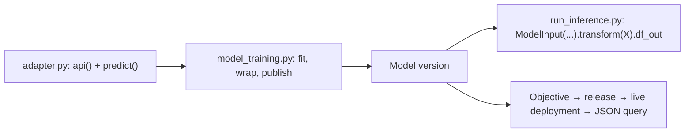

# 03 — Training in Jupyter and Code Repositories

*Sources: [Train a model in a Jupyter notebook](https://www.palantir.com/docs/foundry/integrate-models/model-asset-code-workspaces/) · [Train a model in Code Repositories](https://www.palantir.com/docs/foundry/integrate-models/model-asset-code-repositories/) · [Train a binary classification model with scikit-learn in Code Repositories](https://www.palantir.com/docs/foundry/integrate-models/model-asset-code-repositories-sklearn/) · checked October 23, 2026 · Ready for Review*

The two pro-code paths and the docs' own worked example. Both paths end in the same call, `model_output.publish(adapter)`; what differs is where the adapter file lives, how the package is named, and how the result is tested. The example then shows a complete adapter and training transform for a scikit-learn classifier, which is the shape Kestrel's fraud model takes.

## In a Jupyter code workspace

**[Docs]** The page opens with a limit: "Model assets do not currently support the SparkML library" in notebooks; use "a single-node machine learning framework like PyTorch, TensorFlow, XGBoost, LightGBM, or scikit-learn". Five steps: create a Jupyter code workspace; import data and write training code; add a model output and implement the adapter; publish; consume.

**[Docs]** Data comes in through the *Data* tab with an alias ("Training data used in Code Workspaces will need a human-readable alias as its resource identifier"), and a generated snippet such as `Dataset.get("my-alias").read_table(format="pandas")`. Packages come from the *Packages* tab (Conda or PyPI) or `maestro env conda install` / `maestro env pip install` in a terminal.

**[Docs]** Adding a model output (*Models → Add model → Create new model*) creates a `.py` file for the adapter, and the left panel walks through *Install palantir_models*, *Develop your model adapter* and *Publish your model*. The adapter "must implement" `save` and `load` (or a default serializer), `api` and `predict`. Publishing:

```python
from palantir_models.code_workspaces import ModelOutput
from linear_regression_model_adapter import LinearRegressionModelAdapter

model_output = ModelOutput("linear_regression_model")   # the model's alias
model_output.publish(LinearRegressionModelAdapter(sklearn_model))
```

**[Docs]** Consumption: submit to a modeling objective for "Automatic model evaluation", "Batch pipelines" or "Live hosting", or use a model deployment, "an alternative model hosting system beyond modeling objectives" ([05-03](../05-modeling-objectives-and-deployments/README.md)).

## In Code Repositories

**[Docs]** With the **Model Training template**: author the adapter, write a transform that trains and publishes, build, consume. The adapter and the training code "should be in separate Python modules to ensure the trained model can be used in downstream transforms" (the template's `model_adapters` and `model_training` folders). "Model adapters cannot be authored directly in Python transforms repositories": an existing transforms repository imports a Model Adapter Library or migrates to the training template ([01-02](../01-models-and-model-adapters/02-writing-a-model-adapter.md#where-the-adapter-lives)).

```python
@transform.using(
    training_data=Input("/path/to/training_data"),
    model_output=ModelOutput("/path/to/model"),
)
def compute(training_data, model_output):
    trained_model = train_model(training_data)
    model_output.publish(model_adapter=ExampleModelAdapter(trained_model))
```

**[Docs]** `ModelOutput` "will create the asset when a user selects Commit or Build and transforms checks (CI) are executed". On enrollments with classification-based access controls, "transforms cannot create their own output resources": create the model first (*+ New → Model*), set its file classification, and point `ModelOutput` at it; the same holds for output datasets. Compute for training (CPU, memory, GPU) goes on the `@configure` annotation.

**[Docs]** Testing before a build: *Preview* runs "on a smaller resource profile"; **ModelOutput preview** validates "your model training logic as well as your model serialization, deserialization, and API implementation"; **ModelInput preview** validates inference against an existing model, with "a 5GB size limit for every ModelInput". A build resolves "both the Python dependencies and dependencies of your model", then `publish()` calls `save()`.

**[Docs]** Consuming in another repository needs one of two things. With `use_sidecar=True` the adapter and its dependencies run "in a separate environment to prevent dependency conflicts"; this works for non-Spark transforms (`@lightweight` or `@transform.using`) "from palantir_models version 0.2010.0 onwards". Without it, "the model adapter and its dependencies must be imported into or defined within the current code repository": the adapter library, whose name and version for each model version are on the model page, is added to the consuming repository's environment, and the editor "will detect if a model's dependencies are not present in the repository and offer to perform the library import".

**[Docs]** The two classes, as the page summarises them: `ModelInput(model_rid_or_path, model_version=None)` retrieves a model ("If this is not provided, the most recently published model will be used") and arrives in the transform as an instance of the adapter, already loaded; `ModelOutput(model_rid_or_path)` arrives as a `WritableModel` whose `publish()` takes an adapter and creates a version. [05](05-modelinput-in-transforms.md) has the full `ModelInput` reference.

## The scikit-learn example, read as a template

**[Docs]** A random-forest binary classifier on the Breast Cancer Wisconsin dataset, dependencies `foundry-transforms-lib-python`, `pandas 1.5.3`, `scikit-learn 1.3.2`, `dill 0.3.7`. The adapter declares thirty feature columns as names (so their type is `Any`), outputs them plus `prediction` (`int`), `probability_0` and `probability_1` (`float`), and in `predict()` calls both `predict` and `predict_proba`, writing one probability column per class from `self.model.classes_`. The training transform builds a `Pipeline` of imputer, scaler and `RandomForestClassifier(n_estimators=50, max_depth=3)` and publishes `SklearnClassificationAdapter(model)`. Inference runs in a second transform with `ModelInput(<model rid>)` and `inference_results.df_out`; the live path is a modeling objective, release and deployment, queried with a JSON array of feature objects.



**[Explanation]** Three things to copy from the example and one to improve. Copy: the adapter and training code in separate modules; the probability columns named per class; `predict_proba` alongside `predict`. Improve: the thirty columns are declared without types, which [01-02](../01-models-and-model-adapters/02-writing-a-model-adapter.md#what-the-api-must-look-like-downstream) says a published function will reject (`Any` is not allowed), so a model that will become a function declares `(name, float)` pairs instead.

## Jupyter or Code Repositories

| | Jupyter code workspace | Code Repositories (Model Training template) |
|---|---|---|
| Suits | Interactive exploration; the person training is the person publishing | A repeatable training job; review through pull requests; schedules |
| Adapter package | `cws_adapter`, version from the latest Git tag | `transforms-model-training-<repository rid>`, version from the commit |
| Spark ML | Not supported | Supported ([04](04-spark-ml-distributed-training-and-gpus.md)) |
| Testing | Run cells | Preview of `ModelOutput` and `ModelInput` |
| Retraining | A scheduled job from the notebook, which only runs models created in that notebook ([00-01](../00-orientation/01-the-modelling-map.md#which-tool-for-which-job)) | A build schedule on the transform |

## For Kestrel

**[Example]** *Proposed*: the **fraud model** is trained in Code Repositories with the Model Training template, in a repository the Kestrel Pay engineers own in `Payments [Ontology]`, next to the evaluation repository of [04-03](../04-experiments-and-evaluations/03-built-in-evaluators-the-faq-and-the-evaluations-api.md#for-kestrel). Its adapter is the `FraudScoreAdapter` of [01-02](../01-models-and-model-adapters/02-writing-a-model-adapter.md#for-kestrel), extended with the example's per-class probability pattern: `score` is `predict_proba(...)[:, 1]` and `predictedFraud` the thresholded label. Daniel's and Priya's working practice from [17-02](../../Ontology/17-case-studies/02-kestrel-reference-model.md) (VS Code workspaces for authoring, Code Repositories for pull-request review) applies to the training repository too. The **delay model's** production version, when the Model Studio baseline of [01](01-model-studio.md#for-kestrel) is outgrown, follows the same route rather than a notebook: Priya may prototype features in a Jupyter workspace, but the version Ama's queue depends on is published by a transform with a schedule. Model versions are pinned in consuming transforms (`model_version=`), as [05](05-modelinput-in-transforms.md) recommends for models not retrained on a fixed schedule.

---
[Module index](README.md) · Previous: [02 — Model Studio trainers](02-model-studio-trainers.md) · Next: [04 — Spark ML, distributed training and GPUs](04-spark-ml-distributed-training-and-gpus.md)
