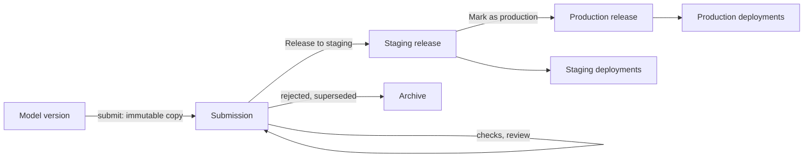

# 01 — The objective lifecycle

*Sources: [Modeling Objectives](https://www.palantir.com/docs/foundry/model-integration/objectives/) · [Create a modeling objective](https://www.palantir.com/docs/foundry/manage-models/create-a-modeling-objective/) · [Submit a model to an objective](https://www.palantir.com/docs/foundry/manage-models/submit-model/) · [Configure objective metadata](https://www.palantir.com/docs/foundry/manage-models/configure-objective-metadata/) · [Review models](https://www.palantir.com/docs/foundry/manage-models/review-model/) · [Release a model](https://www.palantir.com/docs/foundry/manage-models/release-model/) · [Archive models in an objective](https://www.palantir.com/docs/foundry/manage-models/archive-model/) · checked October 23, 2026 · Ready for Review*

The concept page and six short how-to pages, read as one lifecycle: an objective defines a problem; models are *submitted* to it as immutable candidates; candidates are *reviewed* against checks; one is *released* to staging and then production; releases drive deployments; losers are *archived*, never deleted. The concept page's one-line summary is the frame: the objective is "the interface of the problem, for which the models submitted provide the implementation".

## What an objective is

**[Docs]** "A modeling objective is a project for context, relevant data sources, metadata, and models all centralized around a specific operational problem." It is "the communication hub for the modeling ecosystem" and "the system of record for evaluating, reviewing, and operationalizing successive model solutions over time". Objectives carry **metrics** that define "how models submitted to the objective should be evaluated against each other". The overview page quoted in [00-01](../00-orientation/01-the-modelling-map.md#the-lifecycle-in-the-order-the-docs-give-it) adds the three layers it provides: governance and permissions, automation (the same evaluation for every candidate), and a release-driven deployment layer with no downtime.

**[Docs]** Creating one: *Modeling Objectives → New objective*, then a location; the page recommends "a centralized location where all relevant contributors, stakeholders, and consumers will have access to the project". The description is Markdown, meant "as a README for the objective and its goals". Three things are configured on it: **checks** ([02](02-checks-on-submissions-and-objective-settings.md)), **submission metadata**, and **evaluation options** ([06-01](../06-evaluating-in-the-objective/README.md)).

## Submissions

**[Docs]** "When a model is submitted to a modeling objective to be managed and evaluated, a copy of that model version is created. This immutable submission is akin to a code Pull Request - when submitting a model, you are asking for a comprehensive review." An objective "is functionally a catalog of potential production-worthy model versions". Submitting is a UI action: *Submit model*, choose *Model* for a model asset, pick the resource, fill in any required metadata.

**[Docs]** Metadata: some is collected by default and shown in *Model details* for every submission; **custom metadata** fields ("compliance codes, model vendor IDs, or ticket numbers in a task tracker such as Jira") are defined on the objective's *Custom model metadata* tab, support several types, can be copied between objectives through a JSON editor, and are offered to submitters at submission time.

**[Explanation]** The pull-request comparison is exact in one respect: a submission is a *copy*, so the model asset can keep publishing versions without disturbing what the objective is reviewing, and the same version can be submitted to two objectives. It is inexact in another: nothing is merged. What a review produces is a *release*, below.

## Review

**[Docs]** "Reviews on models allow various stakeholders from different backgrounds to collaborate on model evaluation, and set up processes for holistic release decisions." The stakeholders named: "modeling peers, modeling leads, organizational owners, subject-matter experts (SMEs), internal governance or ethics boards, and more". "Objective owners can set roles to control access for review, release, and deployment." The mechanics of a review are the checks of [02](02-checks-on-submissions-and-objective-settings.md).

## Releases

**[Docs]** Two kinds. "A production release represents the best current model and will power all production deployments in its modeling objective." "A staging release is a release that is staged to become the production release; staging releases are used in all staging deployments", so that "downstream operational uses of a model" can be tested first. Create one with *Release to staging* (from the objective's *Releases* section or the submission page's *Create new release*), with "a release number and a release note"; promote it with *Mark as production*.

**[Docs]** The consequence that matters: "Every release will overwrite the previous release for that environment, and all deployments in that environment will automatically be upgraded to use the newly released model." The *Releases* page keeps "a history of releases, upgrade times, and release metadata". And "Once a model submission has been released, it can no longer be archived", so a release is also a point of no return for the catalogue.

**[Explanation]** A release is the one decision in the lifecycle, and it is per *environment tag*, not per deployment. Mark a new production release and every production deployment of that objective, batch and live, moves to it at once, with no downtime and no per-deployment step. That is what [Ontology 15-03](../../Ontology/15-advanced-patterns/03-models-in-the-ontology.md) meant by wanting the model version to change *only on a decision*: the decision is *Mark as production*, and the person who can make it is set by the objective's roles.

## Archive

**[Docs]** Archiving "Removes the ability to create a release from that model" and moves it to the *Archive* table (*View archive*). "Foundry provides model archiving instead of hard deletion because objectives can act as an important system of record for models that have been previously deployed and used for operational decision-making." Released submissions cannot be archived. The clean-up reminder: "do not forget to adjust or remove the build schedule of any configured metric management pipelines."

## For Kestrel

**[Example]** *Proposed*: two objectives, one per problem, each in the project that owns the model's data and reviewers.

| | `Delivery delay` | `Payment fraud` |
|---|---|---|
| Project | `Commerce [Ontology]`, with the model, its evaluation repository ([04-02](../04-experiments-and-evaluations/02-evaluations.md#for-kestrel)) and the inference history ([04](04-querying-a-live-deployment-inference-history-compute-usage.md)) | `Payments [Ontology]`, which [Ontology 02-04](../../Ontology/02-foundry-data-foundations/04-projects-spaces-and-markings.md) leaves unmarked at project level; the objective's inference-history dataset carries `Kestrel Pay – Financial` itself ([04](04-querying-a-live-deployment-inference-history-compute-usage.md#model-inference-history)) |
| Description | ADR-007's context, the band thresholds Ama's queue uses, and the rule that `modelVersion` travels with every score | The fraud scoring need from [Ontology 09-04](../../Ontology/09-functions/04-functions-on-models-and-llms.md) and the refund audit trail the Security area wanted |
| Submitters | Priya, from the training transform's output | The Kestrel Pay engineers |
| Custom metadata | Training window (months), label rule version (excusals excluded), experiment name, the `modelVersion` identifier the adapter stamps | The same, plus the fraud threshold in force |
| Release roles | *Release to staging*: Priya; *Mark as production*: `ontology-governance`, the group that already approves ontology proposals ([Ontology 14-02](../../Ontology/14-lifecycle-and-operations/02-branching-and-proposals.md)), because a production release changes what Ama's queue sorts on | *Mark as production*: Lena as data owner of the payments projects, with Tomás's check approved ([02](02-checks-on-submissions-and-objective-settings.md#for-kestrel)) |
| Staging use | A staging live deployment that Daniel points the Delivery Desk's test branch at before a production release | A staging deployment queried by Tomás's analysis notebooks |

**[Example]** *Proposed* answer to the open question from [01-02](../01-models-and-model-adapters/02-writing-a-model-adapter.md#for-kestrel), **how the adapter knows its version**: the training transform generates a human-readable identifier at publish time (experiment name plus date, `delay-plus-weather-2026-10`) and passes it into the adapter's JSON configuration ([01-03](../01-models-and-model-adapters/03-serialization-save-and-load-upgrading-an-adapter.md#for-kestrel)), so every `predict()` output carries `modelVersion` on both the batch and the live path, and the same identifier is entered as submission metadata. The platform's own `model_version_rid` is recorded alongside it by the inference history for live calls ([04](04-querying-a-live-deployment-inference-history-compute-usage.md#model-inference-history)) and is readable from `ModelInput` in batch ([06-02](../06-evaluating-in-the-objective/README.md)). The release note of every production release names the identifier, which closes the loop 15-03 asked for: a stored `delayRisk.modelVersion` leads to a release, a submission, an experiment and a training window.

---
[Module index](README.md) · Next: [02 — Checks on submissions and objective settings](02-checks-on-submissions-and-objective-settings.md)
