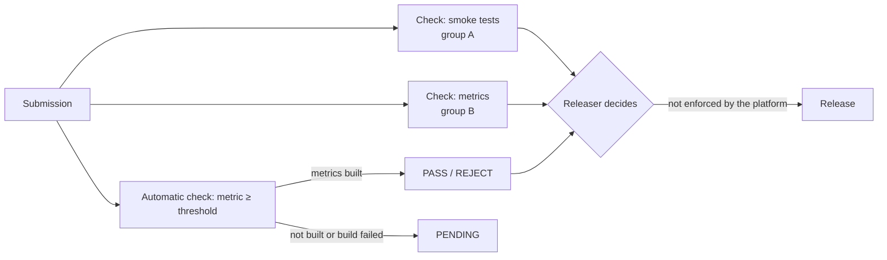

# 02 — Checks on submissions and objective settings

*Sources: [Set up checks for all submissions](https://www.palantir.com/docs/foundry/manage-models/set-up-checks/) · [Modeling objective settings](https://www.palantir.com/docs/foundry/manage-models/modeling-objective-settings/) · checked October 23, 2026 · Ready for Review*

Checks are how a review is structured: one named checkpoint per reviewer group, each with its own discussion thread and approve/reject state, and optionally an automatic one driven by an evaluation metric. The settings page lists everything else that is configured on an objective, most of it about the evaluation dashboard of module 06.

## Checks

**[Docs]** "Modeling objective checks are a way to ensure that models pass predefined quality checks before a model is operationalized." They are "customizable per objective and allow model reviewers with different expertise to collaboratively evaluate a model's performance". The page's example of three checkpoints: "A pipeline infrastructure team that confirms that your model passes the smoke tests", "A data science team that is responsible for making sure the model's metrics meet the relevant requirements", and "An ethics team that ensures proper balance in the training data or that the model meets institutional fairness requirements". Each check gets "independent discussion threads".

**[Docs]** Configure on *Settings → Checks*: a name, a description, and "users or groups that are eligible to approve this check" (approved "if anyone from the pcl-team group or the Administrators group approves"). On a submission's *Checks* panel, reviewers "can approve, reject, or comment on each check", attach files ("such as a screenshot of metrics") and tag groups.

**[Docs]** The sentence not to miss: "Currently, it is not mandatory for all checks to be approved before creating a release for a model submission."

**[Docs]** **Automatic evaluation-based checks** take their status from a metric: the input dataset and evaluation library come from the objective's evaluation configuration ([06-01](../06-evaluating-in-the-objective/README.md)), and a *metric requirement* decides. "A PASS status is achieved when the metric satisfies the requirement." REJECT "If the metric fails the requirement or is not found in the set of metrics produced by the chosen evaluation library". PENDING "If metrics were not yet built for the combination of submission, input dataset, and evaluation library", or if "the metrics build fails".

**[Docs]** Checks can be archived (the *disable* icon); their history stays visible under *View archive*. The *All models* tab filters submissions by the status of one check or of the whole submission.

**[Explanation]** Two things follow from the non-mandatory sentence. First, checks are a review *record*, not a gate: the gate is who holds the release role ([01](01-the-objective-lifecycle.md#releases)). Second, the discipline has to be written down: *no production release without every check approved* is an objective's operating rule, enforced by the releaser, not by the platform. An automatic check removes one human from that rule but not the rule.

## Settings

**[Docs]** From *Modeling objective settings* (top right of the objective's home page):

| Tab | What it holds | Note here |
|---|---|---|
| **Checks** | The checks above | — |
| **Deployments** | "the model submission deployment profile requirements for Python model submissions before they can be operationalized in a batch or live deployment" | [03](03-deployments-live-batch-direct-and-branching.md) |
| **Model metadata** | Display options for default metadata; custom metadata fields | [01](01-the-objective-lifecycle.md#submissions) |
| **Appearance** | Light or dark mode for the objective | — |
| **Advanced** | "non-standard configuration options" for "backward compatibility with legacy functionality"; "Typically, the advanced settings for a modeling objective should not be adjusted" | below |

**[Docs]** Two advanced evaluation settings. **Only show metrics produced by evaluation configuration**: when on, only metrics from the evaluation configuration appear on the dashboard; "We recommend enabling this setting to ensure a standard evaluation process"; when off, "it is not possible for your modeling objective to know whether the displayed model metrics are up to date". Turn it off only for objectives configured before evaluation configuration existed, or "non-production modeling objectives that have metrics defined in code" ([06-02](../06-evaluating-in-the-objective/README.md)). **Show pinned tabs in evaluation dashboard** shows custom metric views beside the subset tabs ([06-02](../06-evaluating-in-the-objective/README.md)).

**[Docs]** Dataset naming: the updated convention is `inference_<Model Submission Name>_<Evaluation Dataset Name>-<Generated Hash>` and `metrics_<Model Submission Name>_<Evaluation Dataset Name>_<Evaluation Library Name>-<Generated Hash>`, which fixed the conflicts the legacy names (`<Model Submission Name> inference`, `<Model Submission Name> metrics`) caused "if multiple modeling objectives created inference and metrics datasets in the same output folder". The legacy scheme remains available for compatibility.

## For Kestrel

**[Example]** *Proposed* checks, per objective, each with a two-or-more approver pool as [Security 11-01](../../Security/11-kestrel-case/01-kestrels-access-model-built-out.md) requires of every approver pool:

| Objective | Check | Approvers | Automatic? |
|---|---|---|---|
| `Delivery delay` | *Holds out of sample*: precision and recall on the hold-out month at the band thresholds | Automatic, from the evaluation configuration of [06-01](../06-evaluating-in-the-objective/README.md): REJECT below the current production release's values | Yes |
| `Delivery delay` | *Regional fairness*: no region's recall more than a set margin below the overall | Priya's data team | No (read from the subset tabs) |
| `Delivery delay` | *Queue behaviour*: Daniel confirms the staging deployment sorts the Delivery Desk test queue sensibly and the Object View labels still read *as of* and *now* ([Ontology 15-03](../../Ontology/15-advanced-patterns/03-models-in-the-ontology.md)) | Daniel, Ama's team lead | No |
| `Payment fraud` | *Classification quality*: `roc_auc` and recall on the monthly hold-out | Automatic | Yes |
| `Payment fraud` | *Fraud review*: Tomás reads the per-corridor subsets and the confusion matrix | Tomás, Lena | No |
| Both | *Adapter unchanged or reviewed*: an adapter-only upgrade ([01-03](../01-models-and-model-adapters/03-serialization-save-and-load-upgrading-an-adapter.md#for-kestrel)) is confirmed to have left the metrics where they were | The submitter's peer | No |

**[Example]** *Proposed* operating rule, written into each objective's description because the platform does not enforce it: *no production release while any check is pending or rejected*; the releaser (`ontology-governance` or Lena, [01](01-the-objective-lifecycle.md#for-kestrel)) confirms the *All models* filter shows the submission green before *Mark as production*. *Only show metrics produced by evaluation configuration* stays on for both objectives; the dataset naming stays on the updated convention, with one output folder per objective, as the evaluation page recommends ([06-01](../06-evaluating-in-the-objective/README.md)).

---
[Module index](README.md) · Previous: [01 — The objective lifecycle](01-the-objective-lifecycle.md) · Next: [03 — Deployments: live, batch, direct and branching](03-deployments-live-batch-direct-and-branching.md)
