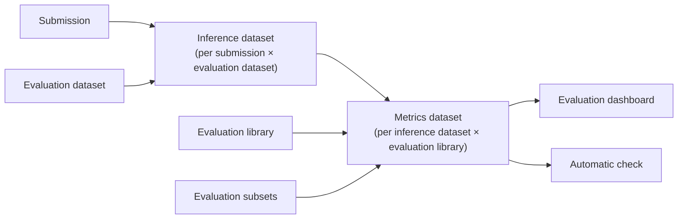

# 01 — Automatic and in-code evaluation

*Sources: [Automatically evaluate models](https://www.palantir.com/docs/foundry/evaluate-models/model-evaluation-automatic/) · [Evaluate a model in code](https://www.palantir.com/docs/foundry/evaluate-models/model-evaluation-code/) · checked October 23, 2026 · Ready for Review*

Module 04 evaluated a *model version* from code, on the model page. Module 06 evaluates every *submission* to an objective the same way, on the objective's dashboard. The automatic page is the one that matters today; the in-code page describes `MetricSet`s built on `foundry_ml`, which the docs now mark for deprecation and point away from.

## Why the objective evaluates

**[Docs]** "As modeling projects mature, scale, and become operational, it is critical to evaluate and compare current and new model submissions systematically", "using well-maintained representative data against well-defined metrics". An objective "can be configured to automatically generate inference and metrics pipelines for all models submitted to that objective", "a systematic testing and evaluation (T&E) plan in software".

## The configuration, step by step

**[Docs]** From *Configure evaluation dashboard* (or *Edit evaluation configuration*):

| Step | What is set | Rules on the page |
|---|---|---|
| **Pipeline management** | Generate "inference and metrics pipelines" or "only generate inference pipelines"; whether to build them automatically on submission | "Inference and metrics pipelines are only built on model submission"; existing submissions need *Build evaluation* by hand |
| **Evaluation datasets** | One or more datasets, each with a folder for inference datasets and a folder for metrics datasets | "one inference dataset will be generated for every combination of model submission and evaluation dataset"; datasets may include "curated validation or test sets, production observations, user feedback instances, key test cases, or representations of hypothetical scenarios", and "can have different sizes, update cadences, and permissions"; dataset and objective must be in the same project as the destinations, or added as a reference; "only compatible with models that have a single tabular dataset input" |
| **Evaluation libraries** | A published Python package that "produces a model evaluator": the default binary-classification and regression evaluators or a custom one ([03](03-model-evaluators.md)); its fields, with *expected model outputs* for columns the model will produce (`prediction`, `probability_1`, confidence scores) | "one dataset containing a metric set for every configured inference dataset" |
| **Evaluation subsets** | Optional slices of each evaluation dataset for which metrics are "separately generated" | Always an *Overall* subset; string fields give one subset per value; numeric fields use *Fixed width* (start value and width) or *Range cut-offs* (lower bound inclusive, upper exclusive; uncovered ends get extra buckets); multi-field subsets give "a subset for every combination of bucket between fields"; "generating a large number of subsets may significantly increase build times" |

**[Docs]** "Permissions are fully respected inside a modeling objective. Users cannot see models, evaluation datasets, evaluation libraries, or metrics without having the proper access." The page's recommendation is "one output folder per modeling objective".

**[Explanation]** The design choice in that table is which datasets to evaluate against. The page lists five kinds; the two that make an objective operational rather than academic are *production observations* (what the model actually saw) and *key test cases* (the handful of rows a reviewer can reason about). The subsets are where fairness lives: the page says they "can be generated on any column of an evaluation dataset", so a protected attribute that the model never sees as a feature can still be a subset.

## Evaluating in code: the deprecated path

**[Docs]** The page opens with the notice: metric sets "were built for dataset-backed models using" `foundry_ml`, "a library which has been formally deprecated since October 31, 2025", and "For new implementations, we recommend using experiments instead." Metric sets "will not appear on the model page for a model built with" `palantir_models`, "although they can be shown in a modeling objective". The mechanics: a transform creates a `MetricSet(model=..., input_data=...)`, adds numbers and figures with `metric_set.add(name, value, subset)`, and saves it (`metric_set.save(metrics_output)` in Code Repositories; returned from a Code Workbook); subsets are dictionaries such as `{'median_house_value': 'Old (>30)'}`; metrics are "associated with a specific transaction of the evaluation dataset" and must be rebuilt when the model or the data changes. To see them, the objective setting *Only show metrics produced by evaluation configuration* must be off ([05-02](../05-modeling-objectives-and-deployments/02-checks-on-submissions-and-objective-settings.md#settings)).

**[Explanation]** Read this page as history and as a migration note. Everything it does by hand, the automatic configuration does for every submission; and what it did for a *version*, the evaluations of [04-02](../04-experiments-and-evaluations/02-evaluations.md) now do with `palantir_models`. The one reason to touch it is an existing objective whose dashboard still shows `MetricSet` output ([02](02-the-evaluation-dashboard-metric-views-and-metricsets.md)).

## For Kestrel

**[Example]** *Proposed* evaluation configuration, both objectives: inference *and* metrics pipelines, built automatically on submission, one output folder per objective in the objective's project.

| Objective | Evaluation datasets | Library and fields | Subsets |
|---|---|---|---|
| `Delivery delay` | `delivery_holdout_month` (last complete month of delivered shipments, rebuilt monthly by Priya's pipeline); `delivery_key_cases` (about fifty shipments Ama's team lead picked: known-late carriers, excused delays, a reroute) | Binary classification ([03](03-model-evaluators.md)): `inference_field` = `predictedLate`, `actual_field` = `isLate`, `probability_field` = `probability` (`predictedLate_proba_1` for the Model Studio baseline); both label columns as 0/1 integers, which the evaluator requires ([03](03-model-evaluators.md#binary-classification)) | `region` (string: one subset per region); carrier; promised lead time in fixed-width buckets of 24 hours |
| `Payment fraud` | `payments_holdout_month`; `payments_confirmed_fraud` (every confirmed case from `Fraud Case`, as production observations) | Binary classification: `predictedFraud`, `isFraud`, `probability_field` = `score` | `cardCountry`; amount in range cut-offs at the refund thresholds Lena's team uses |

**[Example]** The `delivery_key_cases` dataset is the one Ama's team can argue with: a model that scores a shipment everyone knows will be late as *low* fails a check a metric would not catch. The amount cut-offs are *proposed* as whatever thresholds Kestrel Pay's refund policy already uses, which [17-02](../../Ontology/17-case-studies/02-kestrel-reference-model.md) does not record; until it does, the subset is a placeholder and goes into the open items of [00-02](../00-orientation/README.md). No `MetricSet`s: Kestrel has no `foundry_ml` code ([07-02](../07-language-models-migration-and-products/README.md)), and the plan already recorded the migration as not applicable.

---
[Module index](README.md) · Next: [02 — The evaluation dashboard, metric views and MetricSets](02-the-evaluation-dashboard-metric-views-and-metricsets.md)
