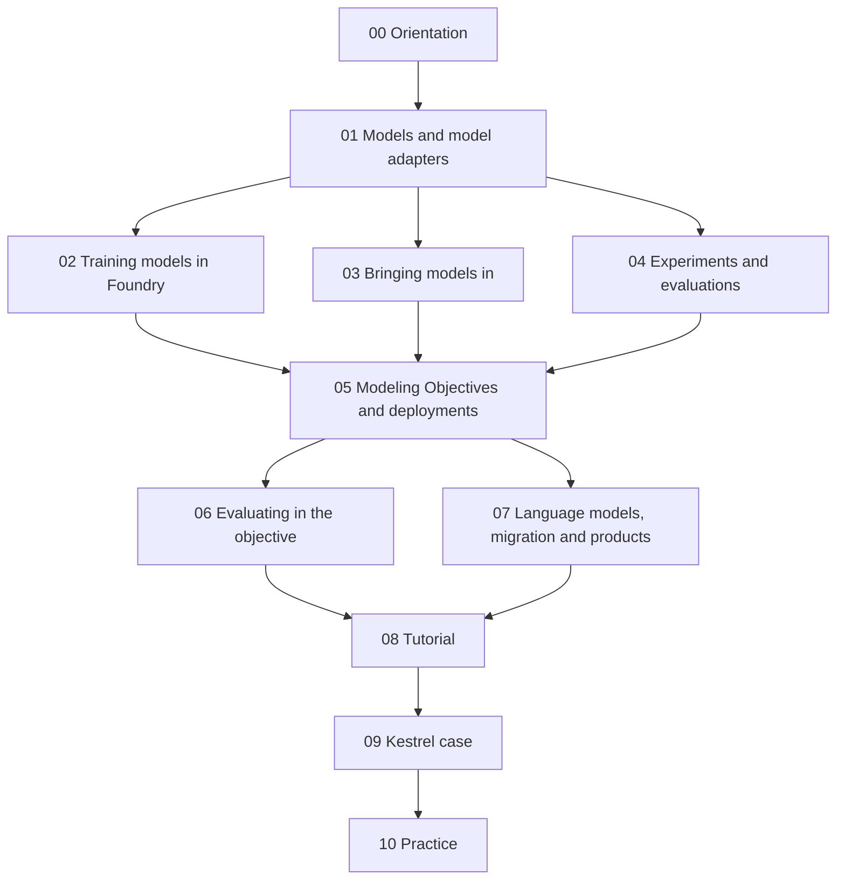

# Model integration

A course and working reference for the **Model connectivity & development** part of the Foundry docs (URL prefix `model-integration`, hence the area's name): what a model is in Foundry (saved artifacts plus a model adapter), how it is trained (Model Studio, Jupyter, Code Repositories, Spark) or brought in (files, containers, externally hosted APIs), how training runs and model versions are recorded (experiments, evaluations), how models are managed and served (Modeling Objectives: submissions, reviews, releases; live, batch and direct deployments) and how a deployed model becomes a function in the Ontology. Every page in scope is assigned to a planned note; the [docs index](99-reference/docs-index.md) maps them.

| | |
|---|---|
| Structure | Created October 23, 2026 (Phase 2). Built from the official docs; the course notes listed in each module are linked, not reused as sources. |
| Notes written | **25 of 36**: [00 Orientation](00-orientation/README.md), [01 Models and model adapters](01-models-and-model-adapters/README.md), [02 Training models in Foundry](02-training-models-in-foundry/README.md), [03 Bringing models in](03-bringing-models-in/README.md), [04 Experiments and evaluations](04-experiments-and-evaluations/README.md), [05 Modeling Objectives and deployments](05-modeling-objectives-and-deployments/README.md), [06 Evaluating in the objective](06-evaluating-in-the-objective/README.md), [07 Language models, migration and products](07-language-models-migration-and-products/README.md), [08 Tutorial: supervised machine learning](08-tutorial-supervised-machine-learning/README.md), [09 Kestrel case](09-kestrel-case/README.md), [10 Practice](10-practice/README.md), [99 Reference](99-reference/README.md). Module READMEs list every note and the official pages it covers. |
| Scope | 98 pages: the docs' *Model connectivity & development* sidebar, read from the fetched sidebar HTML on October 23, 2026 (`_tools/mdl/raw.tsv`). The release-notes link is out of scope. Ten pages are API references (the ModelAdapter and language-model-adapter references above all) and are read in full but written as reference sheets. |
| Sources | Official Palantir documentation first. Register, corrections and open questions: [SOURCES](SOURCES.md) |
| Why it matters | The Application Developer Associate exam's domain 7 (AIP Logic and AI-powered applications) was covered on the language-model side by the AIP area; the *model* side, how a predictive model is trained, evaluated, released and served to a function, is this sidebar. Domain 3 (Ontology functions) names functions on models; domain 6 names recovery and monitoring, where live deployments reappear from the Observability area |

## How this area relates to the others

The [Ontology area](../Ontology/README.md) already decided how Kestrel's delivery-delay model reaches the Ontology ([15-03](../Ontology/15-advanced-patterns/03-models-in-the-ontology.md), ADR-007: a batch property plus a live function) and how a function wraps a deployed model ([09-04](../Ontology/09-functions/04-functions-on-models-and-llms.md)); this area supplies the lifecycle underneath both: adapter, training, experiments, evaluation, objective, release, deployment, inference history. The [AIP area](../AIP/README.md) covers language models: the catalog ([01-01](../AIP/01-models-and-llms/01-supported-llms-and-model-catalog.md)), bringing your own LLM ([02](../AIP/02-bring-your-own-model/README.md)) and Evals for Logic functions ([04](../AIP/04-aip-evals/README.md)); here a *model* is usually a predictive one, an *evaluation* is metrics on its predictions, and the one LLM page group (language model adapters, 07-01) is read against AIP 02. The [DevTools area](../DevTools/README.md) covers compute modules ([03](../DevTools/03-compute-modules-and-custom-endpoints/README.md)), which container *models* resemble but are not (03-02 says when each fits), and DevOps and Marketplace ([08](../DevTools/08-product-delivery/README.md)), through which a model can travel in a product (07-03). The [Observability area](../Observability/README.md) has the monitoring rules for live deployments ([01-02](../Observability/01-monitoring-views/02-monitoring-rules-reference.md)) and the Metrics tab ([03-04](../Observability/03-ontology-and-aip-observability/04-metrics-performance-and-observability-dashboards.md)); 05-04 says what a live deployment is and how it scales, and refers to those rules rather than repeating them. Training in Code Repositories and Jupyter is explained as far as the model pages go; the mechanics of transforms, datasets and builds belong to the Data integration docs, not yet an area here.

## Learning path

## Modules

| # | Module | What you learn | Status |
|---|---|---|---|
| 00 | [Orientation](00-orientation/README.md) | The modelling map; Kestrel's posture | In Progress (1/2) |
| 01 | [Models and model adapters](01-models-and-model-adapters/README.md) | Model assets, adapters, serialization, the API reference | **Ready for Review** |
| 02 | [Training models in Foundry](02-training-models-in-foundry/README.md) | Model Studio and its trainers; Jupyter, Code Repositories, Spark, GPUs; ModelInput | **Ready for Review** |
| 03 | [Bringing models in](03-bringing-models-in/README.md) | Models from files, containers and external APIs | **Ready for Review** |
| 04 | [Experiments and evaluations](04-experiments-and-evaluations/README.md) | Experiments, evaluations, evaluators | **Ready for Review** |
| 05 | [Modeling Objectives and deployments](05-modeling-objectives-and-deployments/README.md) | Objectives, submissions, releases; live, batch and direct deployments; models in the Ontology | **Ready for Review** |
| 06 | [Evaluating in the objective](06-evaluating-in-the-objective/README.md) | Automatic evaluation, the dashboard, MetricSets, evaluators | **Ready for Review** |
| 07 | [Language models, migration and products](07-language-models-migration-and-products/README.md) | Language model adapters; foundry_ml migration; DevOps and Marketplace | Planned |
| 08 | [Tutorial: supervised machine learning](08-tutorial-supervised-machine-learning/README.md) | One model trained three ways, evaluated and productionized | Planned |
| 09 | [Kestrel case](09-kestrel-case/README.md) | Kestrel's delivery-delay, fraud and Kestrel Pay models | Planned |
| 10 | [Practice](10-practice/README.md) | Review questions tagged by exam domain | Planned |
| 99 | [Reference](99-reference/README.md) | Limits, decision guide, docs index | In Progress (1/3) |

## Conventions

Same as the Ontology, AIP, Apps, DevTools, Security and Observability areas. Each note has a one-line *Sources · checked · status* header and footer navigation; otherwise its shape follows its topic. Labels: **[Docs]** (only real doc wording goes in quote marks), **[Concept]**, **[Explanation]**, **[Recommendation]**, **[Example]**, **[Analogy]**, **[Observed]**. Open questions are numbered RQ-NN in [SOURCES](SOURCES.md). Self-checks live only in [10 — Practice](10-practice/README.md). Examples use **Kestrel Commerce**, as defined in [Ontology 17-02](../Ontology/17-case-studies/02-kestrel-reference-model.md).

---
[Learn home](../../README.md) · [Capabilities](../README.md) · [Topic map](MAP.md) · [Sources](SOURCES.md) · [Glossary](GLOSSARY.md)
