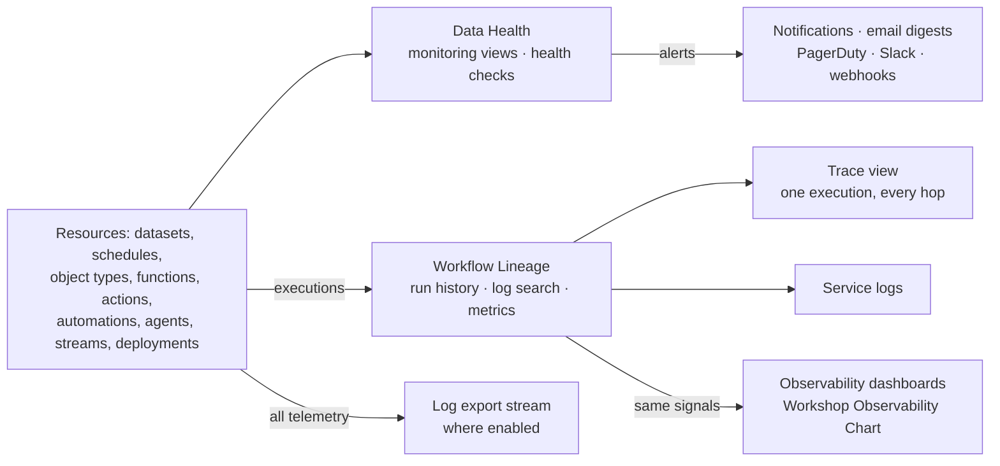

# 01 — The observability map

*Sources: [Observability](https://www.palantir.com/docs/foundry/observability/overview/) · [Data Health](https://www.palantir.com/docs/foundry/observability/data-health/) · checked October 23, 2026 · Ready for Review*

Two short pages that say what the whole sidebar is for. The overview sorts the tools by **verb**; the Data Health page splits the monitoring half into **two feature sets**. Both distinctions carry the rest of the area, so this note draws them once and then says what is *not* here, because the exam uses the word "monitoring" for three different things.

## Four verbs, four tools

**[Docs]** The platform's built-in tools let you "monitor the health of your resources, debug issues in development and production, trace execution across services, and analyze telemetry at scale":

| Verb | Tool | What you do there |
|---|---|---|
| **Monitor** | **Data Health** | Set rules and thresholds "for failures, latency and more"; configure monitors per resource or at scale across projects; receive alerts "through PagerDuty, Slack, webhooks, or Foundry notifications"; see execution counts and P95 latency for the last 30 days |
| **Debug** | **Workflow Lineage** | Explore platform history and logs: "seven days of execution history", filtered by status, user, duration or version; search logs across all executions of a **source executor** |
| **Trace** | **Trace views** | "the full request journey across functions, actions, and LLM calls"; drill into any operation for duration, inputs, outputs and errors |
| **Analyze** | **Log export** | Export logs, metrics and traces "to a streaming dataset to power your own dashboards, pipelines, or custom observability workflows" |

**[Docs]** Three more sections fill the map in. **Metrics**: functions, actions and AIP Logic report "near real-time success/failure counts and P95 execution duration over the last 30 days", in Ontology Manager, in Workflow Lineage, or embedded in a Workshop module with the **Observability Chart** widget; streams and compute modules have a **Metrics tab**. **Logs**: from third-party libraries your code uses (Kafka for streams is the example) and from your own code; live logs on a transform's job report, compute module logs on its overview page, function logs in Workflow Lineage. **Log export**: "may not be available in your enrollment"; where it is, "a stream in a specified folder containing all telemetry for an organization", logs, metrics and traces together, configured on the *Configure logging* page of the Administration docs.

**[Explanation]** The split that matters for everything after this note: Data Health tells you *that* something is wrong and routes the news; Workflow Lineage tells you *what happened* inside the execution that went wrong. The overview even hands over from one to the other: an alert on a function or action opens its run history pre-filtered to the executions that tripped the rule ([01-01](../01-monitoring-views/01-monitoring-views-and-core-concepts.md#5-from-an-alert-to-the-lineage)). Modules 01 and 02 are the first tool; module 03 is the second.

## Data Health's two feature sets

**[Docs]** Data Health is "the primary application for monitoring the health of your platform resources", reached from the Foundry sidebar, and it has two feature sets:

| | **Monitoring views** | **Health checks** |
|---|---|---|
| **Idea** | Scope-based rules: "Monitor resources at scale using scope-based monitoring rules" | Detailed checks on one resource: "content and schema validation for datasets" |
| **Resource types** | "datasets, schedules, streaming datasets, agents, object types, and more" | Datasets, schedules, tables |
| **Scope** | Project, folder, or a single resource | A single resource |
| **Use when** | "you need coverage that scales automatically as resources are added" | "you need fine-grained validation of a specific resource's data quality, agnostic of a workflow" |
| **Module** | [01](../01-monitoring-views/README.md) | [02](../02-health-checks/README.md) |

**[Docs]** Both "generate alerts when issues are detected". Three delivery routes: **Foundry notifications** (subscribe to a monitoring view or an individual check), **email digests** "on a configurable schedule", and **external systems**: PagerDuty, Slack, "or arbitrary REST endpoints through built-in integrations". Health checks are also reachable from the resource itself: a dataset's **Health** tab in Dataset Preview; a schedule's *Metrics > Health* in Data Lineage; and Data Lineage can colour datasets by health check status and list every check in a *Data Health* tab at the bottom.

**[Explanation]** Read the two columns as *rule* versus *check*. A rule is written once against a scope (*every schedule in this project*) and applies to whatever lands there later; a check is written against one dataset and knows its columns. The FAQ in [01-04](../01-monitoring-views/04-monitoring-faq-and-the-check-groups-sunset.md) gives the exact coverage split: some things only a rule can watch (agents, OSv2 objects, streams, live deployments, automations), some only a check can (content, freshness, schema, data expectations), and a few checks have been replaced by rules. The docs' own recommendation is to use both, inside one monitoring view, which is also where the Kestrel design in module 04 ends up.

## What is *not* in this area

**[Explanation]** Four neighbouring things share vocabulary with this sidebar and live elsewhere:

| It sounds like monitoring, but it is… | Where it lives |
|---|---|
| **Automate**, which replaced *Object Monitoring* as the business-automation entry point: conditions on objects or time, effects such as actions and notifications | [Apps 08](../../Apps/08-automate/README.md). Automations are a *resource type* this area monitors (rules for missed evaluations and failed effects, [01-02](../01-monitoring-views/02-monitoring-rules-reference.md#automations)), not a monitoring tool |
| **Audit logs**, which record who did what on the platform, with retention and export datasets | [Security 10-02](../../Security/10-privacy-governance-and-enterprise-security/02-audit-logs.md). The logs in module 03 record what the *code* did; [03-03](../03-ontology-and-aip-observability/03-log-search-and-log-permissions.md) draws the line |
| **Chatbot session logging**, an export of a chatbot's conversations | [AIP 05-04](../../AIP/05-chatbot-studio/04-session-logging.md). Trace views cover the model calls a function or agent makes, not a chat transcript |
| **Build job reports and schedules** themselves, and the *maintaining pipelines* guidance both Data Health pages point to | The Data integration docs, not yet an area here. This area explains the checks and rules placed *on* datasets and schedules, not how builds run |

Two numbers already disagree inside this sidebar, and the Ontology area logged it as [RQ-26](../../Ontology/SOURCES.md#open-research-questions): the overview says Workflow Lineage shows "seven days of execution history", while the metrics sentence on the same page, the run-history page and the metrics page say 30 days. [03-01](../03-ontology-and-aip-observability/01-overview-and-run-history.md) records both readings; until the pages agree, plan for seven.

## Where this sits in the exam

**[Explanation]** From the [exam guide](../../../Tracks/Application%20Developer/07_Exam_Guide.md): **D6** (Automate and operational workflows) ends with *recovery and monitoring*, which is the automation rules in 01-02 and the run history in 03-01; **D8** (application security, governance and operations) ends with *operational diagnosis*, which is modules 01–03 read as a triage path; **D3** (Ontology functions) names *publishing and diagnosis*, which is the function metrics, failure types and traces in module 03. [Ontology 09-03](../../Ontology/09-functions/03-function-lifecycle.md) already summarised function metrics and failure categories from the Functions docs; this area reads the observability pages those summaries point to.

## For Kestrel

**[Example]** What Kestrel has today, before this area adds anything:

- An **operations calendar** ([Ontology 14-06](../../Ontology/14-lifecycle-and-operations/06-monitoring-and-cleanup.md)): a daily look at Data Health alerts, action failure counts and the payment-hold automation's run history; a triage flowchart from alert to run history to trace or service logs. It names the alerts it expects (index pipeline failures, Sync Propagation Delay on `Shipment` and `Order`) but no monitoring view, rule or health check has been designed.
- A **Delivery Desk health page** of Observability Charts for `draftDelayMessage` and *Hold order* ([Apps 03-06](../../Apps/03-workshop-widgets/06-ai-observability-and-embedding.md), [11-01](../../Apps/11-kestrel-case/01-delivery-desk-queue-built-out.md)).
- The customer portal's **error handling and usage metrics** from Developer Console ([DevTools 09-01](../../DevTools/09-kestrel-case/01-customer-portal-built-out.md#errors-limits-and-monitoring)), and the audit export's standing queries ([Security 10-02](../../Security/10-privacy-governance-and-enterprise-security/02-audit-logs.md#for-kestrel)).

The gap this area fills: *who is told, through what, when which rule fires*, and *which logs the person told may read*. [00-02](02-kestrels-monitoring-posture.md) keeps the register of proposals; [04](../04-kestrel-case/README.md) builds them out.

---
[Module index](README.md) · Next: [02 — Kestrel's monitoring posture](02-kestrels-monitoring-posture.md)
