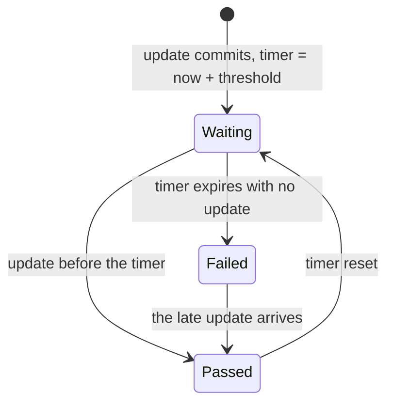

# 02 — Schedules, watching and notifications

*Sources: [Check schedules](https://www.palantir.com/docs/foundry/health-checks/check-evaluation/) · [Watching checks](https://www.palantir.com/docs/foundry/health-checks/watching-checks/) · [Notifications and issues](https://www.palantir.com/docs/foundry/health-checks/notifications/) · checked October 23, 2026 · Ready for Review*

Three short pages on the mechanics around a check: **when** it evaluates, **who** hears, and **what** the news looks like. The first is the one worth reading twice, because the automatic schedule of a time-based check is a small state machine that explains why the check fires exactly at the threshold rather than at the next build.

## When a time-based check runs

**[Docs]** A time-based check is evaluated either **automatically** or on a **manual schedule**. Automatically means two triggers: "When a dataset is updated" and "When a dataset passes the threshold you have configured". An update transaction makes the check evaluate the dataset against its rule and the time since the previous transaction, and "reset the threshold for the next check by adding the time threshold minimum to the current time".

**[Docs]** The page's worked example, a *Time since last updated* check with a threshold of one hour:

| Case | What happens |
|---|---|
| The dataset updates after **58 minutes** | The check runs on the update and passes; the next evaluation is rescheduled for 60 minutes from now. "As long as the dataset continues to update in less than 60 minutes, the check will continue to pass on dataset update, and never reach the threshold" |
| The dataset updates after **62 minutes** | At 60 minutes a check runs "as set by the one hour threshold" and **fails**; at 62 minutes the update runs it again and it **passes**; "Any watchers of the check will be notified" |

**[Docs]** A **manual schedule** "runs checks at a regular interval regardless of when the dataset is built": by minute, hourly, daily, weekly, or custom.

**[Explanation]** So an automatic freshness check never needs a build to notice silence: the failure fires at the threshold, from the timer set by the last update. That is what makes it the right check for *the pipeline stopped*. A manual schedule exists for checks whose question isn't about the gap between updates, say a daily content check on a dataset that updates hourly, where you want one evaluation a day, not twenty-four.

## Who is told

**[Docs]** The page opens by pointing elsewhere: "Instead of watching individual checks, you can create and subscribe to a monitoring view". For a single check, expand it and *Watch*; the check's rule section decides what a watcher receives: **Nothing** (never), **All failures** (Moderate and Critical), **Only critical**. The recommendation: give Moderate and Critical different thresholds, with Critical looser; the example is a build-duration check that fails Moderately at 5 minutes and Critically at 10. *Watch All* applies the same to every check on a dataset.

**[Docs]** **Pausing** a check "will temporarily snooze its alerts for all watching/subscribed users"; **deleting** removes its configuration and schedule for good.

**[Explanation]** Two severities are the health-check world's version of the three monitoring severities, and the mapping onto PagerDuty in [01-03](../01-monitoring-views/03-alerts-the-debug-page-and-external-systems.md#pagerduty) was Info/low → LOW, Moderate → MEDIUM, Critical → HIGH. The advice to make Critical *looser* reads backwards until you see it as two thresholds on one metric: Moderate at the first sign, Critical when it's unmistakable. Pausing differs from snoozing a monitor alert in [01-01](../01-monitoring-views/01-monitoring-views-and-core-concepts.md#4-snooze): it's a property of the check, for everyone, not of one alert.

## What the news looks like

**[Docs]** Data Health "will always send an in-platform notification to watchers of failed checks". **Email** is opt-in per user, under the profile's *Settings > Notifications*, where "To receive updates on checks make sure to check everything under the Builds section". And a check can **file an Issue** on failure: tick *Automatically create an issue when this check fails* when creating or editing it, optionally naming an assignee; Data Health "can also automatically close the issue once the check resolves".

**[Explanation]** The Issue integration is the mechanism behind the operating rule [01-04](../01-monitoring-views/04-monitoring-faq-and-the-check-groups-sunset.md#for-kestrel) kept from check groups: if every check that matters files an Issue, *check Issues first* becomes a real step rather than a hope, and auto-closing keeps the list honest. Monitoring rules have no equivalent today; their counterpart is the SOP card ([01-03](../01-monitoring-views/03-alerts-the-debug-page-and-external-systems.md#the-alert-debug-page)).

## For Kestrel

**[Example]** *Adopted* in Phase 6 ([04](../04-kestrel-case/README.md)):

- **Automatic schedules** for every freshness check in [01](01-health-checks-and-the-types-of-checks.md#for-kestrel); a **manual daily schedule** for the content checks in [03](03-checks-reference.md#for-kestrel), evaluated once a day after the pipelines' runs, so a check doesn't re-run on every intermediate transaction. The cadence is the open item from [01-02](../01-monitoring-views/02-monitoring-rules-reference.md#for-kestrel): it is set from each dataset's `refresh` tag once Priya records it.
- **Two thresholds per check** where the metric is continuous: schedule duration Moderate at the median plus one deviation, Critical at twice the expected duration; freshness on the shipments dataset Moderate at one hour (the queue's requirement) and Critical at three.
- **Nobody watches individual checks.** Subscriptions go through the two monitoring views, as the page itself suggests; *Watch* on a single check is reserved for Priya while tuning a new one.
- **Issues on**, assigned to Priya for the commerce pipelines and to a named Kestrel Pay engineer for the ledger (the box takes one user), with auto-close, so the Issues panel is the incident list.

---
[Module index](README.md) · Previous: [01 — Health checks and the types of checks](01-health-checks-and-the-types-of-checks.md) · Next: [03 — Checks reference](03-checks-reference.md)
