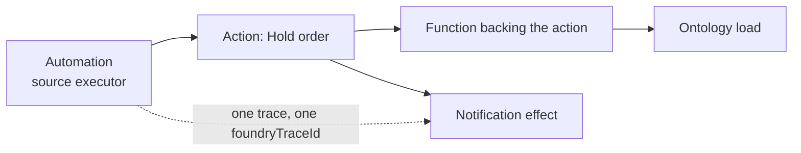

# 02 — Trace views, service logs and debugging

*Sources: [Trace views](https://www.palantir.com/docs/foundry/aip-observability/trace-view/) · [Service logs and debugging](https://www.palantir.com/docs/foundry/aip-observability/service-logs-and-debugging/) · checked October 23, 2026 · Ready for Review*

What *View log details* opens: a **trace**, the timeline of one execution across every service it touched, and the **service logs**, the lines the code and the platform wrote while it ran. The second page ends with the only writing advice in the sidebar, how to log from a function so the logs are worth reading, and one rule that connects back to the Security area: never log what you wouldn't want in a dataset.

## The trace view

**[Docs]** "a visual timeline of your workflow execution, showing how different services interact and where time is spent". A distributed trace is "the timeline comprising all of the events between the generation of a request and the receipt of a response", crossing "process, network and security boundaries".

| Element | What you see |
|---|---|
| **Timeline** | Horizontal bars, one per operation, length = duration |
| **Service hierarchy** | Nested spans: parent and child operations |
| **Resource types** | Colour by origin: function, action, automation, model, or LLM call |
| **Performance** | Each span shows its execution time |

**[Docs]** Selecting a span opens its **Trace Log Details**: operation name (function, action, language model, automation, model, "or inner operation"); duration; **input and output data** for function execution requests ("the parameters passed to and returned from the operation"); **model interactions** for LLM calls ("the prompt, response, and token usage"); **error information** (stack traces and messages); and two identifiers: `foundryTraceId`, "the Foundry-assigned identifier used to fetch telemetry", and `x-b3-traceid`, the standard distributed-tracing ID, carried in the `tags` field of each service log entry "best-effort; may be absent on logs originating outside Foundry, such as applications built with the Ontology SDK".

**[Explanation]** A trace is the picture the run-history table flattens into one row. The source executor is the outermost span, the caller of any inner span is its parent, and the model call sits inside the function that made it, with its prompt and tokens attached. Two things to read off it that nothing else shows: *where the time went* (the long bar), and *what the model was actually asked* (the LLM span's prompt), which is the same content the Security area treats as sensitive in [03](03-log-search-and-log-permissions.md#who-may-read-logs). The `x-b3-traceid` caveat matters for Kestrel's portal: an OSDK application's own logs may carry no trace ID, so correlating a portal request with its Foundry trace is the portal's job ([DevTools 09-01](../../DevTools/09-kestrel-case/01-customer-portal-built-out.md)).

## Service logs

**[Docs]** The **Details** view behind *View log details* lists "All log messages generated during execution", chronologically, at five levels, **INFO, WARN, ERROR, DEBUG, TRACE**, including "Any console.log() or logging statements from your functions or models". Filter by level with the selector at the top; select the *Content* field for a full entry. The page's gloss on levels: ERROR for "Error messages and stack traces", WARN for "potential issues", INFO for "execution flow", DEBUG and TRACE for detail.

## Who may look

**[Docs]** Both pages carry the same box: "To view traces and service logs, an administrator must enable log access for the relevant project. Users always have access to logs for their own executions from the past 24 hours, except on CBAC stacks", "where log access must be enabled to view trace and service logs". The full model is the next note ([03](03-log-search-and-log-permissions.md#who-may-read-logs)).

## Writing logs that help

**[Docs]** The page's practices, under *Writing effective logs in your functions*:

| Practice | The page's guidance |
|---|---|
| **Levels** | INFO "for normal operation flow and key business events"; WARN "for recoverable issues or unexpected conditions that do not prevent execution"; ERROR "for failures that prevent normal operation"; DEBUG "for detailed diagnostic information (avoid in production)" |
| **Context** | Include identifiers, counts and retry context: the TypeScript v1 examples log the order and user IDs, the number of items retrieved, the retry attempt of a maximum, and the error message with the order ID |
| **TypeScript v2** | Uses `@opentelemetry/api-logs`: `logs.getLogger("my-function")`, then `logger.emit({ severityText, attributes: { LOG_MESSAGE }, body })`, with the IDs repeated in the structured `body` |
| **Sensitive data** | "Never log sensitive information that could compromise security": not credentials, not a full API response that "May contain sensitive data"; log the username of an authentication attempt and the status of an API call instead |

**[Explanation]** The v2 shape is the one to teach: the message in `LOG_MESSAGE` for humans, the same fields in `body` for log search ([03](03-log-search-and-log-permissions.md)), which matches on the *Content* column too. And the sensitive-data rule is where this module meets [Security 03-01](../../Security/03-discretionary-controls-propagation-and-diagnosis/01-access-control-propagation.md): a function reads a `Customer` under the user's permissions, but a log line is text, and the next note says markings do **not** follow data into logs. Whatever a function logs is protected only by the markings an administrator chose when enabling log access. So *don't log the full response* is not hygiene, it is the only control on that path that the developer holds.

## For Kestrel

**[Example]** *Adopted* in Phase 6 ([04](../04-kestrel-case/README.md)):

- **A logging standard for Kestrel's functions**, written into Daniel's and Priya's repository templates ([DevTools 09-02](../../DevTools/09-kestrel-case/02-daniels-developer-setup.md)): TypeScript v2 logging with `orderId`, `shipmentId` and the action's request ID in `body`; INFO at entry and exit with counts, WARN on retries, ERROR with the message; **never** a `Customer` object, an address, an email, a card number or a model prompt in a log line. The agent's `draftDelayMessage` logs the order ID and the length of the draft, not the draft.
- **Code scanning** gets a third custom rule ([Security 10-05](../../Security/10-privacy-governance-and-enterprise-security/05-code-scanning.md#for-kestrel)): a `console.log` or `logger.emit` whose arguments include an object typed `Customer`, `Payment` or `Refund`, or a field named like `email`, `address`, `cardNumber`, is flagged.
- **The trace is the agent's audit view**: for a staged write the agent proposed ([Ontology 16-04](../../Ontology/16-ai-and-agents/04-human-in-the-loop-and-staged-writes.md)), the trace shows the tool calls, the prompt and the tokens; Daniel reads it when a proposal looks wrong. Who may read it is settled in [03](03-log-search-and-log-permissions.md#for-kestrel).
- **The portal** logs the timestamp, the service user and the failing call for every error, because its own logs may carry no trace ID (the page's caveat for OSDK applications); the join to Foundry's run history is then the timestamp and the caller column. Whether an error response carries a `foundryTraceId` the portal could keep is not stated on these pages and is logged as a question for DevTools 09-01.

---
[Module index](README.md) · Previous: [01 — Overview and run history](01-overview-and-run-history.md) · Next: [03 — Log search and log permissions](03-log-search-and-log-permissions.md)
