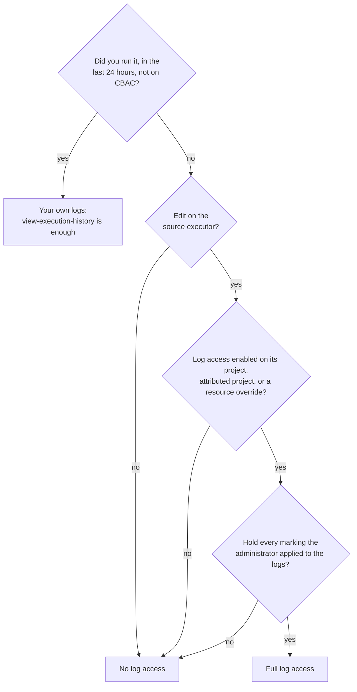

# 03 — Log search and log permissions

*Sources: [Log search](https://www.palantir.com/docs/foundry/aip-observability/log-search/) · [Log permissions](https://www.palantir.com/docs/foundry/aip-observability/log-permissioning/) · checked October 23, 2026 · Ready for Review*

Two pages that belong together because the second decides what the first returns. **Log search** finds a message across many executions; **log permissions** say who may see any of them, and open with the sentence that makes this the most security-relevant page in the sidebar: markings on data do **not** propagate into the logs of the code that read it.

## Log search

**[Docs]** The **Search logs** tab in Workflow Lineage searches service logs across executions, "to investigate recurring errors, find a specific message, or compare logs from different resources in a workflow". Two modes: **global log search** "on all cloud enrollments"; **single-source-executor search** elsewhere.

### Single-source-executor search

**[Docs]** Searches the executions that originated from one **source executor**: "the first executable resource in a call chain, such as a function, action, automation, AIP Logic function, AIP Chatbot, or model live deployment". If the selected resource was itself called by something else, "its logs are not included because it was not the source executor". When nothing is found, the panel suggests the source executors that recently called the resource, and an *Also recently executed by* indicator lists them.

### Global log search

**[Docs]** Searches executable resources across a graph and "does not always treat a selected node as the source executor". With one node selected: functions, Logic functions, actions, chatbots, model live deployments and language models are searched as the **log-producing resource**, including logs from executions that started elsewhere; **automations** are searched as source executors. Language model logs appear only when the model was called from a supported source executor. With several nodes: **Across selected resources** (default: any selected node is producer *or* source executor, which "can include logs from call chains that are not displayed in the graph") or **Within selected call chain** (both producer and source executor selected). With no node selected, the whole graph.

### Searching and reading

**[Docs]** The search bar matches "the full log line, including the Message and Content fields", **case-sensitive**, with `*` as a wildcard: `connection failed` finds the phrase, `timeout*retry` finds *timeout* followed by *retry*, `Error` does not find `error` or `ERROR`. Filters: log level; timestamp range (default the past day; single-source search is limited to the enrollment's retention period, shown by the date picker; global search to a maximum of 30 days); producing resource; source executor; **originating code** ("user code only, or from Foundry only"). Results, newest first: level icon (red for ERROR and FATAL, orange for WARN), timestamp, message, content (often JSON), producing resource *or* source executor (one at a time, depending on scope), tags, parameters. Pages of **100** entries (single-source) or **25** (global); "The search is not a live stream". Hover a row for **View trace**, which opens the trace view ([02](02-trace-views-service-logs-and-debugging.md)).

**[Explanation]** The two modes answer different questions. *Which executions of my automation logged this error?* is single-source. *Which workflows hit this function and logged this error, whoever started them?* is global, with the function as producer. The case-sensitivity and the `*` wildcard are the two things people get wrong first; `*rror*` is the safe spelling.

### Permissions and retention

**[Docs]** "Access to an execution in run history does not necessarily grant access to its logs." Searching shared logs needs the operation `foundry-telemetry-service:view-execution-history` on the resource (in **Editor** by default, grantable through a custom role) **and** log access enabled by an administrator "with markings that you can access". Without log access: only your own executions from the past 24 hours, and not even those on CBAC enrollments. Retention: logs outside the enrollment's retention period don't appear.

## Who may read logs

**[Docs]** The opening paragraph of the permissions page: service and trace logs "can contain sensitive content from any data source a workflow reaches, including language model prompts and completions, object property values, and user-supplied inputs. The platform does not propagate markings from the source executor's resource or from any data the execution accessed; only the markings an administrator explicitly applies when enabling log access are enforced on viewers." Enabling log access "carries a security risk and should be reviewed against the maximum sensitivity of data the workflow may touch".

**[Docs]** The access table:

| Capability | Needs |
|---|---|
| View metrics | View on the resource (`foundry-telemetry-service:read-metrics`, in Viewer) |
| View run history | Edit on the resource (`foundry-telemetry-service:view-execution-history`, in Editor) |
| View trace and service logs; search logs | Edit on the resource **+** log access enabled **+** every marking applied to the logs |
| See organization-wide project log access settings (Control Panel) | Organization administrator, by default |
| Configure project-level or resource-level log access | Edit on the project or resource **+** Information security officer or Enrollment administrator |
| Delete logs | Information security officer or Enrollment administrator |

**[Docs]** Three requirements, for an execution you didn't invoke: **Role**, Edit on the **source executor**; **Log access policy**, enabled on the source executor's project (and its *attributed* project, "the project the resource first emitted telemetry under", if it was moved) or by a **resource-level override**, by an Information security officer or Enrollment administrator, through *Configure logging*; **Markings**, every marking applied to the logs. The 24-hour own-executions exception needs only the operation, "independent of log access settings", and does not apply on CBAC stacks. **Actions under legacy Ontology permissions** can't be managed at project level, so they need a resource-level override "until the action is migrated to project-based permissions".

**[Docs]** Workflow Lineage shows a **source executor log access status** tag: *Full log access*, *User ID secured log access* (your own, 24 hours), *No log access*. The **Log access overview** dialog (*View log access* on the node or in the Run history and Log search panels; needs Viewer on resource and project) lists the three requirements and whether you meet them, suggesting "the least-privileged role that grants log access" when the role is the gap; administrators see *Edit permissions* instead, with *Configure log access* and *Delete log history*.

**[Docs]** On markings: "The markings that protect log content are configured explicitly by an administrator when log access is enabled. These are the only markings enforced". "Logs enabled without markings are visible to every user who satisfies the role and log access requirements".

**[Explanation]** Set this beside [Security 03-01](../../Security/03-discretionary-controls-propagation-and-diagnosis/01-access-control-propagation.md): there, a function's return value "is not policy-bound". Here the same thing is said about its logs, and more sharply, because a log can hold the prompt, the completion and the property values the function saw, and the marking that protected those values in the dataset is simply absent. The control is moved to the administrator who enables log access and must *guess* the maximum sensitivity, and to the developer who decides what to log ([02](02-trace-views-service-logs-and-debugging.md#writing-logs-that-help)). This is also why the role for logs is **Editor**, not Viewer: reading logs is treated as closer to reading code than to reading data. Compare the audit logs in [Security 10-02](../../Security/10-privacy-governance-and-enterprise-security/02-audit-logs.md): those record *who did what* and are exported into a dataset the administrators mark; these record *what the code did* and are read in place, under markings chosen at enablement. Different logs, different readers, different controls.

## For Kestrel

**[Example]** *Adopted* in Phase 6 ([04](../04-kestrel-case/README.md)). The design question from the plan: how log access meets `Kestrel Pay – Financial`.

- **Log access enabled per project, with markings matching the worst case the workflow can touch**: `Delivery Desk [Workflow]` and `Commerce [Ontology]` with the marking `Customer PII`, because the agent's functions read `Customer` and a prompt may quote one; `Payments [Ontology]` with `Kestrel Pay – Financial` **and** `Customer PII`, because *Issue refund* and the payment-hold automation touch both. Enabled by Kestrel's Information Security Officer (a role 17-02 doesn't yet name; recorded as the platform administrators' lead, to confirm), reviewed with the quarterly marking review ([Security 06-01](../../Security/06-approvals-and-checkpoints/01-approvals.md#for-kestrel)).
- **Who reads what**: Daniel, Editor on both commerce projects and a `Customer PII` member, has full log access to the Delivery Desk's functions and actions; Priya likewise; on the payments side the **Kestrel Pay engineers**, Editors there, have full log access; **Lena's team are Viewers** ([Security 11-01](../../Security/11-kestrel-case/01-kestrels-access-model-built-out.md#who-holds-what)), so they see metrics and their own executions only, which fits a reconciliation team that reads results, not code; Kofi and the CS agents have the 24-hour view of their own executions, the right amount for someone clicking *Hold order*. No custom role: Editor is the line, as the docs draw it, and if Lena ever needs shared logs the answer is `view-execution-history` through a custom role, not Editor on the ledger.
- **The payment-hold automation** is project-scoped in `Payments [Ontology]` ([17-02 §6](../../Ontology/17-case-studies/02-kestrel-reference-model.md#6-functions-automations-and-the-agent)), so its logs follow that project's setting; the user-scoped *High-risk payment alert* runs as a person, and that person's 24-hour view covers nothing for the team: it gets a resource-level override under the same two markings.
- **Legacy actions**: none; Kestrel's ontology is on project-based permissions (17-02 §7), so project-level enablement reaches every action.
- **Log search habits** in every SOP: start single-source from the alerting resource; switch to global with the function as producer when the error could come from several callers; search `*rror*` and `WARN` first; set *originating code* to user code when hunting a Kestrel bug, to Foundry when hunting a platform one.

---
[Module index](README.md) · Previous: [02 — Trace views, service logs and debugging](02-trace-views-service-logs-and-debugging.md) · Next: [04 — Metrics, performance and observability dashboards](04-metrics-performance-and-observability-dashboards.md)
