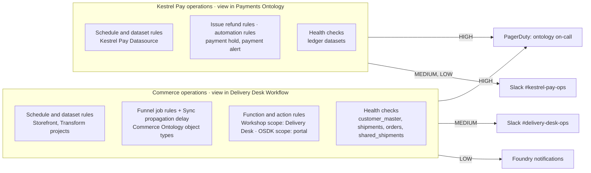

# 01 — The Delivery Desk monitored

*Sources: no new doc pages; every row links to the note that holds the docs' wording · written October 23, 2026 · Ready for Review. Everything here is **[Example]** unless a line says otherwise.*

[Ontology 14-06](../../Ontology/14-lifecycle-and-operations/06-monitoring-and-cleanup.md) gave Kestrel an operations calendar that *expects* alerts: index pipeline failures, Sync Propagation Delay on `Shipment`, failed runs of the payment-hold automation. Nothing had been configured to produce them. This page is the **build record** for the monitoring half of this area: the two monitoring views, their rules and checks, where alerts go, and what the on-call person finds attached. The register rows from [00-02](../00-orientation/02-kestrels-monitoring-posture.md) are in the first column; with this note, 17-02 §7 gets its monitoring line and the *proposed* markers in modules 01–03 are **adopted**, except where a row below says otherwise.

**What it has to do:** tell the ontology team the same day when a pipeline, an index, an action, a function or an automation behind Ama's queue breaks; tell the Kestrel Pay team when the ledger pipeline or a payment automation breaks; page a human only for the things that stop the operational flow; and never put a marked dataset's name in a chat message.

## The shape

## The two views

| Row | Decision | Choice | Note |
|---|---|---|---|
| 1 | Views by audience | `Commerce operations`, saved in `Delivery Desk [Workflow]`; subscribers Ama's team lead, Daniel, Priya. `Kestrel Pay operations`, saved in `Payments [Ontology]`; subscribers Lena's team and the Kestrel Pay engineers. One view per set of people who care, as the FAQ puts it. Because an alert needs Viewer on the resource, the pipeline-project alerts in the commerce view reach **Priya** in Foundry (Ama's lead and Daniel hold no role on the datasource and transform projects, [Security 11-01](../../Security/11-kestrel-case/01-kestrels-access-model-built-out.md#who-holds-what)); the Slack and PagerDuty routes carry them to everyone regardless | [01-01](../01-monitoring-views/01-monitoring-views-and-core-concepts.md#for-kestrel), [01-04](../01-monitoring-views/04-monitoring-faq-and-the-check-groups-sunset.md#the-faq) |
| 1 | Where the views live | Both in projects their subscribers already hold Viewer on. `Payments [Ontology]` is unmarked at project level ([Ontology 02-04](../../Ontology/02-foundry-data-foundations/04-projects-spaces-and-markings.md#kestrels-layout)); alerts about its marked datasets reach only subscribers who hold `Kestrel Pay – Financial`, because an alert needs Viewer on the resource | 01-01 |
| 2 | Scopes | Project scope for datasets, schedules, automations and object types (the ontology is on project-based permissions, 17-02 §7); **Workshop** scope on the Delivery Desk module and **OSDK application** scope on the portal for functions and actions, so new ones are covered when they ship | 01-01 |
| 3 | Who is not subscribed | Kofi's warehouse staff and the CS agents: alerts are the ontology team's job | 01-01 |
| 4 | Coverage check | Before each release, the Delivery Desk workflow coloured by *Monitoring status*; every *No monitors configured* node gets a rule or a written reason. Added to the release checklist from [Security 03-04](../../Security/03-discretionary-controls-propagation-and-diagnosis/04-diagnosing-access.md#for-kestrel) | 01-01 |

## The rules

| Row | Scope | Rules | Note |
|---|---|---|---|
| 5 | `Storefront [Datasource]`, `Commerce [Transform]`, `Kestrel Pay [Datasource]` (Project) | Consecutive schedule failures at the defaults (medium at 1, high at 3); *Time since job last succeeded* with the threshold from each dataset's `refresh` tag ([Security 08-02](../../Security/08-compass/02-moving-sharing-tagging-uploading-and-the-data-catalog.md#for-kestrel)) once the cadences are recorded | [01-02](../01-monitoring-views/02-monitoring-rules-reference.md#for-kestrel) |
| 6 | `Commerce [Ontology]` object types (Project) | Changelog, merge-changes and scroll job failures at the defaults; **Sync propagation delay 1 hour on `Shipment`** (14-06's requirement), 1 day on the rest; the fixed-high rules (terminal sync failure, invalid stream and direct-write records) added | 01-02 |
| 7 | Delivery Desk (Workshop), portal (OSDK application) | Function non-user-facing failure rate (10%, 10 runs, 5 minutes) and p95 duration 10s on `draftDelayMessage` and the queue's functions; non-user-facing action failures greater than 0 in 1 hour on *Re-route shipment* and *Hold order*. No all-failure or user-facing rules: a validation message is the action doing its job ([Ontology 09-03](../../Ontology/09-functions/03-function-lifecycle.md)) | 01-02 |
| 8 | `Payments [Ontology]` automations (Project) | *High-risk payment hold* and *High-risk payment alert*: disabled by the system (fixed high), effect execution failures greater than 0 in 1 hour, no new evaluations in 1 day | 01-02 |
| 9 | `Payments [Ontology]` actions | Non-user-facing failures and p95 on *Issue refund* | 01-02 |

## The checks

| Row | Dataset | Checks | Note |
|---|---|---|---|
| 16 | Every schedule in the three pipeline projects | **Schedule status**, Critical, *Escalate* on; **Schedule duration**, Moderate at one median deviation over ten builds, Critical at twice the expected duration. No job status checks under a schedule | [02-01](../02-health-checks/01-health-checks-and-the-types-of-checks.md#for-kestrel), [02-03](../02-health-checks/03-checks-reference.md#for-kestrel) |
| 17, 19 | `customer_master` | *Time since last updated* (ignore empty on); *Data freshness* on the storefront event timestamp; row count and null percentage on `region` by median deviation; schema `COLUMN_ADDITIONS_ALLOWED_STRICT` | 02-03 |
| 17 | The shipments dataset behind `Shipment` | *Data freshness* Moderate 1 hour, Critical 3 hours; schema strict | 02-03 |
| 19 | The orders dataset behind `Order` | Allowed values on `status` against `OrderStatus`; schema strict | 02-03 |
| 19 | The ledger datasets | Row count and transaction file size by median deviation; numeric range on amounts; primary key on the payment ID | 02-03 |
| 19 | `shared_shipments` | Schema `EXACT_MATCH_UNORDERED_COLUMNS`, Critical: the columns are the contract with Northwind ([Security 04-04](../../Security/04-securing-data-and-applications/04-cross-organization-collaboration.md#for-kestrel)) | 02-03 |
| 19 | `Storefront [Datasource]/raw` | Dataset partition, Moderate, as a hint to Priya | 02-03 |
| 18 | Keys | Uniqueness and non-null on `customer_master.customerId` and `policyRegion` validity are **data expectations** in the transforms (a gate), not checks (an observer); Security 02-02's invariant transform stays, as an expectation | 02-01 |
| 20, 21 | Schedules and thresholds | Automatic schedules for freshness; a daily manual schedule for content checks; two thresholds wherever the metric is continuous | [02-02](../02-health-checks/02-schedules-watching-and-notifications.md#for-kestrel) |
| 22 | Watching and Issues | Every check added to its monitoring view; no individual watching except while tuning; Issues on with auto-close, assigned to Priya (commerce) and a named Kestrel Pay engineer (ledger) | 02-02 |
| 24 | Scheduling | Schedules off the hour and midnight, which also spreads them away from the audit export's and scanner's fixed times | [02-04](../02-health-checks/04-builds-and-checks-faq-health-checks-in-a-marketplace-product.md#for-kestrel) |

## Where the alerts go

| Row | Decision | Choice | Note |
|---|---|---|---|
| 11 | Routing | HIGH from both views to one PagerDuty service whose escalation policy is 14-06's on-call; MEDIUM to `#delivery-desk-ops` or `#kestrel-pay-ops`; LOW to Foundry notifications (commerce) or the same Slack channel (payments). Integrations are per view and per severity, so the pager is configured on both views | [01-03](../01-monitoring-views/03-alerts-the-debug-page-and-external-systems.md#for-kestrel) |
| 12 | The Slack source | A Data Connection source owned by the platform administrators, its bot token in the PAM ([Security 10-03](../../Security/10-privacy-governance-and-enterprise-security/03-protecting-identity-tokens-phishing-and-files.md#for-kestrel)). **Exportable markings: the Kestrel organization only**, so a marked dataset appears as its RID in Slack and is read in Foundry | 01-03 |
| 13 | SOPs | One Notepad per rule family (schedule failures, Funnel job failures, function failure rate, automation disabled), attached from *Manage monitors*. Each opens with *check Issues first*, then the steps in [02](02-triage-at-kestrel-from-alert-to-fix.md) | 01-03, 01-04 |

**[Explanation]** Three choices carry the design. *Audience, not system*, decides the number of views, which is why the payments automations sit in the Kestrel Pay view even though they protect the commerce flow; the pager, not the view, is what makes them operational. *Severity routes*, so every rule's severity was chosen against the routing table rather than as a label. And *the gate before the observer*: the two facts that must never be wrong (the key, the policy column) are expectations that stop the build, and everything else is a check or a rule that tells someone.

## Considered, not adopted

| Row | Candidate | Why not |
|---|---|---|
| 10 | Agent, streaming and live-deployment rules | No on-premise agent, no streams, no model live deployment are recorded; the Kestrel Pay model runs in the compute module `kestrel-pay-llm`, watched through its Metrics tab ([03-04](../03-ontology-and-aip-observability/04-metrics-performance-and-observability-dashboards.md#for-kestrel)) |
| 10 | User-facing failure counts | They count validation messages as failures ([01-02](../01-monitoring-views/02-monitoring-rules-reference.md#functions)) |
| 14 | Webhook integrations | No receiver is recorded; PagerDuty and Slack are the built-in integrations |
| 15 | A check-group migration | None exist, and none can be created ([01-04](../01-monitoring-views/04-monitoring-faq-and-the-check-groups-sunset.md#check-groups)) |
| 23 | Sync checks; approximate column relation | Phonograph syncs are Object Storage v1; match quality is measured in the pipeline ([02-03](../02-health-checks/03-checks-reference.md#for-kestrel)) |
| 22 | Watching individual checks | Subscriptions go through the views, as the docs suggest |

## Still open

| Row | Question | Needs |
|---|---|---|
| 5, 20 | The refresh cadence of each pipeline dataset, which sets the freshness thresholds and the content-check schedule | Priya's pipeline records (the `refresh` tags) |
| 40 | Whether log export to a stream is available on Kestrel's enrollment | Palantir ([00-01](../00-orientation/01-the-observability-map.md)) |

Carried into [17-02 §9](../../Ontology/17-case-studies/02-kestrel-reference-model.md#9-known-gaps-in-the-example) with the open items from [02](02-triage-at-kestrel-from-alert-to-fix.md#still-open).

---
[Module index](README.md) · Next: [02 — Triage at Kestrel: from alert to fix](02-triage-at-kestrel-from-alert-to-fix.md)
