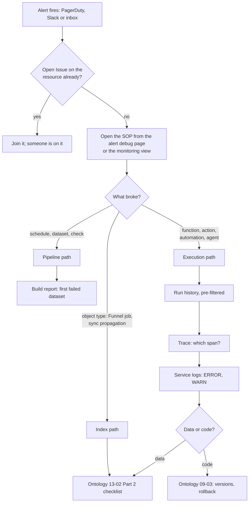

# 02 — Triage at Kestrel: from alert to fix

*Sources: no new doc pages; every row links to the note that holds the docs' wording · written October 23, 2026 · Ready for Review. Everything here is **[Example]** unless a line says otherwise.*

[01](01-the-delivery-desk-monitored.md) decides who is woken up. This page decides what they do next, and what they are allowed to see while doing it: the triage path from an alert to a fix, written three times for the three kinds of thing that break at Kestrel, and the log-access design that makes the path walkable without an administrator on the phone. It replaces the triage flowchart in [Ontology 14-06](../../Ontology/14-lifecycle-and-operations/06-monitoring-and-cleanup.md), which now points here (revised October 23, 2026).

## Who may see what

| Row | Decision | Choice | Note |
|---|---|---|---|
| 32 | Log access | Enabled per project, with the markings set to the worst case the workflow can touch: `Customer PII` on `Commerce [Ontology]` and `Delivery Desk [Workflow]` (the agent's functions read `Customer`, a prompt may quote one); `Kestrel Pay – Financial` **and** `Customer PII` on `Payments [Ontology]` (*Issue refund* and the payment automations touch both). Markings do not follow data into logs, so this is the only control on that path | [03-03](../03-ontology-and-aip-observability/03-log-search-and-log-permissions.md#for-kestrel) |
| 33 | The line | Editor, as the docs draw it: Daniel and Priya have full log access on the commerce side; the Kestrel Pay engineers on the payments side; Lena's team (Viewers) see metrics and their own executions; Kofi and the CS agents see their own 24 hours. No custom role; if that ever changes, `foundry-telemetry-service:view-execution-history` through a custom role, never Editor on the ledger | 03-03 |
| 34 | The user-scoped automation | *High-risk payment alert* runs as a person, so it gets a resource-level override under the same two markings | 03-03 |
| 28 | What gets logged | The logging standard in the repository templates ([DevTools 09-02](../../DevTools/09-kestrel-case/02-daniels-developer-setup.md)): TypeScript v2 logging, `orderId`, `shipmentId` and the request ID in `body`, INFO at entry and exit with counts, WARN on retries, ERROR with the message; never a `Customer`, address, email, card number or prompt. `draftDelayMessage` logs the order ID and the draft's length, not the draft | [03-02](../03-ontology-and-aip-observability/02-trace-views-service-logs-and-debugging.md#for-kestrel) |
| 29 | Enforcement | A third custom code-scanning rule flags a log call whose arguments include a `Customer`, `Payment` or `Refund` object or a field named like `email`, `address`, `cardNumber` ([Security 10-05](../../Security/10-privacy-governance-and-enterprise-security/05-code-scanning.md#for-kestrel)) | 03-02 |

**[Explanation]** The design puts the two controls on the two people who hold them: the Information security officer decides which markings a reader of the logs must hold, and the developer decides what can appear in a log at all. Neither can do the other's job, and [03-03](../03-ontology-and-aip-observability/03-log-search-and-log-permissions.md#who-may-read-logs) is explicit that the platform does neither for them.

## The path

### Path 1 — a pipeline alert (schedule failure, freshness, a check)

| Step | Where | What | Note |
|---|---|---|---|
| 1 | Issues | The check filed one automatically ([01](01-the-delivery-desk-monitored.md#the-checks), row 22); if someone is assigned, join it | [02-02](../02-health-checks/02-schedules-watching-and-notifications.md#what-the-news-looks-like) |
| 2 | Data Lineage | Colour by health status; the Data Health tab lists every failing check in the graph | [02-01](../02-health-checks/01-health-checks-and-the-types-of-checks.md#what-a-health-check-is) |
| 3 | Build report | The FAQ's first questions: has it succeeded before, has the data changed (scale, schema), has an upstream changed; for *Waiting for input dependencies*, the first failed dataset in the build | [02-04](../02-health-checks/04-builds-and-checks-faq-health-checks-in-a-marketplace-product.md#the-faq-as-a-triage-card) |
| 4 | Hand-off | To Priya's group with the ErrorInstanceID and the exact time (date, time, timezone), which is also what Palantir Support asks for | 02-04 |
| 5 | Close | Fix, rebuild; the check passes and closes its Issue; snooze only with a reason and an end | [01-01](../01-monitoring-views/01-monitoring-views-and-core-concepts.md#4-snooze) |

### Path 2 — an index alert (Funnel job, sync propagation delay)

| Step | Where | What | Note |
|---|---|---|---|
| 1 | The alert | Which rule: changelog, merge-changes or scroll failures are **user-caused** by definition (schema, malformed row, permissions); a terminal sync failure is fixed high | [01-02](../01-monitoring-views/02-monitoring-rules-reference.md#objects-and-links) |
| 2 | Data Lineage | Opened from the alert, on the object type | 01-01 |
| 3 | The checklist | [Ontology 13-02 Part 2](../../Ontology/13-backend-architecture/02-indexing-and-funnel.md#part-2--my-objects-are-wrong-or-missing): backing dataset, schema against the mapping, the pipeline's job report | — |
| 4 | Sync propagation delay on `Shipment` | If the dataset is fresh (its health check passes) and the index is late, it is the index; if the check fails too, it is Path 1 first | [02-01](../02-health-checks/01-health-checks-and-the-types-of-checks.md#three-freshnesses) |

### Path 3 — an execution alert (function, action, automation, agent)

| Step | Where | What | Note |
|---|---|---|---|
| 1 | Alert debug page | Current value against threshold, the window, the 30-day history, the SOP card; *Dive deeper* | [01-03](../01-monitoring-views/03-alerts-the-debug-page-and-external-systems.md#the-alert-debug-page) |
| 2 | Run history | Opened **pre-filtered** from the alert (status, window, run time or failure type as the rule saw it); read the *Caller* and *Source executor* columns before widening the filter | [03-01](../03-ontology-and-aip-observability/01-overview-and-run-history.md#the-run-history-table), [01-01](../01-monitoring-views/01-monitoring-views-and-core-concepts.md#5-from-an-alert-to-the-lineage) |
| 3 | Trace | *View log details* on a failed row: the long bar or the red span; for the agent, the tool calls, the prompt and the tokens | [03-02](../03-ontology-and-aip-observability/02-trace-views-service-logs-and-debugging.md#the-trace-view) |
| 4 | Service logs | ERROR then WARN; the IDs in `body` join the line to the order or shipment | 03-02 |
| 5 | Log search | Single-source from the alerting resource; global with the function as producer when several callers could be the cause; `*rror*` and `WARN`; *originating code* to user code for a Kestrel bug, to Foundry for a platform one | [03-03](../03-ontology-and-aip-observability/03-log-search-and-log-permissions.md#log-search) |
| 6 | Data or code? | A data failure goes to Path 2's checklist; a code failure to [Ontology 09-03](../../Ontology/09-functions/03-function-lifecycle.md): version, rollback, re-publish; a model-latency finding to the performance signs | [03-04](../03-ontology-and-aip-observability/04-metrics-performance-and-observability-dashboards.md#performance-monitoring) |
| 7 | Automations | *Disabled by the system* means limits or a cycle ([Apps 08-06](../../Apps/08-automate/06-operating-automations.md)); effect failures mean the action or notification, not the trigger; the automation's run history shows which | [01-02](../01-monitoring-views/02-monitoring-rules-reference.md#automations) |

## The calendar, revised

| Row | Cadence | What | Reads | Note |
|---|---|---|---|---|
| 26 | Daily, on-call | The two views' *Troubleshoot alerts* tabs; open Issues; the three paths above as needed | Alerts, run history (within seven days, RQ-26) | [03-01](../03-ontology-and-aip-observability/01-overview-and-run-history.md#seven-days-or-thirty-rq-26) |
| 38 | Weekly, ontology owner | The Delivery Desk workflow coloured by *Failure rate* (past day) and by *Monitoring status*; per-resource metrics for the 30-day trend; P95 on the health page; open proposals and branches (unchanged from 14-06) | Metrics, colour modes | [03-04](../03-ontology-and-aip-observability/04-metrics-performance-and-observability-dashboards.md#for-kestrel) |
| 38 | Monthly, cleanup session | 14-06's cleanup tool run, unchanged; plus one trace of the slowest charted resource, read against the performance page's four signs | Traces | 03-04 |
| 37 | The health page | *Delivery Desk health* ([Apps 11-01](../../Apps/11-kestrel-case/01-delivery-desk-queue-built-out.md)) with `draftDelayMessage`, *Hold order*, *Re-route shipment* and the `kestrel-pay-llm` compute module on one time range; linked from every SOP; a page, not an alert | Observability Chart | 03-04 |
| 39 | Operating rule | `draftDelayMessage` is called once per order, never in a loop; a batch path is Daniel's to design if the P95 chart says so | — | 03-04 |
| 31 | The portal | Logs timestamp, service user and the failing call for every error, because its own logs may carry no trace ID; the join to run history is the timestamp and the caller column | — | [03-02](../03-ontology-and-aip-observability/02-trace-views-service-logs-and-debugging.md#for-kestrel) |

**[Explanation]** What changed from 14-06's calendar: the daily row no longer lists alerts it hopes to see, it opens the two views that produce them; the automation line disappears, because the *Monitoring status* colour mode shows automations and the Kestrel Pay view alerts on them, which the *Failure rate* mode never could; the triage flowchart becomes three paths with the permission question answered up front; and the weekly P95 look moves onto the health page. The cleanup half of 14-06 is untouched.

## Considered, not adopted

| Row | Candidate | Why not |
|---|---|---|
| 33 | A custom role granting `view-execution-history` to Lena's team | Not needed: a reconciliation team reads results, not code ([03-03](../03-ontology-and-aip-observability/03-log-search-and-log-permissions.md#for-kestrel)) |
| — | Enabling log access with no markings on the commerce projects | The docs say logs enabled without markings are visible to every user who meets the role requirement; the agent's prompts can contain customer data |

## Still open

| Row | Question | Needs |
|---|---|---|
| 35 | Who holds the Information security officer role at Kestrel; 17-02 names nobody and the role enables log access | Kestrel's platform team (recorded as the platform administrators' lead, to confirm) |
| 31 | Whether an OSDK error response carries a `foundryTraceId` the portal could keep | The pages don't say; a question for DevTools 09-01 |
| — | RQ-26, seven or 30 days of run history | The docs ([Ontology SOURCES](../../Ontology/SOURCES.md#open-research-questions)) |

---
[Module index](README.md) · Previous: [01 — The Delivery Desk monitored](01-the-delivery-desk-monitored.md) · Next module: [05 — Practice](../05-practice/README.md)
