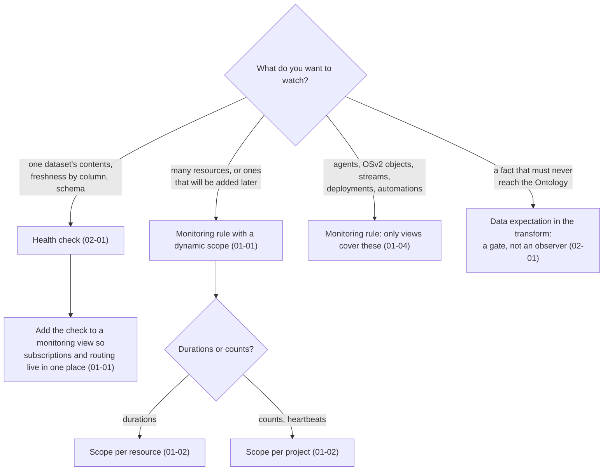
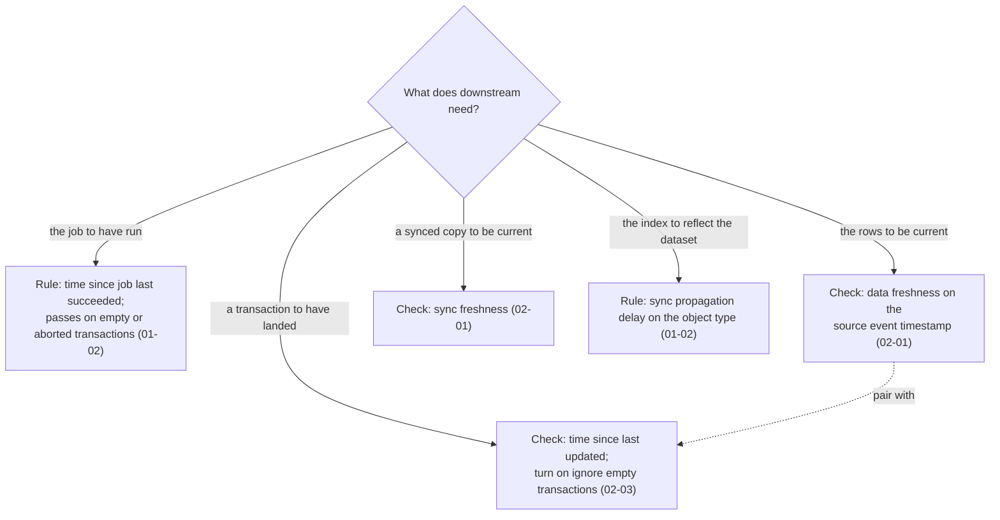
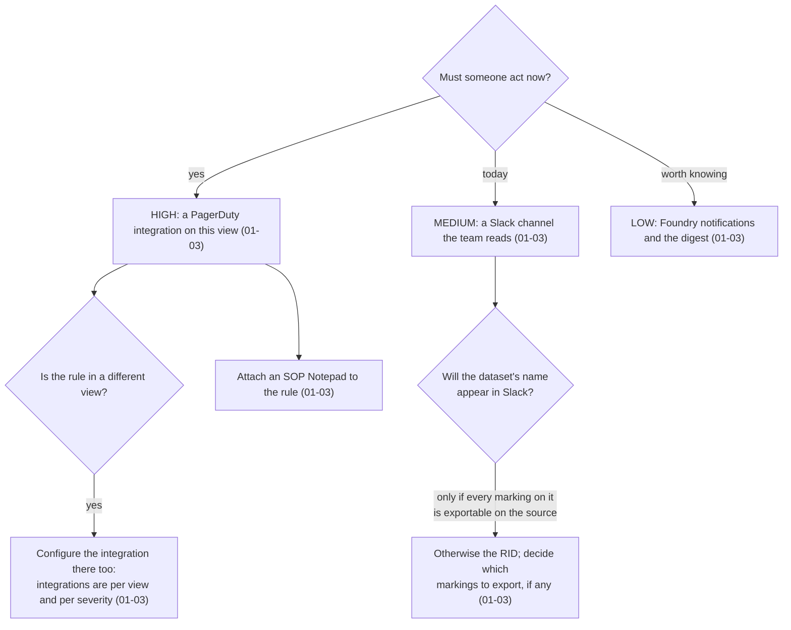
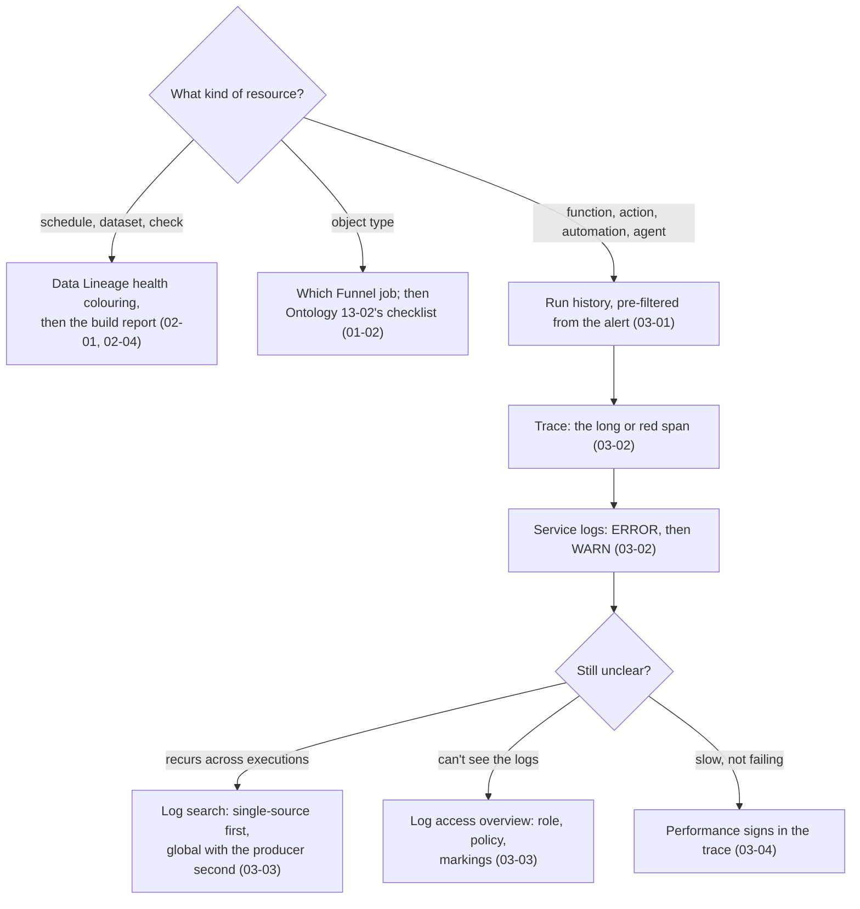

# Decision guide

*Sources: the notes each branch links to · compiled October 23, 2026 · Ready for Review. The flowcharts are ours; every leaf links to the note with the docs' wording.*

Four decisions that come up on almost every monitoring question, as flowcharts. Each ends at the note to read next.

## 1. Rule or check?

[01-01](../01-monitoring-views/01-monitoring-views-and-core-concepts.md) · [01-02](../01-monitoring-views/02-monitoring-rules-reference.md) · [01-04](../01-monitoring-views/04-monitoring-faq-and-the-check-groups-sunset.md) · [02-01](../02-health-checks/01-health-checks-and-the-types-of-checks.md)

## 2. Which freshness signal?

[01-02](../01-monitoring-views/02-monitoring-rules-reference.md#time-series-syncs-datasets-geotemporal-observations) · [02-01](../02-health-checks/01-health-checks-and-the-types-of-checks.md#three-freshnesses) · [02-03](../02-health-checks/03-checks-reference.md#time-checks)

## 3. Where does the alert go?

[01-03](../01-monitoring-views/03-alerts-the-debug-page-and-external-systems.md) · [01-01](../01-monitoring-views/01-monitoring-views-and-core-concepts.md#the-vocabulary)

## 4. *It failed.* Which signal do you read first?

[02-01](../02-health-checks/01-health-checks-and-the-types-of-checks.md) · [02-04](../02-health-checks/04-builds-and-checks-faq-health-checks-in-a-marketplace-product.md) · [01-02](../01-monitoring-views/02-monitoring-rules-reference.md#objects-and-links) · [03-01](../03-ontology-and-aip-observability/01-overview-and-run-history.md) · [03-02](../03-ontology-and-aip-observability/02-trace-views-service-logs-and-debugging.md) · [03-03](../03-ontology-and-aip-observability/03-log-search-and-log-permissions.md) · [03-04](../03-ontology-and-aip-observability/04-metrics-performance-and-observability-dashboards.md) · worked for Kestrel in [04-02](../04-kestrel-case/02-triage-at-kestrel-from-alert-to-fix.md)

---
[Module index](README.md) · [Observability home](../README.md)
