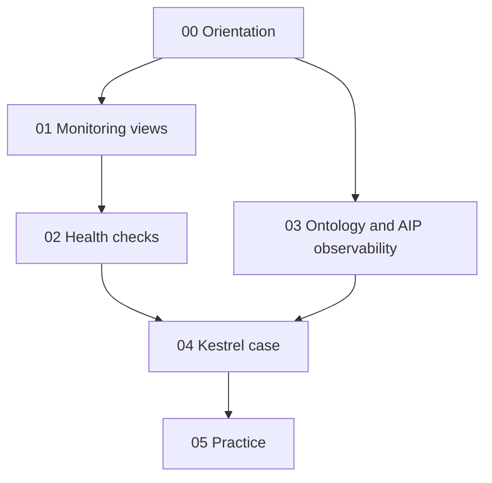

# Observability

A course and working reference for the **Observability** part of the Foundry docs: Data Health's two feature sets (monitoring views over many resources, health checks on one), where alerts go, and the Ontology and AIP observability tools in Workflow Lineage: run history, trace views, service logs, log search, log permissions, metrics and observability dashboards. Every page in scope is assigned to a planned note; the [docs index](99-reference/docs-index.md) maps them.

| | |
|---|---|
| Structure | Created October 23, 2026 (Phase 2). Built from the official docs; the course notes listed in each module are linked, not reused as sources. |
| Notes written | **20 of 20**: [00 Orientation](00-orientation/README.md), [01 Monitoring views](01-monitoring-views/README.md), [02 Health checks](02-health-checks/README.md), [03 Ontology and AIP observability](03-ontology-and-aip-observability/README.md), [04 Kestrel case](04-kestrel-case/README.md), [05 Practice](05-practice/README.md), [99 Reference](99-reference/README.md). Module READMEs list every note and the official pages it covers. |
| Scope | 26 pages: the docs' *Observability* sidebar, read from the fetched sidebar HTML on October 23, 2026 (`_tools/obs/raw.tsv`). The release-notes link is out of scope. Two pages are references (monitoring rules, checks) and are read in full like the rest. |
| Sources | Official Palantir documentation first. Register, corrections and open questions: [SOURCES](SOURCES.md) |
| Quality | Reviewed October 23, 2026 (Phase 7): all 26 pages re-fetched and found unchanged, 253 doc quotes and every bold number re-matched by two scripts, 27 limit rows re-verified, 11 diagrams parsed, links clean, cross-area consistency checked against Ontology 14-06, 13-02, 02-04 and 17-02 and the Apps, DevTools and Security notes it cites (1 fix). Details and known limitations: [QUALITY-REVIEW](QUALITY-REVIEW.md) |
| Why it matters | The Application Developer Associate exam's domain 6 (Automate and operational workflows) names *recovery and monitoring*, domain 8 names *operational diagnosis* and domain 3 names *diagnosis* of functions. This sidebar defines those words: what to watch (monitoring views, health checks) and how to find out what went wrong (run history, traces, logs, metrics) |

## How this area relates to the others

The [Ontology area](../Ontology/README.md) already uses four of these pages for Kestrel's operations calendar ([14-06](../Ontology/14-lifecycle-and-operations/06-monitoring-and-cleanup.md)) and points at Data Health from the indexing notes ([13-02](../Ontology/13-backend-architecture/02-indexing-and-funnel.md), [02-05](../Ontology/02-foundry-data-foundations/05-lineage-and-builds.md)); this area reads every page in full and revises the calendar in Phase 6. The [Apps area](../Apps/README.md) covers the Observability Chart widget ([03-06](../Apps/03-workshop-widgets/06-ai-observability-and-embedding.md)) and Automate ([08](../Apps/08-automate/README.md)), which replaced *Object Monitoring* and is a different thing from Data Health monitoring. The [DevTools area](../DevTools/README.md) covers compute module logs and replica states ([03-03](../DevTools/03-compute-modules-and-custom-endpoints/03-debugging-history-and-cost.md)). The [Security area](../Security/README.md) covers audit logs ([10-02](../Security/10-privacy-governance-and-enterprise-security/02-audit-logs.md)), which record who did what; the logs here record what the code did. Health checks are configured on datasets and schedules, whose builds belong to the Data integration docs, not yet an area here.

## Learning path

## Modules

| # | Module | What you learn | Status |
|---|---|---|---|
| 00 | [Orientation](00-orientation/README.md) | The observability map; Kestrel's posture | **Ready for Review** |
| 01 | [Monitoring views](01-monitoring-views/README.md) | Scopes, rules, severities, alerts, external systems | **Ready for Review** |
| 02 | [Health checks](02-health-checks/README.md) | Health checks: types, schedules, notifications, the reference | **Ready for Review** |
| 03 | [Ontology and AIP observability](03-ontology-and-aip-observability/README.md) | Run history, traces, logs, log search, log permissions, metrics, dashboards | **Ready for Review** |
| 04 | [Kestrel case](04-kestrel-case/README.md) | Kestrel's monitoring and triage design | **Ready for Review** |
| 05 | [Practice](05-practice/README.md) | Review questions tagged by exam domain | **Ready for Review** |
| 99 | [Reference](99-reference/README.md) | Limits, decision guide, docs index | **Ready for Review** |

## Conventions

Same as the Ontology, AIP, Apps, DevTools and Security areas. Each note has a one-line *Sources · checked · status* header and footer navigation; otherwise its shape follows its topic. Labels: **[Docs]** (only real doc wording goes in quote marks), **[Concept]**, **[Explanation]**, **[Recommendation]**, **[Example]**, **[Analogy]**, **[Observed]**. Open questions are numbered RQ-NN in [SOURCES](SOURCES.md). Self-checks live only in [05 — Practice](05-practice/README.md). Examples use **Kestrel Commerce**, as defined in [Ontology 17-02](../Ontology/17-case-studies/02-kestrel-reference-model.md).

---
[Learn home](../../README.md) · [Topic map](MAP.md) · [Sources](SOURCES.md) · [Glossary](GLOSSARY.md)
