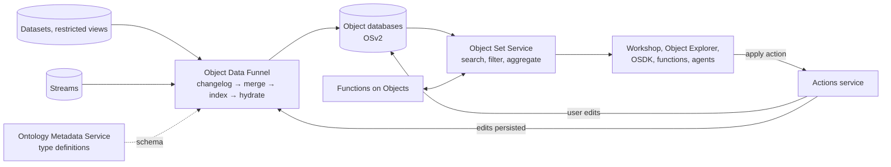

# 03 — Architecture at a glance

*Sources: [The Ontology system (Architecture center)](https://www.palantir.com/docs/foundry/architecture-center/ontology-system/) · [Ontology architecture overview](https://www.palantir.com/docs/foundry/object-backend/overview/) · [Funnel batch pipelines](https://www.palantir.com/docs/foundry/object-indexing/funnel-batch-pipelines/) · [Ontology-aware applications](https://www.palantir.com/docs/foundry/ontology/applications/) · checked October 2, 2026 · Ready for Review*

## Key facts
- **[Docs]** Palantir says the Ontology "is not a 'semantic layer'" but a multimodal system of dozens of components, grouped into three parts:

  | Part | What it is |
  |---|---|
  | **Language** | What you model: objects, links, properties, actions, automations, logic |
  | **Engine** | The read and write machinery |
  | **Toolchain** | The OSDK and DevOps tools for building on it |

- **[Docs]** Under the hood, several services cooperate:

  | Service | Job |
  |---|---|
  | **Ontology Metadata Service (OMS)** | Holds the definitions |
  | **Object databases** | Store and serve indexed object data. Object Storage v2 is current; v1, Phonograph, is legacy |
  | **Object Set Service (OSS)** | Serves reads |
  | **Actions service** | Applies user edits |
  | **Object Data Funnel** | Indexes datasources and edits into the object databases |
  | **Functions on Objects** | Runs logic |

- **[Explanation]** Data does not "live in" the Ontology the way it lives in a dataset. Datasets remain the source; the Ontology keeps an **indexed copy merged with user edits**, optimized for operational reads.
- This note is the map. [13 — Backend architecture](../13-backend-architecture/README.md) is the territory.

## Why bother with the internals

**[Concept]** To use the Ontology well you need a picture of what happens between "I saved an object type" and "Ama sees the object in her app". Without it, common symptoms are puzzling:

- objects that don't appear yet;
- an edit that "disappears";
- a duplicate key that fails a build;
- a property you can't filter on.

This note gives just enough architecture to make those symptoms understandable.

## Four concerns every operational store separates

**[Concept]** Most operational data systems separate four concerns:

1. **Metadata:** what types exist and what they look like.
2. **Storage and indexing:** data organized for fast lookup, not just for scanning.
3. **Reads:** queries, filters, aggregations, permission checks.
4. **Writes:** changes from upstream data and from users, applied consistently.

The Foundry Ontology backend has a service for each.

## How Foundry does it

### Language, Engine, Toolchain
**[Docs]** From the Architecture center:
- **Language** models the semantic objects, links and properties, the kinetic actions and automations, and the logic that defines how actions work and how they interact with other systems.
- **Engine** implements every part of the Language.
  - **Reads:** a modular read architecture with high-scale SQL queries, real-time subscriptions to state changes, and the materializations mixed human and AI teams need.
  - **Writes:** atomic, durable transactional updates, high-scale batch mutations, high-scale streams, and change data capture (CDC) for low-latency mirroring with other operational systems.
- **Toolchain** lets developers "use the Ontology as a backend", through the **Ontology SDK (OSDK)** and DevOps tools for governing production use cases.

**[Docs]** The same page also stresses that security runs through all of this. Different teams need different scopes, for example global machine telemetry for production, regional restrictions for warehouse staff, and row and column restrictions for analysts. Agents must inherit their security scope either from a human user or from a defined project.

### The backend services
**[Docs]** The Ontology backend is a set of microservices with three jobs:
1. **Datasource management:** feeding the Ontology and managing its schema definitions.
2. **Querying, searching and aggregating** objects, with filtering and permissions.
3. **Write orchestration:** indexing datasources, and applying edits made by decisions and actions.

| Service | Responsibility |
|---|---|
| **Ontology Metadata Service (OMS)** | Defines which ontological entities exist: the metadata of object types, link types, action types and more |
| **Object databases** | Store indexed object data for fast queries. They are also responsible for indexing, querying and orchestrating user edits. **Object Storage v2** is the canonical store; **v1 (Phonograph)** is legacy |
| **Object Set Service (OSS)** | Serves reads: searching, filtering, aggregating and loading objects for other services and apps |
| **Actions** | Applies user edits to object databases in a structured way, with permissions and conditions. Can build a historical action log |
| **Object Data Funnel ("Funnel")** | OSv2 only. Reads datasources (datasets, restricted views, streams) and user edits from Actions, indexes them into object databases, and keeps them up to date as sources change |
| **Functions on Objects** | Executes code logic quickly in operational contexts such as apps and dashboards |

### How data gets in: the Funnel pipeline
**[Docs]** A Funnel batch pipeline is a series of ordinary Foundry build jobs:

1. **Changelog:** computes what changed in each datasource since the last run, written as `APPEND` transactions to datasets that Funnel owns.
2. **Merge changes:** joins those changes with recent user edits by the object type's **primary key**.
3. **Indexing:** converts the merged rows into the object database's index format.
4. **Hydration:** loads the index files onto the database's search nodes. Progress shows in Ontology Manager.

**[Docs] Edit and schema behaviour:**
- User edits apply to the indexes **immediately**.
- If edits exist, the live pipeline also runs **every six hours** to persist them into Foundry, even when no data changed.
- A schema change, such as a new property, a changed property or a swapped datasource, makes Funnel build a **replacement pipeline** in the background. Users keep the live one until the replacement succeeds.

**[Explanation]** This is why the [primary key](../01-foundations/02-keys-and-identity.md) matters so much: it is the join key between source data and human edits.

### Object sets: four flavours
**[Docs]**

| Kind | Stored as | Behaviour |
|---|---|---|
| Static | A list of primary keys | Never changes when data changes |
| Dynamic | The filters that defined it | Gains new objects that match |
| Temporary | Handed between apps and services | Only the creator can access it; expires within 24 hours |
| Permanent | Saved in the object backend | Reusable across the platform |

### What OSv2 changed
**[Docs]** Object Storage v2 was built "from first principles". Separating indexing from querying lets it scale horizontally. The overview lists:

- incremental indexing by default;
- indexing throughput of tens of billions of objects per object type;
- multi-datasource object types, with column- and property-level permissions;
- up to **10,000 objects edited in one action** (higher on request);
- lower edit latency;
- migrating user edits after a breaking schema change;
- streaming datasources;
- up to **2,000 properties** per object type;
- a Spark-based query layer for larger Search Arounds and more accurate aggregations;
- a default Search Around limit of **100,000 objects**.

**[Docs]** The overview states that OSv1 (Phonograph) "will be unavailable after June 30, 2026".

### Who consumes it
**[Docs]** Ontology-aware applications differ on three dimensions:
- **use case:** discovery, analysis, dashboards, applications;
- **workflow style:** exploratory or workflow-specific;
- **configuration:** walk-up usable or customizable.

| App | Primary use case | Configuration |
|---|---|---|
| Object Views | Discovery | Walk-up usable |
| Object Explorer | Discovery and analysis | Walk-up usable |
| Quiver | Analysis and dashboards | Walk-up (analysis) / customizable (dashboard) |
| Workshop | Applications and dashboards | Customizable |
| Slate | Complex applications; can also read datasets | Customizable |
| Map | Geospatial | Walk-up usable |

Carbon combines these into curated workspaces. The canonical comparison is in [10 — Applications](../10-applications/README.md).

## Familiar equivalents

| Familiar component | Ontology counterpart | Where the analogy holds | Where it breaks |
|---|---|---|---|
| Data catalogue / schema registry | OMS | Holds definitions and metadata | OMS also defines actions, links and interfaces: behaviour, not only structure |
| Search index (Elasticsearch-style) | Object databases (OSv2) | Data is indexed and served for low-latency search and aggregation | Edits are merged by primary key and permissions are enforced per object and property |
| Query API / read replica | OSS | Serves reads to many clients | Object sets are first-class saved resources, static or dynamic |
| ETL into a serving store | Funnel | Incremental changelog, merge, index, load | Funnel is managed by the platform, and its intermediate datasets aren't accessible to users |
| Application write path | Actions service | Applies validated changes | Every change goes through a declared action type with permissions and a log |

**[Analogy]** Think of a dataset as the **ledger** and the Ontology's object database as a **live, searchable register** built from the ledger plus approved corrections. Readers use the register; the ledger stays authoritative for pipeline data.

## What agents touch
- **[Docs]** The Engine's real-time subscriptions and the Toolchain (OSDK) are what agents and AI apps call into. The Architecture center says agents' security scopes inherit from a user or from a project.
- **[Explanation]** For agent design, the OSS is the "read tool" and the Actions service is the "write tool". Understanding that they are separate services explains why an agent can be allowed to read without being allowed to act.

## Following one shipment through the system

**[Example]** Priya maps the WMS `shipments` dataset to a `Shipment` object type and saves it.

1. **OMS** now knows `Shipment` exists, with its properties and primary key.
2. **Funnel** runs changelog → merge → index → hydrate. Only after hydration can Kofi find shipments in Object Explorer.
3. Kofi applies *Re-route shipment*. The **Actions service** writes the edit, and the object database shows it immediately.
4. Next morning the WMS sync adds 3,000 changed rows. Funnel's changelog picks up only those rows and merges them with Kofi's edit by `shipment_id`.
5. Daniel's Workshop app reads shipments through the **OSS**. An at-risk shipment list is saved as a **dynamic object set**, so new late shipments appear on their own.

## When something looks wrong
- **[Recommendation]** When objects "aren't there yet", check the Funnel pipeline first: build failures, hydration progress, duplicate keys. Monitoring views in Data Health can alert on sync delays. The detail is in [13](../13-backend-architecture/02-indexing-and-funnel.md).
- **[Explanation]** Because edits are attached by primary key and merged with source data, **who wins** when a pipeline value and a user edit disagree is a modelling decision. [13 — Edits and materializations](../13-backend-architecture/03-edits-and-materializations.md) covers the documented rules.
- **[Explanation]** Limits such as 2,000 properties and 10,000 objects per action shape design. A type close to either limit is usually a design smell, the God Object, before it is a technical problem.

## Misreadings
- Assuming a saved object type is immediately queryable. Indexing and hydration must finish first.
- Generating a new random primary key on every pipeline run. Funnel then merges edits against keys that no longer exist.
- Reading "not a semantic layer" as "not semantic". Palantir's point is that it is *more than* a semantic layer, because actions, logic and security are part of it.

## Dates and numbers to recheck
- **Open question** [RQ-05](../SOURCES.md#open-research-questions): the overview gives June 30, 2026 as the date after which OSv1 is unavailable. That date has passed as of this note, and whether any enrollment still runs OSv1 hasn't been checked. These notes assume **OSv2** unless they say otherwise.
- **[Docs]** The numbers above (10,000 objects per action, 2,000 properties, 100,000-object Search Around) are documented defaults, and some can be raised through Palantir Support. They are collected and dated in [99 — Limits and thresholds](../99-reference/limits-and-thresholds.md).

## In our course notes
- [Ontology deep dive 14 — Create an object type](../../../Tracks/Application%20Developer/02-deep-dive-creating-your-first-ontology/14-create-object-type.md): "Saving the definition triggers indexing. Only successful indexing makes objects queryable."
- [Intro course 05 — High-level architecture](../../../Tracks/Courses/Introduction%20to%20Foundry%20&%20AIP%20for%20Enterprise%20Organizations/05-high-level-architecture.md): north and south of the Ontology.
- [Intro course 14 — Products and SDKs](../../../Tracks/Courses/Introduction%20to%20Foundry%20&%20AIP%20for%20Enterprise%20Organizations/14-products-and-sdks.md): the Toolchain side.

---
[Module index](README.md) · Previous: [02 — Why an Ontology](02-why-an-ontology.md) · Next: [04 — The running example](04-running-example.md)
