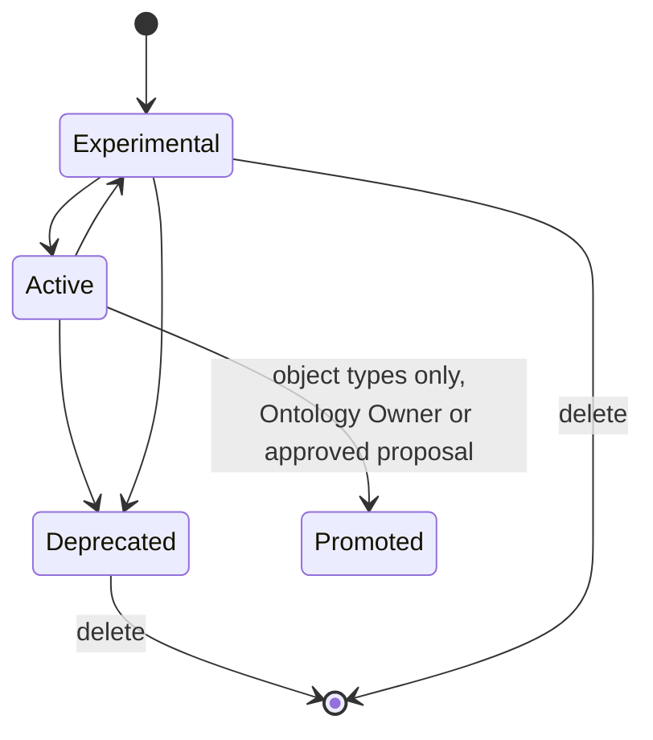

# 04 — Type metadata and statuses (reference)

*Sources: [Object type metadata](https://www.palantir.com/docs/foundry/object-link-types/object-type-metadata/) · [Property metadata](https://www.palantir.com/docs/foundry/object-link-types/property-metadata/) · [Statuses](https://www.palantir.com/docs/foundry/object-link-types/metadata-statuses/) · [Type classes](https://www.palantir.com/docs/foundry/object-link-types/metadata-typeclasses/) · [Render hints](https://www.palantir.com/docs/foundry/object-link-types/metadata-render-hints/) · [Object type groups](https://www.palantir.com/docs/foundry/object-link-types/type-groups/) · [Create an object type](https://www.palantir.com/docs/foundry/object-link-types/create-object-type/) · checked October 2, 2026 · Ready for Review*

A lookup page. The fields here look like admin detail, but three of them carry real weight:

- **API names** are how code refers to types and properties.
- **Status** decides what you're allowed to change.
- **Visibility** decides what users see.

## Object type metadata at a glance

| Field | What it is | Change later? |
|---|---|---|
| **ID** | Unique identifier used when configuring applications, e.g. `employee`. Lowercase letters, numbers and dashes; starts with a letter | **No** — fixed after creation |
| **RID** | Platform-generated resource ID, shown in error messages | No (generated) |
| **API name** | Name used in code, e.g. `Employee`. PascalCase, alphanumeric, unique, 1–100 characters | Yes, but **not while the status is active** |
| **Display name / plural** | What users read | Yes |
| **Description** | Shown to users, e.g. in Object Explorer search results | Yes |
| **Aliases** | Extra search terms that find the type | Yes |
| **Groups** | Labels for organizing types | Yes |
| **Icon** | Picture and colour shown in apps | Yes |
| **Visibility** | **Prominent** (shown first), **normal** (default) or **hidden** (not shown in user apps) | Yes |
| **Status** | Development state; see below | Yes, within the rules |
| **Index status** | Result of the last reindex: success, failed or not started | No (reported) |
| **Writeback** | Whether edits are enabled (OSv1 also had a writeback dataset) | Yes |

**[Docs]** Properties carry a similar set: ID, RID, API name, display name, description, status, keys, base type, formatting, type classes, render hints and visibility. Property API names are **camelCase**. Reserved words can't be used as API names: `ontology`, `object`, `property`, `link`, `relation`, `rid`, `primaryKey`, `typeId`, `ontologyObject`.

**[Explanation]** Treat API names like public function names in a library. OSDK clients, functions and agents call them, so pick them carefully before the type goes active.

## Statuses

**[Docs]** Object types, properties, link types, actions and interfaces each have a status. New resources start as **experimental**.

| Status | Meaning | Rules |
|---|---|---|
| **Experimental** | Still in development; may change or disappear | Can be deleted; API name can change |
| **Active** | Used by user-facing apps | **Can't be deleted. API name can't change.** Primary key can't change on an active object type |
| **Deprecated** | Will be deleted soon | Needs a reason, a deadline and optionally a replacement. Can be deleted |
| **Example** | Installed as an example for training or exploration | Not for production |
| **Promoted** (object types only) | A core, vetted type, marked with a purple check | Set directly only by an Ontology Owner at ontology level; others submit a proposal. Also makes the type prominent |

**[Docs] Statuses cascade.**

- Changing an object type to experimental, example or deprecated changes its link types to match.
- The same happens when a link's foreign-key property changes.
- Marking a type active **doesn't** automatically make its link types active.

Conflicts show up as `OntologyMetadata:ConflictBetweenLinkTypeStatusAndPropertyTypeStatus` (or `…ObjectTypeStatus`).

**[Explanation]** Status is the Ontology's version of semantic versioning without the numbers. *Active* is the promise "I won't break you". Move a type to active only when an app depends on it, and use *deprecated* plus a replacement when you need to change it incompatibly.

## Visibility, groups, type classes, render hints

**Visibility** (types and properties): *hidden* removes something from user apps without deleting it. That's the documented way to keep technical types and properties out of default views ([Design 01](../11-design/01-best-practices.md#1-domain-driven-design-model-the-world-not-the-source-data)).

**Object type groups.** **[Docs]** A classification primitive for search and exploration. Groups show in Ontology Manager search and filters and on the Object Explorer home page. Viewing a group needs viewer permission on the project it lives in. Groups replaced the old tag-based groups on May 22, 2024; the `oe_home_page_object_type_group` type class is deprecated.

**Type classes.** **[Docs]** Extra metadata on properties, link types and action types that some apps interpret. Most of the long list is **deprecated** or now configured on the object type's **Capabilities** page, including time series and geo altitude settings. A few still matter:

| Type class | Effect |
|---|---|
| `hierarchy.parent` (link) | Object Views show breadcrumbs such as Europe → France → Paris |
| `hubble-oe.hide-action` (action) | Hides an action from Object Explorer and Object Views |
| `actions.generate_uuid` / `actions.prefill_current_user` (action) | Fill a string parameter with a UUID or the current user |
| `vertex.*` | Vertex graph and event behaviour |

**Render hints.** **[Docs]** Hints on properties, for example:

| Hint | What it does |
|---|---|
| *Searchable* | Needed before sortable, selectable or low cardinality apply |
| *Sortable* | Strings can be sorted |
| *Selectable* | Allows aggregations and exact-match filters |
| *Low cardinality* | Few possible values |
| *Long text*, *Identifier* | Display and handling |
| *Leading wildcards*, *Regex* | Extra string search |

The render-hints page is written for **OSv1 (Phonograph)**. There, several hints added a raw index and needed a reindex, so switching off unneeded hints sped up indexing.

**[Explanation]** How these hints behave on OSv2 isn't stated on that page. Don't assume the OSv1 performance advice carries over unchanged.

## Kestrel conventions

**[Example]** Priya writes these down once, in the `Commerce [Ontology]` project README:

- **API names:** singular PascalCase types (`Order`, `OrderLine`, `Shipment`); camelCase properties with units or qualifiers (`totalEur`, `promisedDeliveryDate`, `unitPriceAtCheckout`).
- **Status:** every new type starts experimental. It becomes active when the first production app uses it. `Customer`, `Order` and `Product` become promoted after review by the data officer.
- **Visibility:** `Customer Crosswalk` (source IDs to master ID) stays **hidden**. Builders need it; Ama doesn't.
- **Groups:** *Commerce*, *Fulfilment*, *Kestrel Pay*.

---
[Module index](README.md) · Previous: [03 — Objects and object sets](03-objects-and-object-sets.md) · Next module: [04 — Object types](../04-object-types/README.md)
