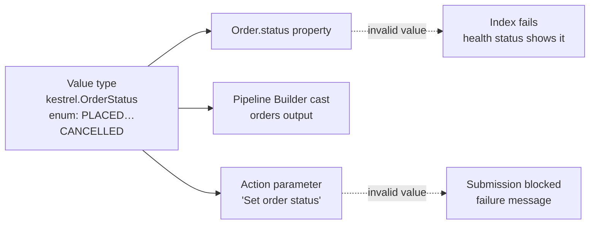

# 02 — Value types

*Sources: [Value types overview](https://www.palantir.com/docs/foundry/object-link-types/value-types-overview/) · [Create a value type](https://www.palantir.com/docs/foundry/object-link-types/create-value-type/) · [Use value types](https://www.palantir.com/docs/foundry/object-link-types/use-value-type/) · [Versions](https://www.palantir.com/docs/foundry/object-link-types/value-types-versions/) · [Permissions](https://www.palantir.com/docs/foundry/object-link-types/value-types-permissions/) · [Constraints](https://www.palantir.com/docs/foundry/object-link-types/value-type-constraints/) · checked October 2, 2026 · Ready for Review*

A String base type tells Foundry nothing about *what* the string is. Kestrel has strings that are emails, ISO country codes, SKUs and order statuses. Each has rules — an email has an `@`, a status is one of seven words — and without value types those rules get re-written, or forgotten, in every pipeline and action.

**[Docs]** A **value type** is a "semantic wrapper" around a field type. It adds metadata and an optional **constraint**, so meaning and validation are defined once and reused everywhere.

## What a value type is made of

**[Docs]**

- **Name, description, API name.** These can change at any time.
- **A base type**, such as String, Integer, Date or Array. Fixed once created.
- **An optional constraint**, with a *failure validation message* shown when a value breaks it. Also fixed per version (see versions below).
- **An optional example value** for previews. Recommended.

They are created in the **Value Types Manager** application, inside a chosen space.

## The constraints

**[Docs]**

| Constraint | Works on | Example |
|---|---|---|
| **Enum** (one of) | String (case-sensitive or not), Boolean, Decimal, Double, Float, Integer, Short | Order status: PLACED, PAID, ON_HOLD, PICKING, SHIPPED, DELIVERED, CANCELLED |
| **Range** | Numbers, Date, Timestamp; String length; Array size | Discount percent 0–100; a non-empty SKU of at most 20 characters |
| **Regex** | String; can optionally match only a substring | Email; postcode format |
| **RID** / **UUID** | String | A field that must hold a Foundry RID |
| **Uniqueness** | Array: all elements unique | Tag list without repeats |
| **Nested** | Array: a constraint applied to every element | Every entry in `emails[]` is a valid email |
| **Element constraints** | Struct: a value type per struct field | An `Address` struct whose `country` field uses the ISO country value type |

## Where you can use one

**[Docs]**

- **On an object type property**, or a shared property. Values that fail validation make the object type **fail to index**. You'll see it in the type's health status.
- **In Pipeline Builder**, as a logical type through the *logical type cast* expression, applied when writing to the object type.
- **On action parameters**, for String, Integer, Long, Double, Decimal, Date and Timestamp, including lists of them, but **not struct parameters**. A failing value blocks submission and shows the failure message. Non-breaking value type updates reach the action automatically.

A property that has a value type can't be converted into a derived property ([05 — Derived properties](05-derived-properties.md)).

## Scope, permissions and versions

**[Docs]**

- **Scope:** value types belong to a **space**, and so to its single ontology. They can only be used there. They are **not available in the Default ontology**.
- **Permissions:** anyone with View on the space can *assign* value types. Editors and Owners of the space can create, edit and delete them.
- **Versions:** changing a constraint creates a new version.
  - **Non-breaking** versions propagate automatically everywhere the value type is used.
  - For **breaking** constraint changes on a value type that already has consumers, the docs recommend **deprecating it and creating a new one**, to avoid runtime errors and inconsistent data.

## Kestrel's first value types

**[Example]**

| Value type | Base | Constraint | Used by |
|---|---|---|---|
| `OrderStatus` | String | Enum, case-sensitive | `Order.status`, *Set order status* action |
| `CurrencyCode` | String | Enum of the currencies Kestrel sells in | `Order.currency`, `Refund.currency` |
| `CountryCode` | String | Regex `^[A-Z]{2}$` | Address struct `country` field (through element constraints), `Warehouse.country` |
| `EmailAddress` | String | Regex | `Customer.email`, *Update contact details* action |
| `RefundPercent` | Double | Range 0–100 | *Approve partial refund* parameter |

**[Explanation]** The payoff shows up in three places:

- **Data quality:** a pipeline that starts emitting `paid` in lowercase fails at indexing, not three weeks later in Lena's report.
- **Actions:** an agent proposing a refund of 140% is blocked by the parameter constraint before a human even reviews it.
- **Meaning:** an LLM reading the schema sees `CountryCode`, not just "string".

## Caveats

- **[Docs]** Because invalid values stop indexing, a strict value type on an existing property can take a working object type down. Check the data against the constraint before assigning it.
- **[Explanation]** Keep enums for lists that rarely change. A product catalogue's category list changes too often; model categories as an object type instead.

---
[Module index](README.md) · Previous: [01 — Properties and base types](01-properties-and-base-types.md) · Next: [03 — Structs](03-structs.md)
