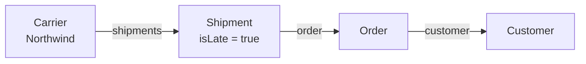

# 03 — Traversal and Search Arounds

*Sources: [Pivot to linked objects](https://www.palantir.com/docs/foundry/object-explorer/pivot-linked/) · [Objects and links (TSv1)](https://www.palantir.com/docs/foundry/functions/api-objects-links/) · [Object sets (TSv1)](https://www.palantir.com/docs/foundry/functions/api-object-sets/) · [TypeScript OSDK: Links](https://www.palantir.com/docs/foundry/ontology-sdk/typescript-osdk/#links) · [TSv2 migration: link traversal mapping](https://www.palantir.com/docs/foundry/functions/typescript-v2-migration/#link-traversal-mapping) · [Optimize performance](https://www.palantir.com/docs/foundry/functions/optimize-performance/) · checked October 2, 2026 · Ready for Review*

One question, answered four ways.

Ama, the customer service lead, asks:

> *Which customers have an order with a late shipment from carrier **Northwind Freight**?*

The path through the Kestrel graph is three hops:



`isLate` is a boolean the shipment pipeline sets when the latest tracking ETA is after the order's promised date.

Each tool below walks the same path. The thing to watch is **where the walk happens**. Either the server follows the links as a set operation, or your code pulls objects one at a time.

## 1. Object Explorer: pivot

**[Docs]** In an exploration you can "shift the main object type of your exploration to any linked object type" from the **Linked Objects** panel. The filters you have already applied carry over. It is "possible to pivot through multiple links".

Here is how Ama does it:

1. Open **Carrier** and filter to Northwind.
2. Pivot to **Shipments** and filter `isLate = true`.
3. Pivot to **Order**.
4. Pivot to **Customer**.

The docs also mention the other direction: start from the end type and filter on linked properties. **[Explanation]** Pivoting from the *small* end matches the advice in [03-03](../03-ontology-fundamentals/03-objects-and-object-sets.md#writing-queries-that-scale) to start from the narrow set.

## 2. TypeScript v1 functions

**[Docs]** Every link becomes a field on the generated type:

- the "one" side is a `SingleLink`, read with `.get()` or `.getAsync()`, and it may be `undefined`;
- the "many" side is a `MultiLink`, read with `.all()` or `.allAsync()`, and it returns an empty array when nothing is linked.

On an **object set**, TSv1 generates one `searchAround<Link>()` method per link type that is imported into the repository.

```typescript
const customers = Objects.search()
  .carrier()
  .filter(c => c.carrierCode.exactMatch("NWF"))
  .searchAroundShipments()
  .filter(s => s.isLate.isTrue())
  .searchAroundOrder()
  .searchAroundCustomer();     // still an ObjectSet<Customer>: nothing loaded yet
```

**[Docs]** These are the limits:

- **Three Search Arounds at most** in one search. This one uses exactly three.
- The result of a Search Around can't exceed **10 million** objects on OSv2 (100,000 on OSv1).
- A `MultiLink` reached from a *single object* can't become an object set. You rebuild one with `Objects.search().employee([employee])`.

**[Explanation]** A fourth hop, for example on through OrderLine to Product (see [02](02-many-to-many-and-object-backed-links.md)), would fail at runtime in TSv1. Modelling choices that add hops have a real cost here.

## 3. TypeScript v2 / OSDK

**[Docs]** TSv2 puts links under `$link`:

- a single link gives `fetchOne()` or `fetchOneWithErrors()`;
- a many link *is already an object set*, so you can page through it or call `asyncIter()` on it.

On a set, the whole `searchAround…` family becomes one `pivotTo("<linkApiName>")`.

```typescript
const customers = client(Carrier)
  .where({ carrierCode: { $eq: "NWF" } })
  .pivotTo("shipments")
  .where({ isLate: { $eq: true } })
  .pivotTo("order")
  .pivotTo("customer");
```

Two migration details from the docs:

- **Missing links behave differently.** TSv1 `.get()` returns `undefined`. TSv2 `fetchOne()` **throws**, and `fetchOneWithErrors()` returns `{ error }`, which looks the same as any other failure. Code that relied on `undefined` meaning "no carrier yet" needs rewriting.
- **Don't guess the API name from the TSv1 method name.** Read it from the keys of `$link` in the generated SDK.

**[Docs]** Python has set-level Search Arounds too. The only example we found is a Python `search_around_…` call in the optimize-performance page's "bulk operation" sample. Check the Python OSDK reference for the exact method names.

## 4. The anti-pattern: loops

This version gives the same answer and is far slower:

```typescript
// Anti-pattern: one round-trip to OSS per shipment
for (const s of lateNorthwindShipments) {
  const order = s.order.get();
  const customer = order?.customer.get();
  ...
}
```

**[Docs]** The optimize-performance page calls inefficient link traversal "the most common source of performance issues in functions". It also explains the two fixes:

- **Set operations first.** Prefer object-set Search Arounds and backend aggregations.
- **Parallel loads.** When you really do need per-object loads, start them in parallel: TSv1 `allAsync()` / `getAsync()` with `Promise.all`, or TSv2 `$link…asyncIter()` inside `Promise.all`. **[Docs]** Running them in parallel "improves execution speed but does not reduce resource consumption or cost". Only bulk operations reduce both.

## Where the limits come from

Every one of these paths ends in the Object Set Service. The tiers are covered in [03-03](../03-ontology-fundamentals/03-objects-and-object-sets.md):

- Search Arounds run in memory up to about 100,000 objects.
- Larger ones fall back to Spark, which is slower.
- **Intermediary link types** always fall back to Spark. **[Explanation]** That includes the object-backed links from [02](02-many-to-many-and-object-backed-links.md), so a link that reads as one hop isn't automatically cheap.

## Changing links rather than reading them

Traversal is read-only. Changing links goes through **action types**, and the rule depends on how the link is stored. **[Docs]**

- **Foreign-key links** (one-to-one, many-to-one): there's no link rule. You use a **Modify object** rule to set or clear the foreign key property.
- **Many-to-many links**: use **Create link** or **Delete link** rules. **Create object** can also add links to the new object. Editing needs the backing join table ([02](02-many-to-many-and-object-backed-links.md#option-1--join-table-link)).

Functions can return link edits too. All of this is covered in [08-02](../08-actions/02-rules-and-parameters.md) and [09 — Functions](../09-functions/README.md).

## Try it

Rewrite Ama's question for the reverse case: *"Which carriers delivered late to customers in the Gold tier?"*

- Which end do you start from?
- How many TSv1 Search Arounds does it take?
- Which tier of OSS would you expect it to run in?

The answer sketch is in [18-practice/03](../18-practice/03-review-questions-by-module.md#06--links).

---
[Module index](README.md) · Previous: [02 — Many-to-many and object-backed links](02-many-to-many-and-object-backed-links.md) · Next module: [07 — Interfaces](../07-interfaces/README.md)
