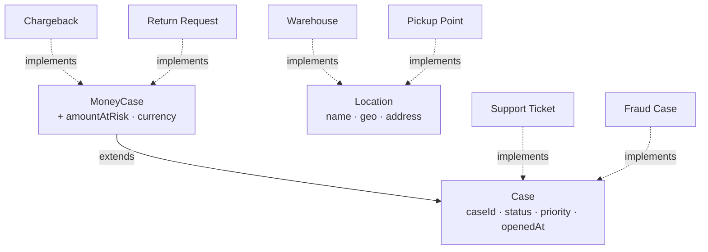

# 02 — Implementing and extending interfaces

*Sources: [Create an interface](https://www.palantir.com/docs/foundry/interfaces/create-interface/) · [Implement an interface](https://www.palantir.com/docs/foundry/interfaces/implement-interface/) · [Edit an interface implementation](https://www.palantir.com/docs/foundry/interfaces/edit-interface-implementation/) · [Extend an interface](https://www.palantir.com/docs/foundry/interfaces/extend-interface/) · [Interface metadata](https://www.palantir.com/docs/foundry/interfaces/interface-metadata/) · [Edit an interface definition](https://www.palantir.com/docs/foundry/interfaces/edit-interface-definition/) · checked October 2, 2026 · Ready for Review*

A lab in four parts. Part A creates `Case`, Part B implements it three times, Part C extends it, and Part D covers changing an implementation later. The steps follow the docs. The Kestrel values are the example.

## Part A — Create the `Case` interface

**[Docs]** In Ontology Manager, check the **Ontologies** dropdown first, then choose **New → Interface** (or **Interfaces → + New interface**). The helper asks for:

1. **Display name and API name**, plus an optional description and icon. Kestrel uses `Case` / `case`, with the description *"Anything a Kestrel team must resolve for a customer."*
2. **Properties**, defined locally (recommended) or reused from shared properties. Each one is **required** or **optional**.
3. **A project** to save to. Then **Create**, and **Save** the Ontology.

Kestrel's property list, with the reasoning for each choice:

| Interface property | Base type | Required? | Why |
|---|---|---|---|
| `caseId` | String | Required | Every case needs a stable handle in the cross-team queue. Each type maps its own key here. |
| `status` | String + enum value type (`open`, `waiting`, `resolved`) | Required | The 48-hour report filters on it. |
| `priority` | String + enum value type | Required | |
| `openedAt` | Timestamp | Required | The age calculation reads it. |
| `ownerTeam` | String | Optional | Fraud cases are owned by a person, not a team. |
| `summary` | String | Optional | Chargebacks have no free text. |

**[Explanation] Untested assumption.** The table gives interface properties enum **value types**. The interface pages describe properties, required or optional, and shared properties, but don't say whether an interface property can carry a value type. If it can't, put the enum on each implementing type's local property, keep a plain String on the interface, and enforce the vocabulary in the pipeline. That is the `disputeState` fix in Part B anyway.

**[Docs]** Optional properties "can be useful when building Marketplace packages to iterate on your interface without introducing upgrade blockers". **[Explanation]** The same reasoning applies inside one company. Every *required* property is a contract that each current and future implementer must meet. Start with the minimum the consumers need.

**[Docs]** Two metadata defaults to know:

- **Status** starts as **experimental**.
- **Searchable** starts as **on**. That limits the interface to 75 implementing types, against 1,000 when it is off ([01](01-interfaces.md#when-not-to-use-one)).

Leave `Case` experimental until Part B passes.

## Part B — Implement it on three object types

**[Docs]** Open the object type's **Interfaces** tab and choose **+ Implement new interface**, or start from the interface's **Implementations** section. Then:

1. **Map local properties.** Every required interface property needs a local property mapped onto it. Optional ones can be skipped.
2. **Map link type constraints.** Every required constraint needs an existing or new link type. See [03](03-interface-links-and-action-constraints.md).
3. **Map action type constraints.** Every required constraint needs a concrete action type, and then **parameter mappings** on the Interfaces tab.
4. **Save.**

The mappings Priya enters:

| Interface property | Support Ticket | Chargeback | Fraud Case |
|---|---|---|---|
| `caseId` | `ticketId` | `chargebackId` | `fraudCaseId` |
| `status` | `ticketStatus` | `disputeState` ⚠ | `caseStatus` |
| `priority` | `priority` | `priority` (new, derived in pipeline) | `severity` ⚠ |
| `openedAt` | `createdAt` | `receivedAt` | `escalatedAt` |
| `ownerTeam` | `queue` | `"kestrel-pay-disputes"` (constant column) | — skipped |
| `summary` | `subject` | — skipped | `analystNote` |

The ⚠ rows are where the lab gets realistic:

- **`disputeState` uses the card network's vocabulary** (`needs_response`, `won`, `lost`). A mapping renames a property. It doesn't translate values. **[Explanation]** Priya adds a normalised `caseStatus` column to the chargeback pipeline and maps *that*. Value translation belongs in the pipeline, where it is versioned and tested ([02-02](../02-foundry-data-foundations/02-pipelines-that-feed-the-ontology.md)).
- **`severity` is 1–5 on Fraud Case**, while `priority` is an enum. Same fix: derive `priority` upstream. **[Explanation]** If the value type on the interface property is an enum, the mapped property presumably has to fit it. The docs don't spell out type-compatibility rules for property mapping, so confirm this in Ontology Manager.

**Check it worked.** Search the `Case` interface in an app that supports interface object sets. You should see tickets, chargebacks and fraud cases in one list, each still showing its own type.

### The Pipeline Builder route

**[Docs]** You can also implement an interface on an **object type output** in Pipeline Builder: **Edit → Implement interface → Implement and go to mapping**. Matching shared properties map automatically. **[Docs]** Pipeline Builder "does not currently support link type constraint or action type constraint mapping". An interface with *required* link or action constraints has to be implemented in Ontology Manager.

**[Explanation]** Kestrel's `Case` will gain a required Customer link in [03](03-interface-links-and-action-constraints.md). From then on, Ontology Manager is the only route.

## Part C — Extend: `MoneyCase`

Lena wants a refund-exposure view: *open cases with money at stake, summed by currency*. Only Chargeback (and later Return Request) carry an amount.

**[Docs]** "An interface inherits the shared properties, link type constraints, and action type constraints of the interface it extends", and "an interface can extend any number of other interfaces". To extend, open the **child** interface, then **Extension → Add extension**. Pick the base, review what will be inherited, and **Confirm** and **Save**.

So Lena creates `MoneyCase` with `amountAtRisk` (Decimal) and `currency`, and adds the `Case` extension. Chargeback then implements `MoneyCase` and satisfies both sets of requirements.

**[Explanation]** The diagram shows Chargeback implementing only `MoneyCase`, because the extension means it already counts as a `Case`. The docs describe property inheritance through layers. They don't state outright that a `MoneyCase` object appears in a `Case` search. **Verify that in the Part B check** before you remove any direct `Case` implementation.

**Composition over hierarchy.** Notice what Kestrel *didn't* build: `Case → PaymentCase → ChargebackCase → CardChargebackCase`. **[Docs]** The docs frame extension as composing "capability interfaces" into more specific ones. **[Explanation]** Keep each interface around one capability or one consumer need. Deep trees recreate the inheritance problems that interfaces are meant to avoid.

**Removing an extension.** **[Docs]** Removing it takes away every inherited property, link constraint and action constraint, and disassociates the two interfaces. Plan it like a breaking change.

## Part D — Changing an implementation later

**[Docs]** On the object type, the **…** menu offers **Remove interface**, and the dropdowns change which property or link type fills each slot. Save afterwards.

Three months in, Support Ticket's `queue` is renamed `assignedQueue`. Re-point the `ownerTeam` mapping and save. **[Explanation]** Consumers written against `case.ownerTeam` don't notice, which is the point of the abstraction. Consumers written against `supportTicket.queue` do notice, and that change goes through the usual migration path ([04-04](../04-object-types/04-creating-and-editing-object-types.md)).

**Changing the interface itself.** **[Docs]** Interfaces expose API names, so "any change to an interface definition has the potential to break downstream applications and will necessarily break existing object implementations". Adding a **required** property, link type constraint or action type constraint means updating **every implementation in the same save**. If consumers can't move at the same time, create a **new version** of the interface, as an extension or a standalone interface, and migrate to it. **[Explanation]** This gives another reason for Part C's design: `MoneyCase` extends `Case` rather than adding money fields to it, so existing `Case` implementations don't break.

## Part E — Location, quickly

Build `Location` the same way:

- **Required properties:** `locationName`, `geo` (geopoint) and `address` (struct, reusing the `Address` shape from [05-03](../05-properties/03-structs.md)).
- **Optional property:** `openingHours`.

Implement it on Warehouse and Pickup Point. Kofi's map layer now reads one `Location` set instead of two.

**[Explanation]** Two things are untested here:

- **The whole-struct `address` interface property.** The struct docs confirm that a struct *field* can map to an interface property ([05-03](../05-properties/03-structs.md)). They don't confirm that a whole struct can be one. If it can't, expose `city` and `country` as separate interface properties.
- **The map widget.** Interface sets have to work in the widget you plan to use, and Workshop support varies by widget ([01](01-interfaces.md#the-support-table)).

Check both before you depend on this.

---
[Module index](README.md) · Previous: [01 — Interfaces](01-interfaces.md) · Next: [03 — Interface links and action constraints](03-interface-links-and-action-constraints.md)
