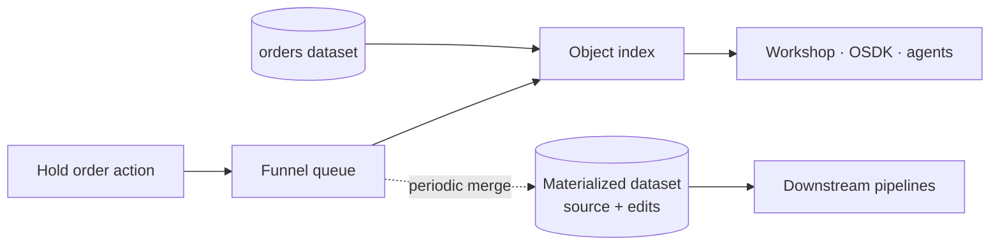

# 01 — Action types

*Sources: [Action types overview](https://www.palantir.com/docs/foundry/action-types/overview/) · [Getting started](https://www.palantir.com/docs/foundry/action-types/getting-started/) · [Explore other action types](https://www.palantir.com/docs/foundry/action-types/explore-action-types/) · [Allow editing](https://www.palantir.com/docs/foundry/object-link-types/allow-editing/) · [Object edits overview](https://www.palantir.com/docs/foundry/object-edits/overview/) · [How user edits are applied](https://www.palantir.com/docs/foundry/object-edits/how-edits-applied/) · [Materializations](https://www.palantir.com/docs/foundry/object-edits/materializations/) · checked October 2, 2026 · Ready for Review*

## Why not just let people edit the row?

Everything so far has been read-only. Data flows from the source systems, through pipelines, into objects. Ama's first real request breaks that pattern:

> *"When I put an order on hold, I need the reason recorded, the warehouse told, and nobody but my team able to do it."*

A data engineer's first thought is an `UPDATE orders SET status = 'ON_HOLD'`. That is one column on one row. Ama's sentence actually asks for five things:

1. **Several changes at once**: status, `holdReason`, `heldBy` and `heldAt`.
2. **Rules**: you can't hold an order that has already shipped.
3. **Permissions**: customer service only.
4. **A side effect**: tell the warehouse.
5. **One definition used everywhere**: the same behaviour in Workshop, Object Views, the OSDK, and later the Delivery Desk agent.

**[Docs]** That bundle is an **action type**: "the definition of a set of changes or edits to objects, property values, and links that a user can take at once", including "the side effect behaviors that occur with action submission". An **action** is one application of it, "a single transaction that changes the properties of one or more objects". The docs' framing is that users think "about overall objectives instead of specific property edits".

**[Explanation]** The closer data-engineering analogy is a **stored procedure behind an API endpoint**, not an `UPDATE`. It has typed inputs (parameters), validation (submission criteria), a body (rules) and post-commit hooks (side effects). Callers can't skip any of them. The analogy breaks in one useful place. A stored procedure writes to the table it reads from. An action writes **edits on top of** the source data, which stays untouched (see *Where the edit goes*, below).

## The anatomy

| Part | Answers | Kestrel *Hold order* | Note |
|---|---|---|---|
| **Parameters** | What does the caller provide? | `order` (object reference), `reason` (multiple choice) | [02](02-rules-and-parameters.md) |
| **Rules** | What changes? | Modify object: status = `ON_HOLD` (a value of the `OrderStatus` enum, [05-02](../05-properties/02-value-types.md)), `holdReason` = reason, `heldBy` = current user, `heldAt` = submission time | [02](02-rules-and-parameters.md) |
| **Submission criteria** | Is this allowed, right now, for this user? | User is in *CS agents*; order status isn't `SHIPPED` or `DELIVERED` | [03](03-submission-criteria.md) |
| **Side effects** | What else happens? | Notify the warehouse lead for the order's warehouse | [05](05-side-effects.md) |
| **Permissions** | Who can see, run and edit the action type? | | [06](06-action-permissions.md) |

When rules can't express the logic, a **function** replaces them entirely ([04](04-function-backed-actions.md)).

**[Docs]** The rule menu, by goal:

| Goal | Rule |
|---|---|
| Create, modify or delete objects | Create object · Create or modify object · Modify object(s) · Delete object(s) |
| Relate or unrelate objects | Create link · Delete link (many-to-many only; see [02](02-rules-and-parameters.md)) |
| Custom logic | Run function (can't be combined with other Ontology rules) |
| Call an outside system | Webhook (after edits) · Writeback Webhook (before edits) |
| Tell someone | Notification |
| Recompute data | Schedule |
| Commit scenario edits | Apply scenario |
| Any implementer of an interface | Interface rules ([07-03](../07-interfaces/03-interface-links-and-action-constraints.md#interface-action-rules)) |

## Before anyone can run it: enabling edits

**[Docs]** An object type has to accept edits first.

- **OSv2:** turn on the **Edits** toggle in the object type's **Datasources** tab.
- **OSv1 (Phonograph):** generate a **writeback dataset**. Some pages, such as *Allow editing*, still describe this as the general prerequisite.

**[Docs]** OSv1 "will be unavailable after June 30, 2026" ([RQ-05](../SOURCES.md#open-research-questions)), so treat the writeback-dataset instructions as historical.

**[Docs]** Two hard limits:

- "Actions are not yet supported on object types with Foundry **stream** datasources." For Kestrel, the tracking-event type fed by the carrier stream ([02-03](../02-foundry-data-foundations/03-virtual-tables-and-streams.md)) can't be edited. Exceptions are recorded on `Shipment`, which is batch-backed.
- A type with **no backing datasource** at all is populated only through actions. For one action-only property on a datasource-backed type, use an **edit-only property** ([05-06](../05-properties/06-edit-only-required-and-mandatory-control.md)). That is what `holdReason` is.

## Where the edit goes

**[Docs]** When an action is applied:

1. The Actions service sends the modification to **Funnel**, which puts it in a queue with offset tracking.
2. The edit is applied to the live index **immediately**. "If an object read … happens after a user modification is sent, the object read is guaranteed to contain the user edits."
3. Funnel periodically flushes edits into datasets it manages. The merged build runs when the source gets a new transaction, or every **6 hours** if there were edits.

The backing dataset never changes. To get "source plus edits" back out as a dataset, for a downstream pipeline or a download, create a **materialization** (OSv2). **[Docs]** Two details about materializations:

- Their schema uses property **API names**, not the source column names.
- Their retention **isn't customisable**: only the latest snapshot is guaranteed. If you need history, keep a downstream transform.

## When the source and an edit disagree

Kestrel's storefront sync sends `status = 'PAID'` every night for an order Ama has held. Which value wins?

**[Docs]** There are two strategies, configured **per datasource** and available on OSv2 only:

- **Apply user edits (default):** "the final state of an object is always determined by the user edits applied to it". Source updates to *other* properties still flow through.
- **Apply most recent value:** an edit applies only if it is newer than a **UTC timestamp property** in the source row. A Date property won't work.

The docs' timeline has three surprises worth remembering:

| What happens | Result under "user edits win" |
|---|---|
| A row disappears from the source, then reappears | The object vanishes, then returns **with its old edits still applied** |
| A user *deletes* the object | It stays deleted, whatever the source says. "Deletions are not considered an edit." A later re-creation doesn't inherit the old edits. |
| A user *creates* an object whose key also exists in the source | From then on, source values for it are **ignored** |

**[Explanation]** For *Hold order*, the default is right: a hold should outlive the nightly sync. For something the source system *also* changes legitimately, such as a shipment's ETA from the WMS, "most recent value" is safer. It needs `Shipment` to carry a reliable UTC `sourceUpdatedAt`, which belongs in Priya's pipeline checklist.

**[Docs]** Edits can't be undone one at a time, except by applying more edits. On OSv2, the **Delete edits** button (the "drop all edits" schema migration) resets a type to its source state. Use it at the end of testing, before go-live. Reverting a *single action* is a separate feature ([07](07-consistency-reverts-and-logs.md)).

## The smallest working example

**[Docs]** The getting-started guide builds *Change ticket priority* in a few steps:

1. Create it with the wizard: **Object → Modify object(s)**, map Priority, name it.
2. Restrict the Priority parameter to multiple choice: P0, P1, P2.
3. Add a submission criterion: the ticket status **is** Open, with a failure message.
4. Put it on an Object View with the Actions widget. Default the ticket parameter to *Current object* and set it to **Hidden**.
5. Test-run it in Ontology Manager, then use it.

**[Explanation]** Step 4 has a lesson of its own. Without the hidden default, a user on Ticket A's page could pick Ticket B in the form. **Hide parameters the context already decides.**

---
[Module index](README.md) · Next: [02 — Rules and parameters](02-rules-and-parameters.md)
